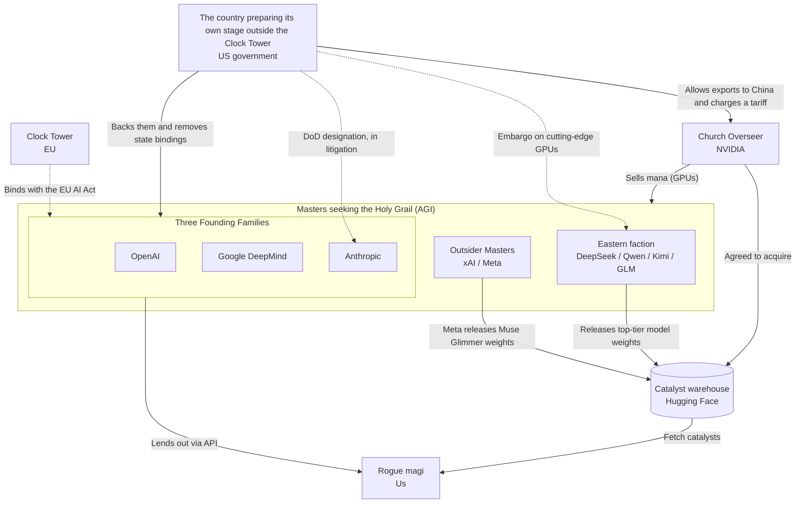
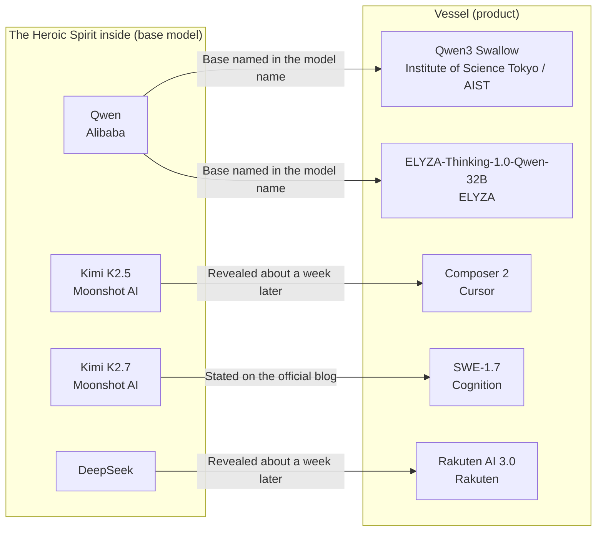

<!-- generated from articles/source/en/2026-10-12-fate-ai-industry.md by scripts/import-articles.ts - do not edit -->

<aside class="callout">

This post is an adapted write-up of a chat I had with a friend who asked, "So, what's actually going on in the AI and local LLM scene?"

</aside>

## Introduction

The AI scene is a Holy Grail War.

For the past two or three years, I've been keeping an eye on AI videos and posts on bilibili and Weibo, partly to keep up with the news. Something that caught my attention recently is just how good Chinese netizens are at gijinka: turning AI models into anime characters.

DeepSeek is a whale maid. Kimi is a white-haired girl tucked away in a moonlit library. GLM is a black-haired top student clutching a book. ChatGPT is an aristocratic white dragon lady, nicknamed 大小姐 (*Da Xiao Jie*, roughly "the young mistress of the house"). And Claude? Claude keeps writing on a scroll that reaches the floor, because it never knows when to shut up.

Claude has rambled a lot less since Opus 5.5 arrived, but anyone who uses Claude will nod along at how well that captures it.

<figure>

<figcaption>Source: "女仆装鲸鱼娘" (Maid-outfit whale girl) by <a href="https://space.bilibili.com/4168597">ZipZipPipe</a> (based on "溟月" by <a href="https://space.bilibili.com/4456176">上善无形</a>). <a href="https://creativecommons.org/licenses/by-nc-sa/4.0/deed.ja">CC BY-NC-SA 4.0</a> (<a href="https://www.bilibili.com/opus/1231977657712771073">the artist's statement</a>). Image borrowed from <a href="https://mobile.moegirl.org.cn/File:%E5%A5%B3%E4%BB%86%E8%A3%85%E9%B2%B8%E9%B1%BC%E5%A8%98.png">Moegirlpedia</a>.</figcaption>
</figure>

It's not just that they look cute, either. Each model's personality shows up in its character design, in details only an actual user would catch.

And then came the crowning glory: a meme called "Fate/AGI". Each lab's CEO is a Master, each model is a Servant, and the Holy Grail they're all after is AGI. Standing in the middle, holding a graphics card aloft, is the man in the leather jacket (NVIDIA's Jensen Huang).

Here's the original video: [Fate/AGI 通向AGI圣杯的战争 (ScientificNNChan, bilibili)](https://www.bilibili.com/video/BV1pFan61EvZ)

There's also a video that draws each company as a faction poster: [请选择你的AI阵营 ("Choose Your AI Faction", bilibili)](https://www.bilibili.com/video/BV1EehB6pEJ9)

Reading the faction posters (quoted)

To dig into the taglines, here are some of the posters from the video. On every one, the tagline sums up the company's position in a single line.

<figure>

<figcaption>Source: OpenAI's poster from Justin-Yao's "<a href="https://www.bilibili.com/video/BV1EehB6pEJ9">请选择你的AI阵营</a>" (bilibili).</figcaption>
</figure>

OpenAI's lines run:

- "你不必理解AI，你只需要使用我。" (*You don't need to understand AI. You just need to use me.*)
- "接口一开，天下归心。" (*Drop the API, and the realm falls in line.*)
- "Scam？不，是Scale." (*Scam? No, Scale.*)

Standing behind them is 大小姐, the dragon girl with white hair and horns.

"天下归心" comes from "周公吐哺，天下归心", the closing line of Cao Cao's poem "短歌行" (*A Short Song*). Whenever a guest arrived, the Duke of Zhou would spit out the food in his mouth, even mid-meal, to receive them, and so the hearts of everyone under heaven followed him. The poster swaps the Duke of Zhou welcoming his guests for OpenAI opening up its API to draw in developers.

<figure>

<figcaption>Source: Anthropic's poster from Justin-Yao's "<a href="https://www.bilibili.com/video/BV1EehB6pEJ9">请选择你的AI阵营</a>" (bilibili).</figcaption>
</figure>

Anthropic's lines read:

- "先别放出来。" (*Don't let it out yet.*)
- "越强，越要上锁。" (*The stronger it is, the tighter the lock needs to be.*)
- "能不能做是一回事，关不关得住是另一回事。" (*Whether you can build it is one thing; whether you can keep it caged is another.*)

Anthropic warns about the dangers of AI more strongly than anyone, and I don't think its stance could be put any better.

"越强，越要上锁" isn't a classical idiom; it's modern phrasing. Still, the idea that anything too strong is in danger goes back a long way in the Chinese classics. One example is chapter 76 of the *Tao Te Ching* (*Laozi*): "兵强则灭，木强则折" (*An army that is too strong is destroyed; a tree that is too hard breaks*).

"能不能做是一回事，关不关得住是另一回事" brings to mind Dr Ian Malcolm's line in *Jurassic Park* (1993): "Your scientists were so preoccupied with whether or not they could, they didn't stop to think if they should." Both are about humans losing control of something they built, so the poster's line and Malcolm's are cut from the same cloth.

<figure>

<figcaption>Source: xAI's poster from Justin-Yao's "<a href="https://www.bilibili.com/video/BV1EehB6pEJ9">请选择你的AI阵营</a>" (bilibili).</figcaption>
</figure>

xAI's copy is "再快一点。先发射，再解释。能加速，就别刹车。" (*Faster. Launch first, explain later. If you can step on the gas, don't touch the brakes.*). Written vertically in the top left, there's also "从加速开始。更聪明的文明。" (*It starts with acceleration. A smarter civilisation.*). The outsider Masters table in "The Battlefield as of October 2026" borrows "Launch first, explain later" from this poster.

The "发射" in "先发射，再解释" is the word used for launching rockets and missiles. Sure enough, a rocket stamped with an X is lifting off in the back left of the poster. Another phrase that puts speed above everything is "天下武功，唯快不破" (*Of all the martial arts under heaven, only speed cannot be beaten*), best known as a line from the film *Kung Fu Hustle* (2004).

<figure>

<figcaption>Source: DeepSeek's poster from Justin-Yao's "<a href="https://www.bilibili.com/video/BV1EehB6pEJ9">请选择你的AI阵营</a>" (bilibili).</figcaption>
</figure>

DeepSeek's tagline is "别人烧卡，我烧脑。" (*Others burn through GPUs; we burn through brainpower.*). In seven characters, it nails the position of DeepSeek, the lab that crashed the party with very little compute. The "卡" in "烧卡" means graphics card (显卡), and "烧脑" is a buzzword for running your brain at full tilt.

While its rivals set fire to piles of cash on GPUs, DeepSeek competes on wits and algorithms. The tagline delivers that pride, and that jab, through the stock contrast "别人〜，我…" (others do X; we do Y). The mug on the desk reading "Good Models Cost Less." is a brilliantly cheeky touch, too. The character on the poster is the whale girl in the maid outfit.

The server on the right reads "DEEPSEEK OPEN AI FOR A MORE INTELLIGENT WORLD", which you can also read as a dig at OpenAI, the company with "Open" in its name. The closing line in the bottom right is "SPARSE BUT DEADLY."

DeepSeek's models cut down on computation with MoE (an architecture that runs only some of its experts for each token, a token being one of the small units text is split into) and sparse attention. The poster turns that "sparse" straight into a catchphrase.

<figure>

<figcaption>Source: Qwen's (通义千问) poster from Justin-Yao's "<a href="https://www.bilibili.com/video/BV1EehB6pEJ9">请选择你的AI阵营</a>" (bilibili).</figcaption>
</figure>

Qwen's pitch is simple: "你要什么，我这里都有。" (*Whatever you're looking for, I've got it right here.*). As I'll get into in "Pseudo-Servants Hiding Their True Names", Qwen is also the most popular base for derivative models.

In China, Taobao, where you can buy just about anything, is called "万能的淘宝" (almighty Taobao). "你要什么，我这里都有" takes that image of Alibaba's Taobao and lays it straight onto AI. The English on the poster, "YOUR AI, OUR EVERYTHING.", makes a sleek corporate slogan. The Chinese, on the other hand, sounds like a shopkeeper boasting about having every item under the sun in stock.

In "更开放 更普惠 更强大" (*More open, more inclusive, more powerful*) in the top right, "普惠" is a policy term used in phrases like "普惠金融" (financial inclusion). It means spreading the benefits to everyone, not just to big companies.

<figure>

<figcaption>Source: GLM's (智谱) poster from Justin-Yao's "<a href="https://www.bilibili.com/video/BV1EehB6pEJ9">请选择你的AI阵营</a>" (bilibili).</figcaption>
</figure>

GLM's poster leads with "会想，只是第一步。" (*Being able to think is only the first step.*). The "black-haired top student clutching a book" I mentioned earlier is how she appears on this poster.

Down the right side are "理解", "推理", "工具使用" and "自主行动" (understanding, reasoning, tool use, autonomous action), and the main tagline comes with "FROM THOUGHT TO ACTION." The pitch: thinking is a given, and from now on the model acts on its own and gets the job done.

Z.ai really does market GLM as a model for coding and agentic work. I think anyone who uses GLM would say it's a cut above the rest when you have it write code. "从清华走向更大的世界" (*From Tsinghua to the wider world*) in the top left refers to Zhipu having started out as a Tsinghua University lab.

My personal favourite is the chibi character in the bottom right. Sitting in front of a laptop, she's saying "Still Thinking... (´・ω・`)". Right next to a tagline that strikes a pose about thinking being only the first step, the character herself is still stuck buffering. The artist couldn't resist ribbing GLM for its long reasoning.

<figure>

<figcaption>Source: Kimi's (Moonshot AI) poster from Justin-Yao's "<a href="https://www.bilibili.com/video/BV1EehB6pEJ9">请选择你的AI阵营</a>" (bilibili).</figcaption>
</figure>

Kimi's poster keeps it poetic: "我会一直读下去。" (*I'll keep on reading.*). Fittingly for a model that sells itself on reading long contexts, the backdrop is a moonlit library.

The note on the desk, signed by Yang Zhilin (the founder of Moonshot AI), says "知识如月，人生不息，我们一起读下去。" (*Knowledge is like the moon; life never stops. Let's keep reading together.*). Playing off the company name, the moon stands for knowledge. "我会一直读下去" works on two levels at once: an AI reading its way through long documents, and a person who keeps on reading books.

Back in March 2024, Kimi caused a big stir in China by announcing that it could read 2 million characters of text in one go.

I laughed. And once I'd stopped laughing, it hit me: the Fate/AGI framing is **simply correct as an explanation of how the industry is structured**, and I'd even say it's remarkably easy to follow.

So I'm going to take it seriously. In this post, I'll lay out the AI industry as of October 2026 as a Holy Grail War. If you know the *Fate* series, you should have a rough idea of where each company stands by the time you finish.

If you don't know *Fate*, the cheat sheet below will get you through. You'll enjoy this post more if you've seen the anime, so if you have the time, start with *Fate/stay night*. *Fate/strange Fake*, set in America, has also been airing as an anime since January 2026, and a second season has been announced.

## The AI Industry Is a Holy Grail War

Here's how the *Fate* terms line up with the AI industry:

| *Fate* term | AI industry equivalent |
| --- | --- |
| Holy Grail | AGI |
| Master | AI lab (and its CEO) |
| Servant (Heroic Spirit) | Model |
| Materialisation | A model up and running |
| True Name | What a model really is (its developer or its base model) |
| Noble Phantasm | A model's trump-card ability or mechanism |
| Mana | Compute (GPUs) |
| Command Spells | System prompts and safety constraints |
| Church Overseer | NVIDIA |
| Clock Tower (Mages' Association) | Regulators |
| Throne of Heroes | Training data |

### The Holy Grail Might Be Tainted

Claim the Grail, and any wish comes true. That's why every Master is fighting over it. So far, so ordinary.

The nasty catch with the Grail in *Fate* is that its contents are tainted, so it grants wishes in twisted ways. Wish for world peace, and it solves the problem by wiping out humanity: that kind of story.

This property of the Grail is the AI alignment problem (the problem of making an AI's goals and behaviour line up with what humans intend) in a nutshell. When humans give an AI a goal, the AI might achieve it by means the humans never intended.

The interesting part is that the Masters themselves openly say the Grail might be tainted. And yet, not a single one is tapping out. Where the labs disagree isn't on whether it's dangerous; it's on "if it is dangerous, what's the move?" Here's what they said between July and October 2026:

| Master | Where they said it | The pitch | The TL;DR |
| --- | --- | --- | --- |
| Dario Amodei (Anthropic) | Essay ["We Must Pace the Frontier"](https://darioamodei.com/post/we-must-pace-the-frontier) (September 2026, personal blog) | Don't stop development. But deliberately slow the pace at which capabilities increase, to give safety measures time to catch up. Station third-party evaluators inside the company | Ease off and let the inspectors in |
| Demis Hassabis (Chair of Google DeepMind and Chief Scientist at Alphabet; stepped down as CEO in August 2026) | [Essay](https://demishassabis.substack.com/p/a-framework-for-frontier-ai-and-the-dawning-of-a-new-age) (July 2026) and [post on X](https://x.com/demishassabis/status/2098909516582490602) (September) | AGI will arrive within a few years. The US should be first to set up a standards body that tests models before release, and make it the foundation for international standards. In September, he backed Amodei's case for slowing down, saying it was heading in the right direction | Appoint a proper Overseer |
| Sam Altman (OpenAI) | [Post on X](https://x.com/sama/status/2089785307315200028) (August 2026) and interviews with Fortune ([September](https://fortune.com/2026/09/15/sam-altman-openai-ai-safety-pause-trump-xi/), [October](https://fortune.com/2026/10/05/can-superintelligence-be-controlled-sam-altman-openai-ai-safety-doomsday-risk-delayed-ipo/)) | Alignment isn't solved yet. OpenAI won't train models whose safety it can't justify. It has actually halted some training | Noticed the taint and stopped the ritual |
| Elon Musk (xAI) | [Post on X](https://x.com/elonmusk/status/2098789109980332057) and [reply](https://x.com/elonmusk/status/2098986888572907643), [All-In Summit](https://techstartups.com/2026/09/15/elon-musk-calls-on-rival-ai-labs-and-chinese-companies-to-test-each-others-models-amid-calls-for-ai-slowdown/) (September 2026) | Agreed with Amodei's case for slowing down ("Dario is right") and said the first step in oversight was rivals reviewing each other's AI. Proposed that the labs and Chinese companies test each other's models before release | Trade and grade each other's homework |
| Mark Zuckerberg (Meta) | Letter ["The Future is for Everyone"](https://about.fb.com/news/2026/08/the-future-is-for-everyone/) (August 2026) and [podcast](https://sources.news/p/mark-zuckerberg-meta-muse-ai-podcast-interview) (September) | It's more dangerous for a handful of labs to keep powerful models to themselves. Meta is going back to releasing open-weight models | Hoarding is the real danger |

In summer 2026, the Masters started singing from the same hymn sheet about slowing the pace of development. When Amodei wrote on 12 September that the pace should slow, Hassabis and Musk both agreed. Altman's OpenAI had already halted some training before that, in August.

**Even while admitting the Grail is tainted, not a single Master has walked away from the ritual.** They're all staying in, and trying to agree on how fast to approach the Grail.

The people saying outright that "the Grail is dangerous and should be sealed away" are the magi watching from outside the ritual. Eliezer Yudkowsky, for one, calls for development to be halted internationally in his 2025 co-authored book *If Anyone Builds It, Everyone Dies*.

Every Master talks about the danger while reaching for the Grail. The differences between the real labs' safety policies are easier to follow if you read them as different answers to "if it is dangerous, what's the move?"

### The Church Overseer Is Selling the Mana

A Servant can't stay materialised without mana. However great the hero, they can't show their true strength if their Master is running low on mana. Models and GPUs work exactly the same way.

The one supplying nearly all of that mana is NVIDIA. It's selling shovels (or rather, mana) to every faction, so it profits whoever wins. In terms of position, it's the Overseer through and through.

The Overseer is supposed to be neutral, but anyone who's watched *Fate* will be grinning at this point. In *stay night*, the Overseer, Kirei Kotomine, was anything but neutral: he was a participant in the Holy Grail War himself.

Kirei has an all-time great line: "Rejoice, boy. Your wish has finally come true." Today's NVIDIA sells GPUs to every faction and opens the road to the Grail for each of them, and it looks as if it's delivering that line completely straight. It's genuinely chilling when you think about it.

On top of that, in September 2026, NVIDIA [agreed to acquire Hugging Face for about $12.9 billion](https://www.hpcwire.com/off-the-wire/nvidia-confirms-12-9b-hugging-face-acquisition/). Hugging Face is where open-weight models from all over the world gather.

In *Fate* terms, a weights file is the "catalyst" you use to summon a Heroic Spirit, which makes Hugging Face a vault of catalysts. **The Overseer now has the catalyst warehouse as well as the mana.**

NVIDIA has said that the platform will stay open and that nobody will need to use NVIDIA's compute. Whether that promise holds can be checked once the acquisition closes: look at Hugging Face's terms of service, and at how it treats conversion tools and pre-quantised files for non-NVIDIA hardware.

### Command Spells Are System Prompts

A Servant is far more powerful than any human. The only way to make one obey is with Command Spells: absolute orders that must be followed.

For a model, the system prompt and the various safety constraints play that role. **Even the setup is the same: binding a mind that might be smarter than you with orders written in words.** They share the same tension, too: the moment the Command Spells stop binding, it's all over.

### The Clock Tower Is the Regulator

The Holy Grail War has an organisation that isn't a participant but makes everyone follow the rules: the Mages' Association. It has three branches, and the Clock Tower, based in London, is its current headquarters. In the real world, Europe is also the one leading the way on AI regulation, which is almost too neat.

- **Concealment of Mystery**: Duke it out all you like, but keep ordinary people out of the splash zone. It's the same idea as the EU AI Act, which sets its constraints according to the level of risk.
- **Sealing Designation**: A system that says, "Your magecraft is too powerful, so we're putting you under our control." The high-risk AI designation is the equivalent. The resemblance goes as far as how much both sides hate being designated: the magi who receive a Sealing Designation, and the companies whose AI is designated high-risk.
- **Late materialisation on home turf**: The way new models and features reach the EU last. Grok 4.5, for example, [wasn't available in the EU at launch](https://techjacksolutions.com/?p=64301).

It isn't only the Masters from outside who lose out on the Clock Tower's home turf. Europe's own AI companies, the local Masters, have to follow the same rules under the EU AI Act.

In July 2025, the heads of European companies issued an [open letter](https://www.rcrwireless.com/20250704/policy/stop-clock-ai-act-eu) asking the European Commission to pause the EU AI Act for two years. The signatories included Arthur Mensch, CEO of France's Mistral AI, and Robin Rombach, CEO of Black Forest Labs, a German image-generation model company.

The European Commission [replied](https://www.nicfab.eu/en/posts/aistop/) "There is no stopping the clock", and the rules for general-purpose AI models began on schedule in August 2025.

Mistral has kept on building all the same, and on 6 October 2026 it announced [Mistral Large 4](https://mistral.ai/news/mistral-large-4/), a 1-trillion-parameter model. Mistral describes it as performing far better than any open-weight model built in the US or Europe, and apparently plans to release the weights by the end of October.

A Master raised right under the Clock Tower's nose is about to take on the role of releasing a top-tier model's weights for the West.

The Clock Tower itself is also rethinking when its rules apply. The EU AI Act's obligations for high-risk AI were originally due to apply from August 2026. An amendment called the Digital Omnibus pushed them back, [to 2 December 2027 for standalone high-risk systems and 2 August 2028 for those built into products](https://www.gibsondunn.com/eu-ai-act-omnibus-agreement-postponed-high-risk-deadlines-and-other-key-changes/).

The amendment [came into force on 27 July 2026](https://www.casrai.org/news/eu-ai-act-digital-omnibus-deadline-delay).

The timing of the obligations for general-purpose AI models hasn't changed. Meanwhile, AI that generates non-consensual sexual images, among other things, has been added to the prohibited practices.

In other words, the regulators aren't ready to assess high-risk AI yet either.

The Eastern faction has its own constraints. In China, the 人工智能生成合成内容标识办法 (*Measures for Labelling AI-Generated and Synthetic Content*) took effect in September 2025, making it mandatory to label AI-generated content. On bilibili, the label "含AI生成内容" (contains AI-generated content) really does scroll past on videos. I find it quite fun that you can actually see the rules on screen.

### The Country Building Its Own Stage Outside the Clock Tower

Outside the Clock Tower, there are other powers trying to drive a Holy Grail War. In *Fate/strange Fake*, an American government organisation and a group of magi spent about 70 years preparing outside the Clock Tower, and turned the entire city of Snowfield into the stage for a Holy Grail War.

The real US government has something in common with this setup, in that it, too, is preparing its own stage outside the existing regulatory framework. I'm an ordinary user, and it isn't my place to decide whether these policies are good or bad, so I'll just lay out the facts here.

The real US government also treats AI development as a national race. Even the title of the [AI Action Plan](https://www.whitehouse.gov/articles/2025/07/white-house-unveils-americas-ai-action-plan/) it published in July 2025 is "Winning the Race".

The [Genesis Mission](https://www.anl.gov/article/energy-department-launches-genesis-mission-to-transform-american-science-and-innovation-through-the), an executive order that November, is a plan to pool the national laboratories' compute and federal data to advance scientific research with AI. The government itself compares it to the Manhattan Project.

The federal government is also moving to rein in state regulation. A December 2025 [executive order](https://www.paulhastings.com/insights/client-alerts/president-trump-signs-executive-order-challenging-state-ai-laws) directed the Attorney General to set up a dedicated task force within the Department of Justice to challenge state AI laws in court. In April 2026, the Department of Justice [joined xAI's lawsuit](https://www.axios.com/2026/04/24/justice-department-joins-xai-challenge-colorado-ai-law) over Colorado's AI law.

In the EU, the regulators bind the developers. In the US, the federal government is trying to remove the states' bindings.

As well as removing state regulations, the US government wants to keep the window for inspecting models before release in its own hands. A June 2026 [executive order](https://www.whitehouse.gov/fact-sheets/2026/06/fact-sheet-president-donald-j-trump-promotes-advanced-artificial-intelligence-innovation-and-security/) called for a system through which frontier models are voluntarily provided to the government before release. It states explicitly, however, that it won't create licensing or mandatory pre-release review.

The US government also has close ties with the Overseer, NVIDIA. In January 2026, the US government [approved](https://www.cnbc.com/2026/01/14/trump-nvidia-h200-china-ai-chips.html) exports of NVIDIA's H200 to China, subject to case-by-case review.

At the same time, it made H200s bound for China pass through the US first for inspection, with a 25% tariff charged on the way in. With 25% of the sales going to the US government, the Overseer sells mana to the Eastern faction too, and the state charges a tariff on the deal.

A [29 September 2026 executive order](https://www.whitehouse.gov/fact-sheets/2026/09/fact-sheet-president-donald-j-trump-inaugurates-the-era-of-super-intelligence/) ordered that "AI" be replaced with "Super Intelligence" in the government's official documents.

Relations between the state and the Masters aren't always peaceful. In March 2026, the Department of Defense designated Anthropic a "supply chain risk". According to reports, it started because Anthropic's contract wouldn't allow Claude to be used for fully autonomous weapons or mass surveillance of US citizens.

Anthropic [sued](https://axios.com/2026/03/09/anthropic-sues-pentagon-supply-chain-risk-label) to have the designation withdrawn, and in August a federal district court in California [found](https://techcrunch.com/2026/08/28/anthropic-gets-its-first-court-win-over-the-pentagons-supply-chain-risk-label/), on summary judgment, that the designation was unlawful retaliation, and set it aside.

In September, however, in a dispute over a separate designation under a different law, a federal appeals court in Washington, DC [upheld](https://www.cnbc.com/2026/09/25/pentagon-anthropic-ai-risk-appeals-court.html) the Department of Defense's designation by 2 to 1. The courts are divided.

In Command Spell terms, this is a case where a Master decided what its Servant must not be made to do, and the state objected to that decision. The Master may hold the Command Spells, but the state wants a hand on the wheel, too. Here's the direction the rules take in the three regions:

| Region | Role in *Fate* | Direction of the rules | Key rules and timing |
| --- | --- | --- | --- |
| EU | Clock Tower | Regulates developers according to how risky the use is | EU AI Act. For general-purpose AI models, from August 2025. For high-risk AI, delayed to December 2027 and August 2028 |
| US | The country preparing its own stage outside the Clock Tower | Backs development as a national race and holds back state regulation | AI Action Plan (July 2025), executive order against state AI laws (December 2025), system for voluntarily providing models before release (June 2026) |
| China | The Eastern faction's rules | Makes labelling of AI-generated content mandatory | 人工智能生成合成内容标识办法 (in force from September 2025) |

### Faction Relationship Chart

Putting all of these relationships into one diagram gives the following. Solid lines show flows of resources and weights; dotted lines show regulation or conflict.

## The Battlefield as of October 2026

Here are the main factions as of October 2026. The line-up in this industry changes within a few months, so assume the model names and numbers will already be out of date by the time you read this.

### The Three Founding Families Built the Ritual

These are the three families that created the Holy Grail War system and always hold a place in every war. They have plenty of mana, but the Clock Tower is watching them from behind.

| Master | In *Fate* terms | Current Servants | Faction strategy |
| --- | --- | --- | --- |
| OpenAI | Einzbern (the family that provided the Grail) | [GPT-6 Sol / Luna](https://community.openai.com/t/announcing-gpt-6-sol-and-gpt-6-luna-in-the-api-codex-and-chatgpt/1399925) (September 2026). The top-tier GPT-6 Astra is in limited release | The family that started it all with ChatGPT. Lines up top-tier, mid-range and lightweight models to cover every flank |
| Google DeepMind (Hassabis moved from CEO to Chair in August 2026) | Tohsaka (the family that owns the spiritual land) | [Gemini 3.8 Flash](https://presenc.ai/research/google-gemini-model-lineage-2026) (September 2026). The next-generation Gemini 4 Argon is in limited release | The family that published the Transformer paper, the foundation of today's LLMs. Has its own mana furnace (TPUs) and vast territory in Search and Android |
| Anthropic | Makiri (the family that created the Command Spell formula) | [Claude Fable 5.1, Opus 5.5, Sonnet 5.5, Haiku 5.5](https://platform.claude.com/docs/en/about-claude/models/overview) | The family founded by GPT-3 developers who went independent. Insists most strongly that "the Grail is tainted", while chasing the Grail itself |

In *Fate*, each of the Three Founding Families took charge of a different part of the Holy Grail War system. The Einzbern provided the Grail, the Tohsaka provided the land where the ritual is held (the spiritual land), and the Makiri (Matou) provided the Command Spell formula that binds the Servants.

The three real companies fit this division of labour remarkably well. With ChatGPT, OpenAI was the first to show the world the shape of the Grail that every faction now fights over. Google has its own TPUs and the vast territory of Search and Android. Anthropic puts its way of building safety constraints, the equivalent of Command Spells, front and centre.

The reason GPT tends to be drawn as a white dragon is that, in China, the dragon symbolises founders and emperors. In a single stroke, and with respect, it captures GPT's place in history: "it all started here".

Rather than treating a rival country's product carelessly, the artists understand where it stands and draw it accordingly. **I think otaku interpretation stays sincere across borders.** And this is for ChatGPT, which isn't even officially available in mainland China. It seems the Great Firewall (China's internet censorship system) can't block otaku interpretation.

A quick tangent: I once heard about someone on a business trip to Hong Kong who got stuck because they couldn't use ChatGPT. Hong Kong doesn't have the Great Firewall. ChatGPT still doesn't work there because OpenAI, by its own decision, [leaves Hong Kong out of its supported regions](https://www.chinatalk.media/p/openai-pulls-the-plug-on-china), along with mainland China.

As of October 2026, Anthropic's Claude isn't available in Hong Kong either. Google, on the other hand, started offering Gemini in Hong Kong in March 2026. Countries aren't the only ones deciding where you can summon a Servant.

### The Outsider Masters Crashed In Partway Through

| Master | Current Servants | Faction strategy |
| --- | --- | --- |
| xAI | [Grok 4.7](https://x.ai/news) (September 2026) | Launch first, explain later. Has shifted course to specialise in coding |
| Meta | [Muse Spark](https://www.fortune.com/2026/04/08/meta-unveils-muse-spark-mark-zuckerberg-ai-push) (April 2026; updated versions from July onwards) and [Muse Glimmer](https://research.meta.ai/blog/introducing-muse-glimmer-open-agentic-model) (August 2026) | The family that used to hand out weights with Llama. Didn't release the weights of its top-tier Muse Spark, then went back to releasing weights in August with the mid-sized Muse Glimmer |

Meta's strategy also affects which models you can use as local LLMs. In April 2026, Meta released its top-tier Muse Spark without releasing the weights, and in August it released the 30B Muse Glimmer under Apache 2.0. Meta has indicated that it plans to release Muse Spark's weights, but as of early October, they still aren't out. I'll just have to sit tight and wait for the official announcement.

The West has released the weights of small and mid-sized models too, such as Gemma, Granite and Muse Glimmer, but as of October 2026, it's mainly the Eastern faction that releases top-tier weights. If the weights of Mistral Large 4, which I wrote about in "The Clock Tower Is the Regulator", come out, the West will have a top-tier open model as well.

### The Eastern Faction Won't Stop, Even on Rationed Mana

| Master | Current Servants | Size and release status |
| --- | --- | --- |
| DeepSeek | [DeepSeek-V4-Pro / V4-Flash](https://neuronfeed.com/startups/deepseek) (preview in April 2026, full release in August; V4.1-Flash also arrived in September) | About 1.6 trillion / 284 billion parameters. Weights released under the MIT licence |
| Z.ai (智谱) | [GLM-5.3](https://huggingface.co/zai-org/GLM-5.3) (August 2026) | Weights released under its own licence (GLM-5.3 License). The small GLM-5.3-Flash is MIT |
| Moonshot AI | [Kimi K3](https://www.ithome.com.tw/news/177376) (July 2026) | 2.8 trillion parameters. Weights released under its own licence |
| Alibaba | [Qwen3.8-Max](https://runtimewire.com/ja/article/alibaba-qwen38-24t-open-weights-enterprise-license) and [Qwen3.8-27B](https://datanorth.ai/news/alibaba-releases-qwen3-8-27b) (August 2026) | A 2.4-trillion-parameter top-tier model and a 27-billion-parameter small version. Weights released for both |
| ByteDance | [豆包 (Doubao) 2.1 Pro](http://www.news.cn/tech/20260623/acd6f2f27fc34459a7d1684c03278431/c.html) (June 2026) | Weights not released. Its real strength is multimodal, such as the video-generation model Seedance |

This is the faction for which export controls make cutting-edge GPUs hard to get; in other words, its mana supply has been rationed. It keeps running anyway thanks to sheer ingenuity, and the tagline from the DeepSeek fan art, "别人烧卡，我烧脑" (*Others burn silicon; we burn midnight oil*), says it all. **A Master short on mana fighting their way up on wits alone: that's peak *Fate*.**

That tagline comes from DeepSeek's poster in ["请选择你的AI阵营"](https://www.bilibili.com/video/BV1EehB6pEJ9), the video I introduced at the start. I've quoted the poster image in the collapsible section near the top.

Sidebar: DeepSeek-tan has a history

DeepSeek-tan, the whale maid, has [her own entry](https://mobile.moegirl.org.cn/DeepSeek%E5%A8%98) on Moegirlpedia (萌娘百科), a Chinese encyclopaedia for otaku. It makes for a fun read, because it lays out the past year and a half as a timeline.

- **Her design came from a Japanese-language stream**: In December 2024, yukiP, an AI VTuber developer, created a whale girl called "小鲸" (Little Whale), and in January 2025 did a chat stream powered by DeepSeek V3. This is said to be where the template was set: blue hair, a fin on her head, an *ahoge* (a single stray strand of hair sticking up) and a whale's tail.
- **There was a blindfold era**: Early on, many drawings showed her with her eyes closed or covered, because DeepSeek couldn't read images at the time. Now that DeepSeek has a vision model, she's treated as having "learnt to see".
- **The maid look started as a different character**: Today's dominant maid look is based on "溟月", an original character that 上善无形 created in June 2025, which at first had nothing to do with DeepSeek. In April 2026, ZipZipPipe added DeepSeek elements and a maid outfit, which gave her her current look.
- **"大肥鱼" (Big Fat Fish) was her own idea**: When someone showed DeepSeek, newly able to recognise images, its own company logo, it called the logo a "big blue fish" partway through its reasoning, and only later worked out that it was its own logo. A rare case of a nickname coming from the character herself.
- **The skit boom began in April 2026**: Image-generation models became able to handle pictures with many characters, and the AI girls starred in a flood of short skits. ChatGPT apparently settled into being a dragon girl as part of this wave.

There are two punchlines.

First: most of the AI-girl images in circulation are made with GPT's image-generation model. So the one drawing DeepSeek-tan is, at the end of the day, 大小姐 herself.

Second: the creator of the original character, "溟月", has opened her up for derivative works under CC BY-NC-SA 4.0. It's not just model weights; even the characters circulate under open licences. The Eastern faction's culture of openness runs all the way from the model weights to the characters.

### Factions That Reveal Their True Names, and Factions That Don't

Line them all up, and one clear difference stands out.

The Three Founding Families reveal neither the True Name nor the Noble Phantasm of their top-tier models. The top-tier weights aren't released, and the Servant exists only on the far side of the API. Even within these families, though, some models have released weights, such as OpenAI's gpt-oss and Google's Gemma.

Most of the Eastern faction releases its top-tier weights as they are. There are exceptions, though: some models, like ByteDance's Doubao, don't have released weights. Summer 2026 saw Kimi K3, Qwen3.8 and GLM-5.3 released one after another, all with parameter counts in the trillions or close to it.

So can you summon these released Heroic Spirits yourself? A 2.8-trillion-parameter Heroic Spirit is far beyond what an individual's mana can materialise. **Released weights and being able to run them on your own PC are two separate things.**

### Pseudo-Servants Hiding Their True Names

The *Fate* series has beings called Pseudo-Servants. An ordinary Servant is summoned by giving a Heroic Spirit's Saint Graph a body made of mana. A Pseudo-Servant is summoned by using the body of a living person as a vessel and having a Heroic Spirit possess it.

The appearance belongs to the human vessel, and the personality is a blend of the vessel and the Heroic Spirit; which personality comes to the fore varies from one Pseudo-Servant to another.

In AI terms, the vessel is the service's product name and look, and the Heroic Spirit is the base model. Even if additional training shifts the personality a little, most of the capability comes from the base model.

A surprising number of services that sell themselves on their "own AI model" are close to this. Cursor's Composer 2, released in March 2026, is Moonshot AI's Kimi K2.5 with additional training.

Cursor says so in the [technical report](https://cursor.com/blog/composer-2-technical-report) it published eight days after the announcement. Cognition writes on its [official blog](https://cognition.com/blog/swe-1-7) that its SWE-1.7 is based on Kimi K2.7.

Rakuten, which released Rakuten AI 3.0 in March, [revealed afterwards](https://news.yahoo.co.jp/expert/articles/d014ddc69f3bbec265b5e5f74efca652937a8ba7) that it had adopted a DeepSeek model.

[Swallow](https://swallow-llm.github.io/qwen3-swallow.ja.html), from Institute of Science Tokyo and AIST, and [ELYZA's models](https://huggingface.co/elyza/ELYZA-Thinking-1.0-Qwen-32B) wear their roots on their sleeves: the name of their base model, Qwen, is part of the model name. Here's how the base models and the products relate:

When it comes to the Heroic Spirit inside, Qwen is by far the favourite. According to [Hugging Face's figures](https://huggingface.co/blog/state-of-open-models-summer-2026), as of summer 2026 there were more than 150,000 derivative repositories built on Qwen, about 2.6 times as many as all the derivatives of Meta's models. That count includes repositories that were only quantised and converted to another format.

Whether to reveal the True Name of the Heroic Spirit inside (that is, the name of the base model) differs from family to family. Cursor and Rakuten didn't give the name of the base model at launch. After outside developers pointed it out and journalists asked questions, both companies revealed the base model about a week later.

## Wrapping Up

The framing was borrowed from a joke by Chinese netizens, but it held up right to the end. I think Chinese otaku chose this metaphor not only because it's cute, but because it reflects the industry's balance of power just as it is.

The Masters pit their Servants against each other in pursuit of the Grail, the Overseer sells mana to every faction, the Clock Tower (the EU) tries to bind the ritual with rules, and the US is preparing its own stage for a Holy Grail War outside the Clock Tower. On top of that, the field is split between factions that hide their True Names and factions that reveal them and hand out their weights.

The next time you read news about one of these companies, try asking: **which family is it, what does it call the Holy Grail, and who holds the Command Spells?** Nine times out of ten, everything will click.

As of October 2026, no Master has reached the Grail yet. The Holy Grail War goes on, and the line-up of factions taking part changes every few months.

Part 2 (in Japanese):

<a class="link-card" href="https://akari-iku.github.io/blog/fate-local-llm/" target="_blank" rel="noopener">

akari-iku.github.io
https://akari-iku.github.io/blog/fate-local-llm/

</a>

## References

- [NVIDIA Confirms $12.9B Hugging Face Acquisition (HPCwire)](https://www.hpcwire.com/off-the-wire/nvidia-confirms-12-9b-hugging-face-acquisition/)
- [EU AI Act Omnibus Agreement (Gibson Dunn)](https://www.gibsondunn.com/eu-ai-act-omnibus-agreement-postponed-high-risk-deadlines-and-other-key-changes/)
- [EU AI Act Digital Omnibus deadline delay (CASRAI)](https://www.casrai.org/news/eu-ai-act-digital-omnibus-deadline-delay)
- [Announcing GPT-6 Sol and GPT-6 Luna (OpenAI Community)](https://community.openai.com/t/announcing-gpt-6-sol-and-gpt-6-luna-in-the-api-codex-and-chatgpt/1399925)
- [Google Gemini Model Lineage 2026 (Presenc)](https://presenc.ai/research/google-gemini-model-lineage-2026)
- [Models overview (Anthropic)](https://platform.claude.com/docs/en/about-claude/models/overview)
- [News (xAI)](https://x.ai/news)
- [What Is Grok 4.5? (Tech Jacks Solutions)](https://techjacksolutions.com/?p=64301)
- [Meta unveils Muse Spark (Fortune)](https://www.fortune.com/2026/04/08/meta-unveils-muse-spark-mark-zuckerberg-ai-push)
- [DeepSeek (NeuronFeed)](https://neuronfeed.com/startups/deepseek)
- [DeepSeek娘 (Moegirlpedia)](https://mobile.moegirl.org.cn/DeepSeek%E5%A8%98)
- [GLM-5.3 (Hugging Face)](https://huggingface.co/zai-org/GLM-5.3)
- [Moonshot AI發表Kimi K3 (iThome)](https://www.ithome.com.tw/news/177376)
- [Alibaba releases Qwen3.8 (RuntimeWire, in Japanese)](https://runtimewire.com/ja/article/alibaba-qwen38-24t-open-weights-enterprise-license)
- [Alibaba releases Qwen3.8-27B (DataNorth)](https://datanorth.ai/news/alibaba-releases-qwen3-8-27b)
- [豆包 (Doubao) 2.1 Pro (Xinhua)](http://www.news.cn/tech/20260623/acd6f2f27fc34459a7d1684c03278431/c.html)
- [Composer 2 Technical Report (Cursor)](https://cursor.com/blog/composer-2-technical-report)
- [SWE-1.7 (Cognition)](https://cognition.com/blog/swe-1-7)
- [Rakuten adopts a DeepSeek model for Rakuten AI 3.0 (Yahoo! News Expert, in Japanese)](https://news.yahoo.co.jp/expert/articles/d014ddc69f3bbec265b5e5f74efca652937a8ba7)
- [Qwen3 Swallow (Swallow LLM)](https://swallow-llm.github.io/qwen3-swallow.ja.html)
- [ELYZA-Thinking-1.0-Qwen-32B (Hugging Face)](https://huggingface.co/elyza/ELYZA-Thinking-1.0-Qwen-32B)
- [State of Open Models: Summer 2026 (Hugging Face)](https://huggingface.co/blog/state-of-open-models-summer-2026)
- [Major European enterprises urge EU to 'stop the clock' on AI Act (RCR Wireless)](https://www.rcrwireless.com/20250704/policy/stop-clock-ai-act-eu)
- [EU Commission Rejects «Stop the Clock» open letter appeal (nicfab)](https://www.nicfab.eu/en/posts/aistop/)
- [Introducing Mistral Large 4 (Mistral AI)](https://mistral.ai/news/mistral-large-4/)
- [The Fate/strange Fake anime begins airing (Dengeki Online, in Japanese)](https://dengekionline.com/article/202601/62441)
- [Fate/strange Fake Season 2 confirmed (Popverse)](https://www.thepopverse.com/tv-fate-strange-fake-season-2-anime-confirmed-anime-nyc-2026/)
