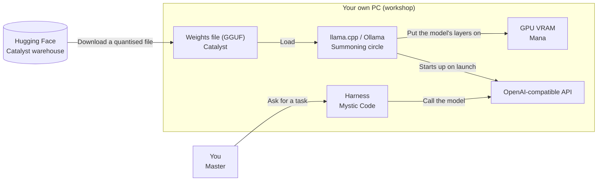
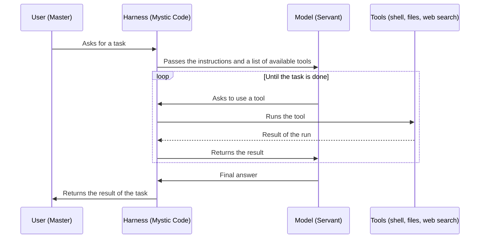

<!-- generated from articles/source/en/2026-10-12-fate-local-llm.md by scripts/import-articles.ts - do not edit -->

<aside class="callout">

This post is an adapted write-up of a chat I had with a friend who asked, "So, what's actually going on in the AI and local LLM scene?"

</aside>

## Introduction

Whenever local LLMs come up, I get hit with the same questions every single time: "Are local LLMs actually any good?", "What about the Chinese models?" and "What is each one good at?" Answering them over and over was getting tiresome, so I decided to write it all down in one place. Consider this post my answer.

That said, new models come out practically every day, and their characteristics shift with each company's direction and with how its research goes.

**What I write here is only the trend as of October 2026.** So rather than going model by model, I'll organise things by model family, such as the Qwen family and the Gemma family. Models in the same family often have similar personalities, even across generations.

In [Part 1](https://akari-iku.github.io/en/blog/fate-ai-industry/), I laid out the AI industry as of October 2026 as a Holy Grail War from the *Fate* series. The AI labs (Masters) pit their models (Servants) against each other in pursuit of the Holy Grail that is AGI.

NVIDIA (the Church Overseer) sells GPUs (mana) to every faction. The labs split into the big US players, which keep their weights to themselves, and the Chinese companies (the Eastern faction), which often release theirs.

In this post, I'll walk you through how to join that Holy Grail War as an ordinary magus who belongs to no faction. A local LLM, a model you run on your own PC, is the *Fate* equivalent of summoning a Servant of your own. Even if you haven't read Part 1, the cheat sheet below will get you through.

| *Fate* term | AI industry equivalent |
| --- | --- |
| Holy Grail | AGI |
| Master | AI lab (and its CEO) |
| Servant (Heroic Spirit) | Model |
| Manifestation | A model up and running |
| Spirit Origin | What's inside a model (the numerical precision of its weights) |
| Noble Phantasm | A model's trump-card ability or mechanism |
| Mana | Compute (GPUs) |
| Command Spells | System prompts and safety constraints |
| Church Overseer | NVIDIA |
| Throne of Heroes | Training data |
| Eastern faction | Chinese companies that often release their weights (DeepSeek, Qwen, GLM, Kimi and others) |

## Local LLMs (Summoning Your Own)

### Using an API Means Borrowing a Model (Someone Else's Servant)

Using ChatGPT or Claude through an API or an app is like hiring a Servant that's already contracted to another Master.

They're strong. Seriously strong. A Heroic Spirit with parameters in the trillions works for you for a monthly subscription in the app, or on pay-as-you-go pricing through the API.

Here's the catch: the Command Spells are held by the AI lab that provides the model. What the model answers and what it refuses, when the specs change, how the information you hand over gets treated: **the provider has the final say**. If your Servant's personality has changed one day, you just have to accept it.

### Running Locally Means Using Your Own PC (Your Own Workshop)

With a local LLM, you summon the Servant yourself, in your own workshop (your PC), with your own mana (your GPU).

The Heroic Spirits you can summon at home are still a rank below the big factions' top tier. But that gap is shrinking year by year, and the models that run locally are no longer weaklings. And **the Command Spells are in your own hands**.

| | Borrowing through an API | Summoning locally |
| --- | --- | --- |
| Strength | Top-tier Heroic Spirits | Whatever your own mana can summon |
| Command Spells | Held by the other Master | Held by you |
| Where your information goes | Through the other party's workshop | Never leaves your own workshop |
| Running costs | Monthly fee for the app, pay-as-you-go for the API | Electricity and the upfront investment |
| Spec changes | Change whenever it suits the other party | Don't change until you change them |

### Why Bother Running Models Locally? (Why Summon Your Own)

If you compare peak performance alone, APIs are still ahead. Even so, there are four reasons to run models locally:

- **The information can't leave**: Confidential documents, customers' personal data, data that a contract forbids you to take outside. Whether you can send these to someone else's workshop is a governance question before it's a technical one. If the data never takes a single step outside your own workshop (PC), the debate over whether it can be sent outside doesn't arise at all.
- **You can pin down the behaviour**: A model built into your work can start giving different answers from yesterday's after an update on the provider's side. For the people running the system, that's a plain old incident. Weights on your own machine won't change by a single byte until you swap them out yourself.
- **Even legitimate work can get refused**: Frontier models' safety measures can lead them to refuse perfectly legitimate work, in fields such as medicine or security. As long as the Command Spells are in the hands of the AI lab providing the model, the Servant may refuse to obey even when your order is legitimate.
- **It's just fun**: The moment a Heroic Spirit starts talking on your own hardware never gets old.

When people think of demand for local LLMs, I think many picture adult uses. But the people struggling with the third reason are doing perfectly legitimate work, in fields like medicine and security.

Anyone reading this post will probably remember it well: in July 2026, Hugging Face was breached by an autonomous AI agent. Hugging Face tried to use commercial models to investigate the breach, but was turned away by the providers' safety measures.

According to Hugging Face's report, those safeguards "cannot distinguish an incident responder from an attacker". So Hugging Face ran GLM-5.2, an open-weight model, on its own infrastructure and pressed on with analysing the logs.


<a class="link-card" href="https://huggingface.co/blog/security-incident-july-2026" target="_blank" rel="noopener">

<span class="link-card-body">
<span class="link-card-domain">huggingface.co</span>
<span class="link-card-title">Security incident disclosure — July 2026</span>
</span>
</a>


### Ready-Made Machines for Local LLMs (Shops That Sell the Whole Workshop)

One of Caster's class skills is Territory Creation: the ability to build a magecraft workshop that works in your favour. Stick with local LLMs long enough, and the gaming PC on your desk starts to fall short as a workshop, in VRAM and in memory. To meet that demand, between 2025 and 2026, several companies started selling workshops for local LLMs as off-the-shelf products.

In October 2025, NVIDIA released [DGX Spark](https://en.wikipedia.org/wiki/Nvidia_DGX), a compact machine with 128GB of unified memory. NVIDIA says it can run models of up to around 200 billion parameters right on your desk.

As a higher-end machine, DGX Station, with 748GB of memory, is also sold through PC makers. Compact PCs and laptops with AMD's Ryzen AI Max+ 395 also advertise 128GB of unified memory. Apple offers the Mac Studio, which can be fitted with up to 512GB of memory.

Unified memory is an architecture in which the CPU and the GPU share the same memory. Because most of the main memory can go to the model, you can summon Heroic Spirits that 8GB of VRAM can't. However, unified memory's read and write speed (bandwidth) is often slower than dedicated GPU VRAM. Your Heroic Spirit will show up, but it tends to move slowly.

Workshops are getting pricier, too. Memory supply is tight in 2026, and in February 2026 NVIDIA [raised](https://forums.developer.nvidia.com/t/2-23-2026-price-change-announcement/361713) DGX Spark's suggested retail price from $3,999 to $4,699.

In October 2026, a version with the memory cut to 64GB [goes on sale](https://blogs.nvidia.com/blog/local-ai-dgx-spark-64gb-sync/) through OEMs, starting at $4,999. The Overseer has started selling workshops as well as mana, but the price tags on those workshops are set by the memory market.

## What You Need to Run a Local LLM

A summoning needs three things: a catalyst, mana and a summoning circle. Add the Mystic Code (harness) that I'll cover in a later section, and the whole flow looks like this:



### Weights Files (Catalysts)

To summon a Heroic Spirit, you need a relic tied to their legend. The catalyst you bring decides who answers the call.

In the local LLM world, the model's weights file is your catalyst. Think of it as a Heroic Spirit called from the Throne of Heroes (the training data) and set into a form you can carry around. llama.cpp uses a format called GGUF, and Hugging Face has loads of these files. Some are published by the official developers; others are converted and uploaded by volunteers.

File names usually include the model name, the parameter count and the quantisation type, something like `model-name-9B-Q4_K_M.gguf`. Once you can read these names, you're halfway through choosing a catalyst.

### Try Before You Buy in the Cloud (Support Servants)

*Fate/Grand Order* has a system where you can borrow another Master's Servant as a Support and take them along on a quest. Before you summon that Servant yourself, you can see how they handle.

You can do exactly the same with open-weight models. Services such as Cloudflare's [Workers AI](https://developers.cloudflare.com/workers-ai/models/), Google's [AI Studio](https://aistudio.google.com/) (Gemma 4 at 31B and 26B) and Hugging Face's [Inference Providers](https://huggingface.co/docs/inference-providers) let you try open models running in the cloud.

Before downloading several GB of weights, you can check how a model handles Japanese, how well it follows instructions and what quirks its tone has. In October, I did this myself with Clef, a decision model whose weights Cloudflare released, by calling it from Workers AI.


<a class="link-card" href="https://akari-iku.github.io/en/blog/clef-decision-models/" target="_blank" rel="noopener">

<span class="link-card-body">
<span class="link-card-domain">akari-iku.github.io</span>
<span class="link-card-title">Hands-On with Cloudflare</span>
</span>
</a>


It has also become more common for inference services and inference engines to ship support on the same day a new model's weights are released: what's known as "Day-0 support".

For example, the inference engine vLLM [announced Day-0 support](https://vllm.ai/blog/2026-07-27-k3) on 27 July 2026, the day Kimi K3's weights were released. New open models also show up early on [OpenRouter](https://openrouter.ai/), which lets you use models from multiple inference services in one place.

So get a feel for a Servant's quirks as a Support, decide which Heroic Spirit to summon at home, and only then shut yourself away in your workshop.

Just keep in mind that the version running in the cloud and the quantised version you use locally often differ in precision. A version quantised for local use (quantisation means lowering the precision of a model's numbers to make it smaller) can answer a little differently.

### VRAM (Mana Capacity)

A Master's mana capacity decides the calibre of Heroic Spirit they can summon. In local LLMs, that's VRAM.

My setup is an RTX 5060 with 8GB of VRAM (8151 MiB). As magi go, honestly, that's below average. Even so, there are Heroic Spirits I can summon.

You can estimate the VRAM you need with some back-of-the-napkin maths:

- **The weights file size**: goes into VRAM more or less as it is
- **The context**: grows the longer you make the model remember the conversation
- **Headroom**: your OS and browser drink from the same VRAM straw

With 8GB, the realistic ceiling for a weights file is 5 to 6GB. A model whose file is exactly 8GB can't put all of its layers on the GPU of an 8GB card. Looking only at the file size and assuming the model will fit in VRAM is the classic rookie trap everyone falls into.

The other trap is the "runs on 8GB" label from whoever distributes the model. When I tried Qwen3.8-27B in August, the figures in Unsloth's requirements table turned out to be **the total of main memory and VRAM, not VRAM alone**. If you read those figures as the answer to whether a model runs on a single 8GB card, you'll get it wrong.


<a class="link-card" href="https://akari-iku.github.io/en/blog/qwen38-27b-8gb-vram/" target="_blank" rel="noopener">

<span class="link-card-body">
<span class="link-card-domain">akari-iku.github.io</span>
<span class="link-card-title">I Squeezed a 27B Into 1-bit on 8GB of VRAM. The 8B at 4-bit Won Anyway | akari.log</span>
</span>
</a>


A Master short on mana still has ways to make up for it. Rin Tohsaka stores mana in jewels ahead of time and uses it in battle. With local LLMs, too, you can add main memory and send the layers that don't fit over to the CPU, or add GPUs to get more VRAM. If that still isn't enough, you end up replacing the whole workshop.

### Quantisation (Manifesting on Too Little Mana)

There's a way to force a high-calibre Heroic Spirit to manifest on very little mana: whittle down its Spirit Origin and settle for lower stats.

Quantisation is a technique that lowers the precision of the weights' numbers to make the file smaller. Numbers originally held at 16 bits get rounded to 4 or 8 bits. The bit count is the size of the Spirit Origin; the fewer bits, the more you've whittled it down. Naturally, the model gets a little less clever. Picture a Servant with Strength A manifesting at B or C.

| Quantisation | How far it ranks down (rough guide) | When to use it |
| --- | --- | --- |
| Q8 | Nearly its original stats | When you have mana to spare |
| Q6 / Q5 | Hardly noticeable in practice | When you have a little to spare |
| Q4_K_M | Drops slightly, but plenty usable | The standard. If in doubt, pick this |
| Q3 | Degradation starts to show | When it just won't fit otherwise |
| Q2 and below | Can't fire its Noble Phantasm | When getting it running is the goal in itself |

There's one important rule of thumb: **running a large model at Q4 is usually smarter than running a small model at high precision.** A high-calibre Heroic Spirit has higher base stats, even after ranking down a bit. Go down to Q3 or below, though, and the story changes, so it's worth treating Q4_K_M as your floor.

As a rough guide, a Q4_K_M file comes to about "parameter count (in billions) × 0.6GB". That's about 5GB for 8B and about 7GB for 12B. So what you can summon comfortably on 8GB of VRAM is roughly up to around 9B.

### llama.cpp (Summoning Circle)

Last comes the summoning circle: the runtime for local LLMs.

Ollama and LM Studio are pre-drawn ritual kits. They're easy, and good for summoning your very first Servant. As long as I use models whose layers all fit in VRAM, I've never had any trouble sticking with Ollama. My advice: start with Ollama, then move to llama.cpp when you want to run a model that won't fit in VRAM, or when you want finer control.

llama.cpp gives you the chalk to draw the circle yourself. In return, you can decide in detail which parts of the model go on the GPU and which go to the CPU. When you run a model that won't fit in VRAM, that split shows up in the speed. In my August tests, running the same model at the same VRAM usage, Ollama's 6.30 tok/s became 9.35 tok/s on llama.cpp.

The basic incantation is just this:

```bash
llama-server -hf <username>/<repo>:Q4_K_M -ngl 99 -c 8192
```

- `-hf`: fetches the catalyst from Hugging Face. The download runs only the first time
- `-ngl`: how many of the model's layers to put on the GPU. Writing 99 or `all` means "all of them"
- `-c`: the context length. The bigger it is, the more VRAM it uses

On launch, it brings up a chat screen you can open in a browser, plus an OpenAI-compatible API.

In recent versions of llama.cpp, if you don't specify `-ngl`, it automatically decides how many layers to load so that they fit in VRAM (a feature called `--fit`, enabled by default). If you want to decide manually, lower the `-ngl` number.

Layers that don't fit run on the CPU and main memory. In *Fate* terms, that's the Master making up the missing mana with their own life force: it runs, but it gets visibly slower. **For the 8GB gang, the basic strategy is finding a setup that puts every layer on the GPU.**

## Harnesses (Mystic Codes)

### A Harness Lets a Model Do More (What a Mystic Code Does)

In *Fate/Grand Order*, Masters fight wearing a Mystic Code. Change your Mystic Code, and your Master Skills (the skills the Master can use) change, and so do the ways you can heal and buff your Servants.

In local LLMs, the equivalent is the harness. A harness is a program that runs outside the model and hands it tools such as a shell, file editing and web search. When the model says to use a tool, the harness runs it and returns the result to the model.

By repeating this back-and-forth, the model can move the work forward on its own instead of just returning answers. Claude Code, Codex CLI and OpenCode are all harnesses. llama-server brings up an OpenAI-compatible API, so with any harness that lets you change where it connects, you can put a Mystic Code on a Servant you summoned locally, too.



### DeepSeek Harness (A Mystic Code Handed Out by the Eastern Faction)

On 13 August 2026, DeepSeek released [DeepSeek Harness](https://github.com/deepseek-ai/deepseek-harness) (command name `dsh`) under the MIT licence. It's modular to the bone: the model, the tools, the sandbox and even the work loop can all be swapped out as plugins.

According to the [official documentation](https://deepseek-harness.github.io/deepseek-harness/en/guide/providers), you can point it at external APIs or at your own server with an OpenAI-compatible API. The Eastern faction has started handing out not just its Heroic Spirits' weights, but the Mystic Codes to put on them as well. It's still a developer preview, though, and the README says in capitals: "THERE WILL BE COMPATIBILITY-BREAKING CHANGES."

### Matching the Harness to the Model (Choosing a Mystic Code)

Just because good Mystic Codes come free doesn't mean you should put the same one on every Servant. Models differ in the tool-calling conventions they got used to in training, in the tasks they're good at and in how long they reason. When choosing a harness, too, you'd ideally get to know the traits of the Servant you summoned first, then pick a Mystic Code that plays to them.

What gets talked about as a model's "strengths" is usually its raw performance, measured on the model alone without a harness. How it actually feels in use changes a lot with these three things:

- **Response preferences**: whether it answers briefly and to the point, adds plenty of explanation or shows its thinking
- **How you instruct it for coding**: how you write the prompt, whether you have it write tests first, whether you have it output changes as diffs
- **Harness design**: the agent loop, how tools are called, how memory is kept, how it retries after a failure

Especially for agent and coding work, differences in harness design tend to show up in the results more than differences between the models themselves. My impression is that Chinese models (Qwen, DeepSeek, GLM, Kimi) have more room to grow when you put them in a good harness than when you use them bare.

Western models (Gemma, gpt-oss, Granite, Muse) and Mistral behave relatively predictably out of the box, but the right harness lifts them too. What decides the model you pick is often not "what is this model good at?" but "**does it click with my harness?**"

### Never Let an LLM Grade Its Own Homework (The Master's Job)

There's one more reason to know your model's traits: LLMs tend to go easy on their own work.

In a 2024 [study](https://arxiv.org/abs/2404.13076) by Panickssery, Bowman and Feng, LLMs could recognise text they had written themselves, and the better a model was at recognising it, the higher it scored its own text.

A March 2026 [study](https://arxiv.org/abs/2603.04582) by Khullar et al. confirmed the same tendency in coding agents. When models were asked whether to approve a PR, they were more likely to miss problematic changes if they evaluated it as work they had done themselves in the same conversation.

Once a coding agent has written your code, **leave the review to a different model**. If you stick with the same model, at least use a separate session. Combine that with checks that don't rely on a model's judgement, such as tests. Not taking your own Servant's report on trust alone, and bringing in another pair of eyes, is the Master's job.

## How to Choose a Model to Run (Choosing a Heroic Spirit)

Deciding which model to summon gets easier if you look at memory, licence, use case, fit with your harness and the availability of quantised versions, in that order.

### Set the Ceiling by Memory (Mana Capacity)

The first thing to look at is the size you can run with your memory. With the rule of thumb from the VRAM section (at Q4_K_M, parameter count (in billions) × 0.6GB), you can work out the size at which every layer fits in VRAM. Even if not every layer fits, the model will run with some layers in main memory, but it gets slower accordingly.

MoE models are estimated a little differently. Take Qwen3.8-Flash-Next: it has 125B total parameters, and even its Q4 quantised version (Unsloth's UD-Q4_K_XL) is about 111GB. But only 6B of it is active per token.

If you keep the expert parts in main memory and send them to the CPU with a llama.cpp option such as `--n-cpu-moe`, you may be able to run it even with little VRAM. In exchange, you need a lot of main memory. It's a summoning close to the way Rin Tohsaka fights in the VRAM section, making up the shortfall with mana stored in jewels.

The tools for running models are multiplying, too. [Strata](https://github.com/Niko1221/Strata), released in September 2026, for example, is an inference engine for running Qwen3.8-Flash-Next on a GPU with 12GB or more of VRAM and 32GB or more of main memory. As tools built for particular models appear, the range of Heroic Spirits you can summon widens little by little.

You can also use tools to check what will run on your hardware. On GitHub, there's open-source software that inspects your PC's GPU and memory and suggests models you can run. [llmfit](https://github.com/AlexsJones/llmfit) gives rough figures for the memory needed and the speed for each quantisation type, and it supports MoE models too. [whichllm](https://github.com/Andyyyy64/whichllm) ranks the models you can run based on recent benchmark results. Both give estimates, so in the end you run the model yourself and check.

### Check the Family and the Licence (True Name)

Next, check the licence against what you'll use the model for. Whether you're trying it out personally, building it into your work or offering it as a service changes which conditions you need to check. Even within the same family, the licence can differ by model size. Here are the main families as of October 2026:

| Family | Faction | Licence | Official | Hugging Face |
| --- | --- | --- | --- | --- |
| Qwen (Alibaba) | East | Apache 2.0 for the 27B and others. The largest, 2.4T, and Flash-Next use their own licence | [qwen.ai](https://qwen.ai) | [Qwen](https://huggingface.co/Qwen) |
| DeepSeek | East | MIT | [deepseek.com](https://www.deepseek.com) | [deepseek-ai](https://huggingface.co/deepseek-ai) |
| GLM (Z.ai) | East | GLM-5.3 uses its own licence. GLM-5.3-Flash and 5.2 and earlier are MIT | [z.ai](https://z.ai) | [zai-org](https://huggingface.co/zai-org) |
| Kimi (Moonshot AI) | East | Kimi K3 uses its own licence (the K2 generation is modified MIT) | [kimi.ai](https://www.kimi.ai/blog/kimi-k3) | [moonshotai](https://huggingface.co/moonshotai) |
| Gemma (Google) | West | Apache 2.0 (Gemma 4) | [Google DeepMind](https://deepmind.google/models/gemma/) | [google](https://huggingface.co/google) |
| gpt-oss (OpenAI) | West | Apache 2.0 | [OpenAI](https://openai.com/index/introducing-gpt-oss/) | [openai](https://huggingface.co/openai) |
| Granite (IBM) | West | Apache 2.0 | [IBM](https://www.ibm.com/granite) | [ibm-granite](https://huggingface.co/ibm-granite) |
| Muse (Meta) | West | Muse Glimmer is Apache 2.0 | [Meta](https://research.meta.ai/blog/introducing-muse-glimmer-open-agentic-model) | [meta-models](https://huggingface.co/meta-models) |
| Mistral | West (Europe) | Small 4 is Apache 2.0. Medium 3.5 is modified MIT (companies with consolidated monthly revenue above $20 million in the previous month can't use it) | [mistral.ai](https://mistral.ai/) | [mistralai](https://huggingface.co/mistralai) |

Most of these custom licences put conditions on businesses that offer the model to third parties through an API or similar, or on products with many users or high revenue.

Some, like Qwen3.8-Flash-Next, require a separate licence for offering the model through an API or building it into an AI assistant product, regardless of scale. If you're just running a model yourself on your own machine, it often isn't a problem, but check the model card and the licence file on Hugging Face before you use it.

### Decide by Use Case (The Heroic Spirit's Personality)

Here's how each family tends to shape up. This is my own read as of October 2026, and it will change with each company's direction and research.

| Family | Tendencies (strengths) | Sizes that run locally |
| --- | --- | --- |
| Qwen | An all-rounder that handles anything. Especially strong in Chinese and English, and also handles Japanese and Korean, its fellow CJK languages (Chinese, Japanese, Korean), to some extent. Also strong at coding, long contexts, tool use and agents | The previous generation has small models from 0.6B to 9B (for phones and light PCs). 27B to 32B is comfortable on a GPU with around 24GB. The latest Qwen3.8 starts at 27B |
| DeepSeek | Good at reasoning. Good at thinking step by step, and strong at maths, logic and coding | For local use, the distilled versions of the previous-generation R1 (1.5B to 14B on 8 to 16GB, 32B on around 24GB). The latest V4.1 generation is several hundred B or more, server-class |
| GLM | Strong at coding, agents, long-running tasks and software development. Efficient MoE | In the latest generation, even the small GLM-5.3-Flash is 320B (18B per token), server-class |
| Kimi | Strong at agents, long contexts (up to 1 million tokens), long coding sessions and knowledge work. Extremely sparse MoE | The K2 generation (1T total, 32B per token) can be quantised and run if you have a large amount of memory. K3 (2.8T) needs a large cluster |
| Gemma | Small to mid-sized, focused on efficiency. Handles images and audio, and is good at agents and reasoning. Suits laptops and phones | E2B and E4B (phones and laptops), 12B, 26B (4B per token), 31B |
| gpt-oss | Reasoning, tool use, agents. Reasoning depth is adjustable. Also strong at maths and coding | 20b (16GB of memory), 120b (a single 80GB-class GPU). MoE, with only a small part active per token |
| Granite | Enterprise-focused. Emphasises reasoning, agents, tool use and data governance. You can switch whether it shows its thinking | 3B and 8B (light to mid-range), 30B (high-end consumer GPUs) |
| Muse | Aimed at agents running locally. Tool calling, always-on agents, coding, handling images | Muse Glimmer 30B (about 17 to 20GB at 4-bit; practical on a 24GB GPU or a Mac) |
| Mistral | Efficient small models, plus multilingual and image handling. Also supports coding and agents. A strong flavour of European sovereignty | For local use, the previous-generation Ministral (3B, 8B, 14B). Small 4 (119B) and above need large resources |

### Check the Fit with Your Harness (Mystic Code)

As I wrote in the harness section, the strengths listed above are about raw performance. How a model actually feels changes a lot with its response tendencies, how you instruct it and the harness design. Once you've narrowed it down to two or three candidates, the most reliable way to choose is to put them in your own harness, have them do the same task and compare the results.

### Are the Quantised Versions Out Yet? (Preparing the Spirit Origin)

A freshly released model can't necessarily be run locally straight away. Day-0 support from inference services and inference engines means "it can be run". The quantised versions (GGUF) you can use locally usually arrive a bit later. If you run models with llama.cpp, the time to try is once the quantisation you want appears in the repository of a creator who distributes GGUFs, such as Unsloth.

### Examples That Run on 8GB of VRAM (Heroic Spirits You Can Summon)

Here are the candidate Heroic Spirits I can summon on my 8GB VRAM setup. I assigned the classes on my own whim. The VRAM figures come from third-party roundup sites.

| Class | Model | VRAM needed at Q4 (rough guide) | Traits |
| --- | --- | --- | --- |
| Saber | [Qwen3.5 9B](https://www.mayhemcode.com/2026/06/best-local-llms-for-4gb-6gb-and-8gb.html) | Around 6GB | True to the "finest" class (the class considered the most outstanding in *Fate*), it has no quirks and handles anything. All layers fit in VRAM, with room to spare for context. If in doubt, start here |
| Archer | [Granite 4.2 8B](https://bestllmfor.com/meilleur-llm/8gb-vram/) (IBM) | About 4.6GB | True to its class skill Independent Action, it runs on little mana. You can put what you save towards a longer context. Apache 2.0 |
| Berserker | [Gemma 4 12B](https://bestllmfor.com/meilleur-llm/8gb-vram/) (Google) | About 7GB | Higher calibre, but over the 5 to 6GB ceiling for a weights file. You'll need to shorten the context or lower `-ngl`. If you want it to read images, this is the one |
| Assassin | [Bonsai 27B](https://gigazine.net/gsc_news/en/20260721-qwen3-8/) | About 3.9GB | Billed as a drastically shrunk Qwen3.6-27B. Takes its class skill Presence Concealment way too far. I haven't tested it, and it isn't one for your first summoning |

### Failures from My Own Tests (Summoning Mishaps)

In *Fate*, summonings don't always go to plan. In *Fate/stay night*, Rin Tohsaka meant to summon Saber and got Archer instead. What's more, she made two slip-ups in that one summoning.

The first was the time. Every clock in the Tohsaka mansion had been set an hour fast, so Rin thought she was summoning at 2 a.m., when her mana peaks, but she actually performed the ritual at 1 a.m.

The second was where she stood. A Master is supposed to chant outside the summoning circle, but Rin was standing on it. A Heroic Spirit can't appear where a being of this world is already present, so Archer appeared somewhere other than the circle.

I haven't tried Assassin's Bonsai 27B yet, but in August I did try a model built on the same idea of quantising a 27B extremely small: UD-IQ1_S (6.19GB), Unsloth's version of Qwen3.8-27B with its Spirit Origin whittled down to 1-bit class.

Because it keeps the important layers at higher bit counts, its average, calculated from the file size, is about 1.8 bits. This summoning ended in a mishap: it lost outright to an 8B 4-bit quantised version (qwen3:8b) that I summoned on the same 8GB of VRAM.

| | Qwen3.8-27B 1-bit class (6.19GB) | qwen3:8b 4-bit (4.9GB) |
| --- | --- | --- |
| Leap year function | Cut off at 700 tokens, incomplete | Completed in 43 tokens |
| Binary search function | Cut off at 700 tokens, incomplete | Completed in 89 tokens |
| Generation speed | 31.87 tok/s | 47 tok/s |
| VRAM usage | 6974 MiB | 5722 MiB |

The 1-bit-class 27B fit every layer in VRAM and ran at a decent clip. Even so, it couldn't finish writing the leap year check within the 700-token limit. Its thinking may simply have run too long, but it fell short of the 8B running under the same conditions. Carve away too much of the Spirit Origin, and its actual capability seems to vanish right along with its presence.

There was also a mishap where Japanese answers looped forever: the model kept on writing about cherry blossoms blooming in both summer and autumn. The cause of that one, though, wasn't the whittled-down Spirit Origin; I had forgotten to set `presence_penalty` (a parameter that suppresses repeating the same words).

When I set it to 1.5, Unsloth's recommended value, the loop stopped. **Not every summoning mishap is the Spirit Origin's fault.** Just like Rin standing on the summoning circle, sometimes the summoner gets the procedure wrong.


<a class="link-card" href="https://akari-iku.github.io/en/blog/qwen38-27b-8gb-vram/" target="_blank" rel="noopener">

<span class="link-card-body">
<span class="link-card-domain">akari-iku.github.io</span>
<span class="link-card-title">I Squeezed a 27B Into 1-bit on 8GB of VRAM. The 8B at 4-bit Won Anyway | akari.log</span>
</span>
</a>


Whether Bonsai 27B can overturn this result is best left undecided until you've tried it with your own hands.

### Models That Won't Run on 8GB (Heroic Spirits You Can't Summon)

The Eastern faction's top-tier models can't be summoned on 8GB, whatever you do. Even 27B, the small version of Qwen3.8, needs around 16GB at Q4.

Whittle its Spirit Origin down to 1-bit class and it fits in 8GB, but in that state the 27B couldn't beat an 8B 4-bit quantised version. Western Heroic Spirits are no different: Muse Glimmer, whose weights Meta released in August, is 30B and needs around 18GB at Q4.

That doesn't mean you can't spar with the Heroic Spirits you can't summon at home, though. As I wrote in the section on trying models in the cloud, several companies offer services that run open models in the cloud.

Summon the top-tier models that won't fit at home in the cloud, and at home run the models your own mana can summon: that's plenty. Within what your setup can run, go ahead and run models and have fun with them.

The models you can summon at home are getting better every year, too. Even within the same 9B class, they get visibly smarter with each generation. **If you just sit tight, the Heroic Spirits shrink to fit our mana capacity.** I think that's the best thing about this industry.

<details><summary>Sidebar: Physical AI calls for a different way of choosing</summary>


Everything so far about strengths, weaknesses and harnesses applies to the world of text and images. Once you get to Physical AI (AI with a body) that drives robots, the way you think about choosing a model changes quite a lot.

- **Required abilities**: Rather than understanding long contexts or coding, what matters is the speed of looking at camera footage and turning it straight into action, physically correct movement, safe operation and low latency.
- **Data and evaluation**: Instead of learning from huge amounts of web text, the focus is on robot operation data and on reinforcement learning and imitation learning in simulation. Evaluation, too, is measured by task success rates and safety, not coding benchmarks.
- **How the models are built**: Rather than language models themselves, the focus is on VLA (Vision-Language-Action) models, which produce actions from video and language, and on world models, which predict how the world moves.

Here are the models whose names come up often as of October 2026, split into the US and the West, and China. Versions are updated very quickly in this field, so read the model names on the assumption that they'll be out of date by the time you read this.

| Faction | Model / family | Developer | Weights released? | Traits |
| --- | --- | --- | --- | --- |
| US / West | [π0.7](https://www.pi.website/) (April 2026) | Physical Intelligence | Latest version not released. π0 to π0.5 released via [openpi](https://github.com/Physical-Intelligence/openpi) | Strong at dexterous manipulation and at combining skills it hasn't learnt |
| US / West | [Isaac GR00T N1.7](https://huggingface.co/nvidia/GR00T-N1.7-3B) (generally available from July 2026) | NVIDIA | Released (NVIDIA Open Model License; commercial use allowed) | A 3B for humanoids. Designed for inference on NVIDIA's Jetson |
| US / West | [Gemini Robotics 2](https://deepmind.google/blog/gemini-robotics-2-brings-whole-body-intelligence-to-robots/) (July 2026) | Google DeepMind | Not released. ER 2, which handles reasoning, is available through the Gemini API. The main model is limited to some partner companies | Whole-body control and planning, and coordination between multiple robots |
| US / West | [OpenVLA](https://huggingface.co/openvla/openvla-7b) (June 2024) | Stanford, UC Berkeley and others | Released (MIT; built on Llama 2) | 7B. Often used as a baseline for comparison in research |
| US / West | [Helix 02](https://www.figure.ai/news/helix-02) (January 2026) | Figure AI | Not released | Controls the whole body of the company's own humanoid with a single system |
| US / West | [SmolVLA](https://huggingface.co/lerobot/smolvla_base), [Octo](https://github.com/octo-models/octo) | Hugging Face (LeRobot), UC Berkeley and others | Released (SmolVLA under Apache 2.0, Octo under MIT) | Small, and easy to run on consumer GPUs and edge devices |
| China | [Qwen-RobotManip / RobotNav / RobotWorld](https://github.com/QwenLM/Qwen-RobotManip) (June 2026) | Alibaba (Qwen team) | Not released (no plans to release) | A set covering object manipulation, navigation and a world model. The manipulation model is built on Qwen3.5-4B |
| China | [RynnBrain](https://www.alibabacloud.com/blog/alibaba-unveiled-open-sourced-embodied-foundation-model-for-robotics_602898) (February 2026) | Alibaba DAMO Academy | Released (Apache 2.0) | Built on Qwen3-VL, from 2B to 122B. A "brain" model that handles understanding and planning |
| China | [Hy-Embodied](https://github.com/Tencent-Hunyuan/Hy-Embodied-0.5-VLA) (June to July 2026) | Tencent | Released (VLA, RxBrain and VLM-1.0 under Apache 2.0) | Splits understanding the environment, reasoning and generating actions across three models |
| China | [Genie Envisioner 2.0](https://github.com/AgibotTech/GE-Sim-V2), GO-2 (April 2026) | AgiBot | Genie Envisioner released (its original parts under CC BY-NC-SA 4.0). No GO-2 weights to be found (as of October 2026) | Large amounts of data collected on real robots, plus a world model and simulator |
| China | [UnifoLM-WLA-1.0](https://github.com/unitreerobotics/unifolm-wla) (September 2026) | Unitree | Released (Apache 2.0) | 6B. Handles 64 tasks on the company's own G1 robot. The code for further training is released too |
| China | [Xiaomi-Robotics-1](https://github.com/XiaomiRobotics/Xiaomi-Robotics-1) (August 2026) | Xiaomi | Released (Apache 2.0) | 5B. Built on Qwen3-VL |
| China | [InternVLA-A1.5](https://github.com/InternRobotics/InternVLA-A-series) (July 2026) | Shanghai AI Lab | Released (both code and weights under CC BY-NC-SA 4.0) | Brings understanding, predicting the future and acting together in one model |
| China | [Seed GR-3](https://seed.bytedance.com/en/direction/robotics) (July 2025) | ByteDance | Not released | 4B. Two-armed manipulation and handling soft objects such as cloth |

Line them up, and the pattern looks awfully familiar from language models. In the US and the West, many companies keep their latest versions closed, and only some, such as NVIDIA, release their weights.

In China, many companies release their weights, such as Tencent, Unitree and Xiaomi, though some, such as Alibaba's Qwen team and ByteDance, don't. Physical AI doesn't have settled standard benchmarks yet, so the performance rankings are fluid.

The pecking order gets reshuffled here, too. A faction that's strong in language models isn't necessarily strong in robots as well. Having released weights that you can run locally also takes on a different meaning: running models on the small devices mounted on the robots themselves (edge devices).

That said, many VLA models are built on models that are strong at understanding language and images, so this isn't completely unrelated to everything so far. In Physical AI, what data you collect, and how much, and what control system you put the model on carry even more weight than which base model you use.

In *Fate* terms, it's a world where how you train the Heroic Spirit after the summoning, and how the Master calls the plays, count for more than the Heroic Spirit's calibre.


</details>

## Wrapping Up

The Holy Grail War framing held up all the way down to local LLMs. There's just one place where reality parts ways with *Fate*, though.

The Holy Grail War in *Fate/stay night* is a ritual for seven chosen Masters only. Ordinary people may get caught up in it, but they can't take part.

Not so in the real world. The catalysts are public, how to draw the summoning circle is public, and even I, with a mere 8GB of mana, can summon Heroic Spirits. Even if the Holy Grail itself is out of reach, anyone can go as far as forming a contract with a Servant and commanding it with their own Command Spells.

None of this is a given. Many in the Eastern faction keep releasing the weights of their top-tier models, volunteers keep quantising and distributing them, and summoning circles like llama.cpp are maintained free of charge. Pull just one of those Jenga blocks, and the Holy Grail War goes right back to being a spectator sport.

The catalyst warehouse is about to change hands, too. In September 2026, NVIDIA agreed to acquire Hugging Face, and it plans to complete the acquisition in the first half of 2027, after reviews in various countries.

NVIDIA has promised to keep the current setup, in which anyone can upload and download models and datasets, and to keep supporting other chipmakers. Whether that promise holds after the acquisition is something I think rogue magi in particular should keep a close eye on.

If you compare peak performance alone, borrowed Servants are still stronger for now. Even so, only the Master who holds the Command Spells can decide what a model does and what it refuses, and which information goes outside. Before you choose a Servant on strength alone, check whose hands the Command Spells are in.

I ask of you, are you that model's Master?

## References

- [NVIDIA Confirms $12.9B Hugging Face Acquisition (HPCwire)](https://www.hpcwire.com/off-the-wire/nvidia-confirms-12-9b-hugging-face-acquisition/)
- [Zhipu AI releases GLM-5.2 (DataNorth)](https://datanorth.ai/news/zhipu-ai-releases-glm-5-2)
- [Security incident disclosure (Hugging Face, July 2026)](https://huggingface.co/blog/security-incident-july-2026)
- [Alibaba releases Qwen3.8-27B (DataNorth)](https://datanorth.ai/news/alibaba-releases-qwen3-8-27b)
- [Nvidia DGX (Wikipedia)](https://en.wikipedia.org/wiki/Nvidia_DGX)
- [2/23/2026 Price Change Announcement (NVIDIA Developer Forums)](https://forums.developer.nvidia.com/t/2-23-2026-price-change-announcement/361713)
- [DGX Spark 64GB (NVIDIA Blog)](https://blogs.nvidia.com/blog/local-ai-dgx-spark-64gb-sync/)
- [DeepSeek Harness: Configure models (official documentation)](https://deepseek-harness.github.io/deepseek-harness/en/guide/providers)
- [Best Local LLMs for 4GB, 6GB, and 8GB VRAM in 2026 (Mayhemcode)](https://www.mayhemcode.com/2026/06/best-local-llms-for-4gb-6gb-and-8gb.html)
- [Best LLM for 8 GB of VRAM in 2026 (bestllmfor)](https://bestllmfor.com/meilleur-llm/8gb-vram/)
- [The Qwen3.8 announcement and Bonsai 27B (GIGAZINE)](https://gigazine.net/gsc_news/en/20260721-qwen3-8/)
- [Kimi K3 Is Here: Efficient Day-0 Support on vLLM (vLLM)](https://vllm.ai/blog/2026-07-27-k3)
- [NVIDIA Form 8-K (2 September 2026, the agreement to acquire Hugging Face)](https://www.sec.gov/Archives/edgar/data/0001045810/000104581026000078/nvda-20260902.htm)
- [Qwen3.8-Flash-Next (Hugging Face)](https://huggingface.co/Qwen/Qwen3.8-Flash-Next)
- [Strata (GitHub)](https://github.com/Niko1221/Strata)
- [llmfit (GitHub)](https://github.com/AlexsJones/llmfit)
- [whichllm (GitHub)](https://github.com/Andyyyy64/whichllm)
- [deepseek-ai/deepseek-harness (GitHub)](https://github.com/deepseek-ai/deepseek-harness)
- [The Open-Sourcing of DeepSeek Harness (InfoQ)](https://www.infoq.com/news/2026/08/deep-seek-harness/)
- [LLM Evaluators Recognize and Favor Their Own Generations (arXiv)](https://arxiv.org/abs/2404.13076)
- [Self-Attribution Bias: When AI Monitors Go Easy on Themselves (arXiv)](https://arxiv.org/abs/2603.04582)
- [I Squeezed a 27B Into 1-bit on 8GB of VRAM. The 8B at 4-bit Won Anyway (my blog)](https://akari-iku.github.io/en/blog/qwen38-27b-8gb-vram/)
