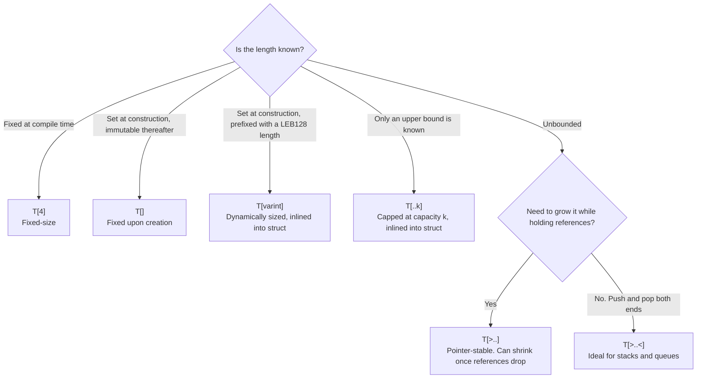
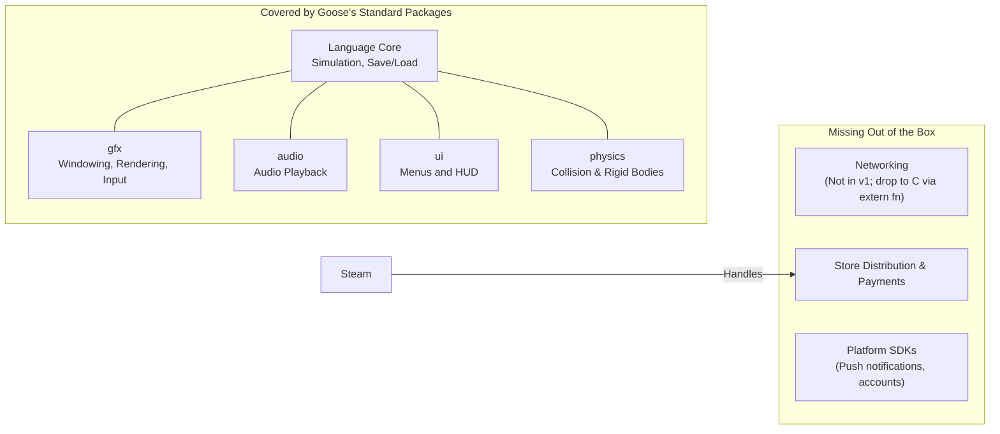

<!-- generated from articles/source/en/2026-10-29-goose-no-serializer.md by scripts/import-articles.ts - do not edit -->

<aside class="callout">

This article is a hands-on log. Having first heard about this language from its announcement on 27 October 2026, I got it running on Windows the very next day; here are my findings and reflections. The star of the show is an experiment with saving and restoring game data without writing a serialiser. There are some speed benchmarks too, but they're just a side note.

</aside>

## Introduction

On 27 October 2026, I stumbled across a GIGAZINE article covering a new programming language called Goose. The headline read "Memory-safe, faster than C++, with a smaller memory footprint", the sort of claim you see everywhere these days. What actually made me stop and look, though, was the author's name and one specific line in the README.

The man behind it is [Wouter van Oortmerssen](https://x.com/wvo), the creator of FlatBuffers, who currently runs his own game studio. According to the "History & Use of AI" section in the README, he designed Goose and started implementing it a few years back, but running a game studio left him strapped for time. Then came Claude Fable, which finally made building it feasible. A human handled the design, while Fable took care of the compiler implementation and documentation. A sign of the times, wouldn't you say?

FlatBuffers is a serialisation format built to access data straight from a byte buffer without parsing (or decoding) it first. Instead of reconstructing objects from scratch each time like JSON does, it reads values directly by following relative offsets in the raw bytes.

<details><summary>What is FlatBuffers?</summary>

FlatBuffers is a serialisation format released by Google in 2014, designed by Wouter van Oortmerssen. It was originally built with game development in mind.

The problem it tackled was asset loading: things like maps, 3D models, and configuration files. Formats like JSON or Protocol Buffers read the whole file, parse it, and piece the objects back together in memory. When dealing with massive assets, this deserialisation step eats up serious time and RAM.

FlatBuffers ditched that approach entirely. The data is generated from a schema (`.fbs` file) into a single contiguous byte buffer, where every value lives at a fixed position or a relative offset from one. The reader keeps that buffer in memory and pulls out only the values it needs on the fly, with zero copies and zero allocations. Whether you read it from disk, pull it off the wire, or map it into memory, you're working directly with the very same bytes.

Because you can't blindly trust external data, a verifier checks that every offset points somewhere within the buffer's bounds. It doesn't validate whether the actual values make semantic sense.

Beyond Google, it's well-known for being adopted by Facebook in 2015 for data loading in its Android app.


<a class="link-card" href="https://flatbuffers.dev/" target="_blank" rel="noopener">
<span class="link-card-body">
<span class="link-card-domain">flatbuffers.dev</span>
<span class="link-card-title">FlatBuffers Docs</span>
</span>
</a>


</details>

So, what does data look like inside a programming language designed by the mind behind FlatBuffers? Naturally, I had to take it for a spin. As it turns out, in Goose, **the byte layout used for runtime computations in memory is bit-for-bit what gets saved to disk**. That's precisely why you don't need a serialiser at all. I verified this first-hand by writing an experiment to save and reload game data.

To see how it stacks up, I wrote the exact same program in Rust and C++. The idea was to compare them side-by-side: to trace where Goose draws its syntactic inspiration, and to see what boilerplate actually disappears when you cut out the serialisation step.

Before jumping in, a quick caveat about scope: this is all based on a single day of tinkering with version v2026.3.

## What is Goose?

Here is a quick recap of the official overview (as of 28 October 2026):


<a class="link-card" href="https://aardappel.github.io/goose/" target="_blank" rel="noopener">
<span class="link-card-body">
<span class="link-card-domain">aardappel.github.io</span>
<span class="link-card-title">The Goose Programming Language · Goose</span>
</span>
</a>


Goose is a systems language that **guarantees memory safety without a heap allocator, garbage collector, reference counting, destructors, or lifetime annotations**. Every dynamic value is allocated inline on a compiler-managed data stack and reclaimed the second it drops out of scope. The compiler itself is written in C++ and emits a single C file. It is licensed under Apache-2.0, with the source code up on GitHub:


<a class="link-card" href="https://github.com/aardappel/goose" target="_blank" rel="noopener">

<span class="link-card-body">
<span class="link-card-domain">github.com</span>
<span class="link-card-title">GitHub - aardappel/goose: The Goose Programming Language</span>
</span>
</a>


The performance claims on the official site represent geometric means across their 16 internal benchmarks. They report that Goose is 3.51x faster than idiomatic C++, 1.24x faster than hand-tuned C++, and 1.13x faster than safe Rust, while boasting a peak memory footprint that is 1.95x, 1.32x, and 1.25x leaner, respectively. The cases where Goose falls behind are listed on the same page too. (Note: the 3.3x and 1.12x figures cited in the GIGAZINE piece differ from the site's current stats; this post sticks to the official numbers.)

A quick run through the author's background. In the 1990s, he created the Amiga E language; later on, he developed the open-source FPS engines Cube and Sauerbraten; during his time at Google, he built FlatBuffers; and he also designed Lobster, a language tailored for his own game projects. According to the README, his current studio (VoxRay Games) runs entirely on top of Lobster. Put simply, he is someone who has **spent his whole career chasing optimal data layouts to squeeze every drop of performance out of games**. Goose's design was locked down years ago and, he says, was never built with AI in mind.

This article sets out to run three experiments:

1. Memory safety without the lifetime dance: I put the official claims to the test by writing code that would trigger memory corruption in other languages, seeing if the compiler catches it with a hard error.
2. The million-dollar question: Can we save game data to a file and read it back without writing a serialiser, and what happens when we intentionally feed it corrupt data?
3. The speed claims: The documentation touts a 3.51x speedup over idiomatic C++. Since I didn't have their exact suite on hand, I wrote my own benchmark to pit Goose against Rust and C++.

Between the second and third experiments, I've included a section placing all three implementations side by side to compare syntax.

## Environment and Setup

Here is the test bench for this run (tested on 28 October 2026):

| Item | Specs |
| --- | --- |
| OS | Windows 11 |
| Goose | v2026.3 (2026-10-21 release), prebuilt Windows x64 binary. `goose version` outputs `goose runtime 4d3da949e563` |
| C Compiler | MSVC 19.44 (Visual Studio 2022 Build Tools) |
| Rust | rustc 1.99.1 |
| CPU / RAM | AMD Ryzen 7 5700X / 32 GB |

Setup is as frictionless as it gets: just extract the zip from GitHub Releases, and `goose file.goose` runs your code on the fly. Goose ships with an embedded TinyCC that compiles the generated C in-process and executes it straight away, with zero dependencies needed on Windows. If you want a standalone executable via `goose build`, you will need a C compiler, but `goose toolchain` picked up MSVC from Visual Studio Build Tools without me even having `cl` on my PATH.

```bash
goose samples/01_tour.goose
goose build samples/01_tour.goose
```

For the benchmarks, I compiled binaries with `goose build` (-O2), `cargo build --release`, and `cl /O2`. A Python harness launched each executable as a fresh process to measure both wall-clock time and peak working set. I ran each payload size 10 times (5 times for heavier inputs) and reported the best run. Since process startup overhead is baked into these numbers, results for the smallest inputs shouldn't be taken as serious points of comparison.

The bundled `samples/` directory comes packed with 31 programs, while `docs/` is stocked with the tutorial, the spec, the language reference, and design notes. When I mention "design docs" in this post, I'm specifically referring to the files living under `docs/design/`.

All the code and raw benchmarks from this post are available here:


<a class="link-card" href="https://github.com/akari-iku/goose-playground" target="_blank" rel="noopener">

<span class="link-card-body">
<span class="link-card-domain">github.com</span>
<span class="link-card-title">akari-iku/goose-playground</span>
</span>
</a>


## First, Trying to Break It on Purpose

Time for experiment #1: putting the claim that "Goose gives you memory safety without lifetime annotations" to the test. Before even touching the manual, I wanted to see where the compiler would draw the line, so I wrote code specifically designed to explode at compile time. First up: a function that tries to return a reference to a locally scoped array.

```goose
fn make() -> i64& {
    var xs: i64[>..] = [];
    xs.push(1);
    return xs[0];
}
```

The `i64[>..]` type represents a growable array that guarantees its elements are pinned in memory. Appending to the tail never moves existing items around, so references are never invalidated behind your back (I'll break down the array types before we get to the save-data section). Hitting compile spat out this error:

```
01_dangling_return.goose:8: error: returning a reference rooted in xs, which dies with this function (§9.2)
    return xs[0];
```

(The line numbers are from my test suite; the code snippets here are trimmed down.) **The error message doesn't just complain. It names the root variable tying down the reference's lifetime (`xs` here) and points straight to the spec.** Section 9.2 of `docs/goose_spec.md` states that every reference must trace back to a root, and you can only hand off or store a reference if its root outlives where it's headed. Because `xs` gets blown away when the function exits, returning it is a non-starter.

Next, I tried another classic: taking a slice `w` of an array, clearing the underlying array, and then trying to read `w` afterwards.

```goose
var line: u8[>..] = [];
line.append("hello world");
let w = line[..5];
line.clear();
print(w);
```

```
02_clear_while_sliced.goose:8: error: cannot clear line while w is still used: it may hold a reference or slice into it (§5.1)
```

The compiler is smart enough to see that `w` is still used after `clear()`. Flipping the order so `print(w)` runs before `clear()` compiles without a hitch.

On the flip side, I wanted to confirm that code which *should* pass actually does. If you take a reference to an element and then push a mountain of data into the array, does that reference stay good? To test this, I grabbed a reference, pushed 100,000 items, and wrote through the original reference. `Item` is just a struct holding an `id` and a `weight`. In Goose, `=` means copy, while `.=` binds by reference. In Rust, trying to `push` while holding a reference to an element is textbook borrow-checker bait.

```goose
var items: Item[>..] = [];
let first .= items.push(Item { 1, 0.5 });
for i in 2..100001 { items.push(Item { i as i32, i * 0.5 }); }
first.weight = 99.5;
print(items.len, " items, first weight ", items[0].weight);
```

```
100000 items, first weight 99.5
```

Because `[>..]` arrays never reallocate and move their elements, **the reference returned by `push` stays completely valid**. Under the hood, each growable array gets its own dedicated data stack (a reserved virtual memory range), so growing it is literally just bumping the tail. Unlike `std::vector` or `Vec`, which reallocate and copy everything to a new block of memory once capacity fills up (instantly invalidating your pointers), Goose's `[>..]` neatly avoids the issue altogether.

I also managed to reproduce a caveat the official docs openly concede. Pools declared with `reusable` recycle freed slots. If you hold onto a reference to a slot that has been freed, you'll end up reading whatever new value gets dropped into that slot down the line:

```goose
reusable var pool: Item[>..] = [];
let stale: Item& = pool.alloc_ref(Item { 10, 1.0 });
pool.free(pool.index_of(stale));
let next: Item& = pool.alloc_ref(Item { 12, 2.0 });
print(stale.id);   // 12
```

Variables explicitly typed as `Item&` bind by reference even with `=`. This compiles just fine, and `stale.id` evaluates to 12. The docs explain that because types still match up and memory isn't corrupted, this is considered a logic bug rather than a memory-safety violation. Sure enough, that's exactly how it behaves.

The two mechanics we just explored, arrays that guarantee pointer stability and references tied to explicit roots, form the backbone for our next experiment: structuring save data as an in-memory tree using relative offsets.

## Writing, Reading, and Corrupting Save Data

For experiment #2, let's address the question posed in the title. The author is a game dev at heart, and the standard packages (gfx, audio, ui, physics) are tailored for games, so a game save felt like the obvious payload. Save files are the quintessential gaming workload: you write them, read them back, and traverse them. They also hit the trifecta of fixed-size fields, dynamic-length buffers, and tree hierarchies. I implemented saving and reloading in Goose, then wrote an equivalent C++ version with a handwritten serialiser to see how they compare.

I deliberately left Rust out of this round. Sure, `serde` saves you from writing boilerplate serialisers, but under the hood, it still deserialises by rebuilding the object graph from scratch, just like C++. Rust's `rkyv` crate does pull off the same zero-copy trick as Goose using relative pointers and a verifier, but loaded data is wrapped in specialised `Archived` types; you can't just treat them like standard values to mutate or `push` to. I'll unpack that distinction later in "FlatBuffers vs. Goose, Feature by Feature".

The test payload models three core domain concepts: the player, their inventory, and quests. Quests form a natural tree of parent-child dependencies: a major objective breaks down into smaller tasks, which branch into even finer steps. Think "Defend the village pond" -> "Gather reeds" -> "Find a sickle." (And since the language is named Goose, a pond setting felt like destiny.)

### First: Making Sense of Array Types

Before we look at the save-data structs, we need to sort out Goose's array typing, which is easily one of its most distinct features. Array types come in eight kinds, keyed on how their length is determined and how they grow. Here is a cheat sheet covering six representative ones. The trick to reading them is understanding that you use the type to declare both where a value lives in memory and how it's allowed to grow:



On top of these, you have the slice type `T[:]`, which is a borrowed view into an array (like `line[..5]` in our first experiment). **Where Rust forces you to spell out reference lifetimes with explicit annotations, Goose has you encode layout and growth semantics right into the array types, leaving the compiler to infer lifetimes automatically from their roots.**

### The Three Data Models

```goose
struct Vec2 { x: f32, y: f32 }
struct Player { name: u8[..16], hp: i32, gold: i32, pos: Vec2 }

struct Item { name: u8[varint], qty: varint, cents: varint }

struct Quest {
    id: u32,
    title: u8[..24],
    done: bool = false,
    first_child: Quest&<u32>?,
    next: Quest&<u32>?,
}
```

`Player` has a fixed footprint. Since the name is an inline array capped at 16 bytes, the entire struct is flat, meaning an array of `Player`s can be indexed directly with zero indirection.

`Item` is dynamic. The name takes up only as many bytes as needed, while the numeric fields use LEB128 encoding (variable-length integers where smaller values pack into fewer bytes).

`Quest` models a tree. The types for `first_child` and `next`, both `Quest&<u32>?`, represent optional 4-byte relative offsets pointing to other nodes within the same array. Under the hood, the stored value is simply the target's address minus the address of the offset field itself. There isn't a single raw pointer in sight. If you dump raw memory pointers to disk, they point to garbage the next time the app boots; relative offsets, however, stay valid no matter where the array gets loaded into memory.

Persisting this state is as simple as piping the three arrays straight into a byte buffer:

```goose
var file: u8[>..] = [];
file.append("GSAV");
players.to_bytes(file);
bag.to_bytes(file);
quests.to_bytes(file);
write_file(path, file);
```

`to_bytes` takes the array's exact in-memory layout and appends it to the buffer, prefixed by its length. **You don't write a single line of serialisation code.** This magic comes down to three things: zero raw pointers in the array, tree links stored as relative offsets, and those links living inside pointer-stable `[>..]` arrays (the property we verified in experiment #1). Because all three hold true, the raw bytes can be dropped anywhere in memory without losing their meaning. That's the punchline to the question in the title.

Loading it back in is handled by `from_bytes`. Here, `image` is the raw slice cut from the file's Quest section. Because data coming off disk can't be trusted like memory managed by the compiler, Goose runs it through a verification pass first:

```goose
var lq, ok = from_bytes<Quest[>..]>(image);
```

Once validation passes, what you get back is just a plain old array. **There is no divide between data read from a file and data the program works with.** I could push new quests directly onto the loaded `lq` array and traverse child nodes via their relative offsets as if nothing happened. Doing this in C++ means reading the file and reassembling an entire `std::vector<Quest>` object graph from scratch. In Goose, that entire intermediate step simply doesn't exist.

### Memory Footprint and File Size

For the C++ implementation, I went with the idiomatic approach using `std::string` and `std::vector`. While C++ can dump data straight to disk if you use flat, C-style structs (`char title[24]` and array indices), you end up having to hand-roll bounds checks and manually verify that links stay within the same array. This article looks at how the two languages compare in terms of who is responsible for that validation. In Goose, the compiler and `from_bytes` take care of it for you.

In Goose, the in-memory layout matches the on-disk format exactly. In C++, in-memory representations diverge from the serialised file format, so the table below compares their footprints in memory.

| Data | Goose (In-Memory = On-Disk) | C++ In-Memory (MSVC) |
| --- | --- | --- |
| 1 Player | 33 bytes | 48 bytes (names with 16+ characters trigger a heap allocation) |
| 3 Items | 35 bytes | 144 bytes |
| 1 Quest | 38 bytes | 72 bytes (child arrays and long titles allocate on the heap: 5 allocations across 7 records) |

Goose packs struct fields tightly in declaration order. Unlike C++, the compiler inserts no alignment padding. The architecture assumes unaligned reads and writes are cheap; if you need alignment padding, you insert `pad` explicitly (Spec §3.2). The 38 bytes for `Quest` break down into: 4 bytes for `id`, 1 + 24 bytes for `title`, 1 byte for `done`, and 4 × 2 bytes for the links.

Total file sizes are practically identical: 375 bytes for Goose versus 369 bytes for C++. C++ repacks data before writing it to disk, so while the final file is 369 bytes, its memory footprint is larger. Goose stays at 375 bytes in memory.

### Code Volume

I didn't write any serialiser code for Goose, just a single-line call to `to_bytes` where needed. The C++ version required 78 lines across the Writer, Reader, and per-type read/write routines. Goose's `from_bytes` also handles input validation out of the box, whereas in C++ I had to hand-code length checks and verify that child indices stayed within bounds. The only code I wrote myself on the Goose side was 8 lines to parse section boundaries: reading the length prefix and slicing out the corresponding byte chunk.

### Peeking Inside the File

Here is the raw hex dump of the beginning of `save.gsav`, as generated by Goose:

```
00000000: 4753 4156 4203 6775 7300 0000 0000 0000  GSAVB.gus.......
00000010: 0000 0000 0000 4600 0000 e204 0000 0000  ......F.........
00000020: 4841 0000 40c0 076d 616c 6c61 7264 0000  HA..@..mallard..
```

The header starts with `47 53 41 56`, my custom magic bytes for `"GSAV"`. Next, `42` is `66` encoded in LEB128, indicating that the Player section payload is 66 bytes long. The slice `03 67 75 73` represents the player name: a single length byte (`3`) followed by `"gus"`, with the remaining 13 bytes left zeroed out. After that, `46 00 00 00` gives `hp = 70`, `e2 04 00 00` gives `gold = 1250`, and the next eight bytes store two `f32` coordinates for `pos`. The second player, `"mallard"`, picks up at `07 6d 61 6c 6c 61 72 64`.

What you see here is bit-for-bit identical to what was sitting in memory during execution. In the words of the design doc (`docs/design/serialization.md`), Goose data "is already its own serialized form". Saving is just a raw buffer dump to disk; loading is just reading those bytes straight back in. There's no post-load pointer fixup or swizzling required.

### Feeding It Corrupted Files

Save files can get corrupted in the wild, whether by bad sectors or save editors. To see where `from_bytes` draws the line on validation, I fed it four differently mangled files to see what passes and what fails.

| Test Case | Goose `from_bytes` | Hand-rolled C++ Reader |
| --- | --- | --- |
| Flip 1 byte in a link (relative offset) | Rejected | Rejected (thanks to manual index bounds checks) |
| Mutate 1 byte of payload (the `done` flag) | Accepted (marks the root quest as `done`) | Accepted |
| Chop off the last byte | Rejected | Rejected |
| Reinterpret the Item section as a Quest | Rejected | Untested |

The design doc is explicit about this boundary: **`from_bytes` validates safety, not integrity**. A malformed link could point to arbitrary memory outside the array, so it has to be rejected. But if a value is simply corrupted while its links still resolve safely inside the array, the tree remains traversable, so it's accepted. `from_bytes` doesn't care about semantic correctness; if you need to guarantee data integrity, the design doc recommends slapping on a checksum. A checksum is computed over the whole payload, so changing even a single byte changes its value.

FlatBuffers takes the exact same stance with its verifier: ensure offsets don't point out of bounds, but don't bother checking whether the payload values make sense.

To get that same baseline safety in C++, you have to guard every read with length checks and manually validate every array index after loading. Miss either one, and a malformed file will happily walk you straight into an out-of-bounds access.

### The Most Quintessentially "Goose" Error

What stuck with me most from this experiment wasn't getting things to run. It was a compiler error I ran into along the way. I had initially written a helper to append a child node to a quest tree by taking the parent by reference:

```goose
fn add_child(pool: Quest[>..]&, parent: Quest&, ...) {
    let node .= pool.push(Quest { ... });
    ...
    cur.next .= node;   // cur was reached by traversing from parent
}
```

```
error: a relative reference must point within the same root as its location (§3.9); this reference is rooted at pool
```

Relative offsets are only meaningful within the very same array. Because of this, the compiler statically verifies that any two references being linked together originate from the same root container. But when you take `parent` as a plain `Quest&`, the compiler has no way to trace which array it actually belongs to. The fix was simple: pass the parent as an index (`i64`) instead, then look it up inside the function via `pool[parent_at]`.

```goose
fn add_child(pool: Quest[>..]&, parent_at: i64, ...) -> i64 {
    let node .= pool.push(Quest { ... });
    let parent .= pool[parent_at];
    ...
}
```

"Hold indices, not pointers" is, I'd say, common practice in game-dev C++. **In Goose, the compiler actually demands it.**

There was another catch: you can't copy an array containing relative references by value. Unlike writing out the entire contiguous array to a file, copying just a subset of elements elsewhere would break where those relative offsets point. When I tried returning an empty array on failure with `var empty: T = []; return empty, false;`, the compiler stopped me: `copying a value of type Quest[>..], which contains self-relative references, is not supported; construct it in place`. The workaround was `return from_bytes<T>("");`, which constructs "an empty array and `false`" in place from an empty byte sequence.

## FlatBuffers vs. Goose, Feature by Feature

The answer to the title question is what we saw in the save-data section. Here, I line up which part of FlatBuffers each of those mechanisms corresponds to.

| FlatBuffers | Goose |
| --- | --- |
| Relative offsets inside the buffer | Relative references such as `Quest&<u32>`. The stored value is "target minus the field's own address", so both ends move together and the data stays position-independent |
| Nested strings and arrays held inline | `u8[..16]` and `u8[varint]` sit inline inside a struct |
| A verifier pass on load | `from_bytes` draws the same line (safety only) |
| Write the buffer out as-is | Goose data "is already its own serialized form" |
| Old buffers stay readable after adding a field to the schema | Not verified. `from_bytes` validates against the type's byte layout, which reads as "change the struct and old files get rejected", but I didn't try it |
| The same buffer can be read from other languages | Not verified. The byte layout is in the spec's appendix, so you could write a reader, but there is no generated code |

There are two differences. FlatBuffers needs a schema language and code generation, and is read-only by default. Rust's `rkyv` likewise hands you a dedicated type on read. **In Goose, the language's ordinary values carry the same property while staying mutable.** You can push onto an array declared as `var quests: Quest[>..]`, mutate it through references, and write it straight to a file.

The price is declaring the kind of array in the type. It's precisely because `[>..]` arrays never move their elements that relative offsets never break. The official page itself puts "you have to think about where data lives and who owns it" at the top of its limitations.

### Convergence with Data-Oriented Design

The architectural philosophy that developers building their own game engines converged on is known as Data-Oriented Design (DOD). It spread through Mike Acton's CppCon 2014 talk (he was at Insomniac Games at the time), made its way into Unity as DOTS (Data-Oriented Technology Stack), and was written up as a book by Richard Fabian.


<a class="link-card" href="https://www.youtube.com/watch?v=rX0ItVEVjHc" target="_blank" rel="noopener">
<span class="link-card-body">
<span class="link-card-domain">www.youtube.com</span>
<span class="link-card-title">https://www.youtube.com/watch?v=rX0ItVEVjHc</span>
</span>
</a>


<a class="link-card" href="https://unity.com/dots" target="_blank" rel="noopener">

<span class="link-card-body">
<span class="link-card-domain">unity.com</span>
<span class="link-card-title">DOTS - Unity’s Data-Oriented Technology Stack</span>
</span>
</a>


<a class="link-card" href="https://www.dataorienteddesign.com/dodbook/" target="_blank" rel="noopener">
<span class="link-card-body">
<span class="link-card-domain">www.dataorienteddesign.com</span>
<span class="link-card-title">Data-Oriented Design</span>
</span>
</a>


DOD essentially revolves around four core ideas:

1. Lay out data contiguously in flat arrays instead of chaining heap objects together with pointers.
2. Use indices or handles for references rather than raw pointers.
3. Prefer Structures of Arrays (SoA) over Arrays of Structures (AoS).
4. Keep asset layouts identical on disk and in memory to bypass load-time deserialisation and reconstruction.

Goose bakes rules 1, 2, and 4 right into the language itself. As for rule 3, there's an open proposal in `docs/design/soa.md` to introduce SoA as a first-class array variant down the road.

## Writing the Same Program Across Three Languages

Stepping away from the main question for a moment, let's talk about developer ergonomics: what is Goose actually like to write? To trace where its syntax takes inspiration from, I wrote a small tool in Goose, Rust, and C++ that generates SVG graphics using L-systems. An L-system generates geometric figures via formal string rewriting rules: you iteratively expand a seed string using replacement rules, then walk the resulting string character by character as turtle-graphics commands ("step forward," "turn left," etc.) to trace out organic branching structures and fractals.

I kept the function boundaries and output format identical across all three versions, which yielded byte-identical SVG outputs across all four test presets.

| Preset | Depth | Segments | SVG Size |
| --- | --- | --- | --- |
| plant | 6 | 6,048 | 182,943 bytes |
| koch | 4 | 625 | 17,517 bytes |
| dragon | 12 | 4,096 | 112,031 bytes |
| sierpinski | 6 | 2,187 | 68,397 bytes |

Here is the `plant` preset rendered at depth 5 (1,488 segments):


The generated SVGs for all four presets live in the repository under `notes/images/`.

### Rust Bones, Eclectic Influences

A typical function signature looks like `fn rewrite(src: const u8[:], out: u8[>..]&)`. That's virtually identical to Rust's `fn rewrite(src: &[u8], out: &mut Vec<u8>)`, save for the placement of `const`, which feels straight out of C++. You'll also feel right at home with Rust-style expression-based `if` and `match` blocks, `as` casts, and `::` path resolution.

The big departure is how call-site references work. When passing an array to be mutated in Goose, you simply pass it as `rewrite(cur, next)`. There's no need to sprinkle in `&mut next` like in Rust; it behaves just like a C++ reference. Variable bindings use `.=` for references (`let first .= items.push(...)`), standard `=` to copy (unless the target type itself is a reference), and `.==` for pointer-identity checks. That three-way distinction (`=`, `.=`, `.==`) is unique to Goose.

Other language idioms make appearances as well. Multiple return values like `-> f64, f64` paired with `let depth, ok = parse_int(s)` are straight out of Go; optional types (`Preset?`) and `guard ... else` come from Swift and Kotlin; and end-relative index slicing (`xs[^2..]`) is pulled right from C#.

There's no dedicated string type either. Any `u8` slice or array does double duty as a string: use `u8[>..]` if it needs to grow, or fixed/compact inline buffers like `u8[..16]` or `u8[varint]` inside structs. String literals like `"hello"` evaluate to read-only slices (`const u8[:]`) that can be copied into whatever backing array you need, working much like a C `char*`.

Array declarations follow the conventions covered in the save-data section. Declaring `to: u8[..32]` embeds an inline buffer of capacity 32 directly into the struct's layout. Think C's `char to[32]`, but with an explicit length tracked alongside it.

### A Trap for Anyone Bouncing Between Rust and Goose

The syntax `for &x in xs` means polar opposites in Rust and Goose.

| Syntax | Goose | Rust |
| --- | --- | --- |
| `for x in xs` | Iterates over element copies | Iterates over `&T` if `xs` is a slice or `&Vec<T>`; moves ownership and yields `T` if `xs` is the `Vec<T>` itself |
| `for &x in xs` | Iterates by reference; writing to `x` mutates the original array | Strips the reference and iterates by value |

**Same symbol, opposite meaning.** In Goose, `&` is consistently a declaration that "this name is a reference", whether in a parameter type `out: T&` or in a binding `let r .= ...`. Read it the way you'd read C++'s `for (auto& x : xs)` and it all lines up.

I hit three syntax errors while writing all this, and fixed every one of them from the error message alone.

<details><summary>The Three Syntax Errors</summary>

- A `match` arm containing a statement needs `{}`. `'+' => t.heading += p.angle,` is a syntax error
- `pad` is a keyword for struct padding and can't be used as a variable name
- `for depth { ... }` isn't allowed; you write `for _ in depth { ... }`

</details>

## Performance Shootout

For my third experiment, I wanted to see if the official claim, "3.51x faster than idiomatic C++", held water in real-world code. Lacking the authors' exact benchmark suite, I pitted Goose against Rust and C++ using the L-system generator. The test environment matches what's listed under "Environment and Setup."

In my first run on `plant` at depth 10, Goose looked 8x faster than C++. But **that gap had nothing to do with memory management**. This run spits out a massive 55 MB SVG, meaning almost all the execution time was eaten up by formatting `f64` floats down to two decimal places. The divergence was really just a showdown between the string-formatting speeds of Goose's `format_flt`, Rust's `{:.2}`, and MSVC's `snprintf("%.2f")`.

To make it an apples-to-apples comparison, I wrote a custom float formatter for both C++ and Rust that mirrors Goose's `format_flt`: multiply by 100, round to the nearest whole number, and stream out each digit char-by-char. While this naive rounding doesn't strictly match standard `%.2f` rounding rules (picking the closest decimal to the true binary value), it produced byte-identical SVG outputs across all four presets. In C++, you could also reach for `std::to_chars`, but I wrote it by hand to match what Goose does.

Each cell tracks "Wall-clock time / Peak working set":

| Input | Goose | Rust (Std) | Rust (Custom) | C++ (Std) | C++ (Custom) |
| --- | --- | --- | --- | --- | --- |
| plant depth 8 | 17 ms / 11 MB | 39 ms / 16 MB | 19 ms / 15 MB | 98 ms / 14 MB | 25 ms / 13 MB |
| plant depth 10 | 167 ms / 113 MB | 520 ms / 162 MB | 205 ms / 161 MB | 1459 ms / 141 MB | 298 ms / 141 MB |

**The 8x blowout collapsed to 1.8x**. Against Rust, Goose was 1.2x ahead. I didn't dig deeper to profile what accounts for the remaining difference. If you cite these numbers, look at the "Custom" columns. While I couldn't validate the advertised 3.51x figure here, what I *can* confirm is that in this specific program, stripping out string-formatting overhead left Goose running 1.8x faster than C++ and 1.2x faster than Rust.

## Who Is Goose Actually For?

To understand Goose's niche, it helps to look at what the language deliberately leaves on the cutting room floor, straight from the official docs:

- No escaping closures. You can't stash a callback away to be invoked later by an event loop (think `setTimeout` or `addEventListener` in TypeScript).
- No function pointers. You can't store functions in variables or pass them around.
- Dynamic dispatch is strictly confined to pattern-matching on tagged enums. There is no interface-based polymorphism.
- Whole-program compilation only. You can't dynamically load plugins at runtime.
- No networking or subprocess support in the standard library (out of scope for v1; you drop down to C via `extern fn` if you need them).

<details><summary>Other Caveats</summary>


- Recursive functions can't maintain growable arrays across recursion frames.
- Arrays of variable-size elements can't be indexed (you have to walk them from the start).
- Regular expressions are ASCII-only.
- WebAssembly support is still just an unimplemented design note.

</details>

Viewing these trade-offs through the lens of enterprise software versus game dev makes the target audience immediately obvious:

| | Enterprise / General Tooling | Game Development |
| --- | --- | --- |
| Time Budget | Per-request latency; the average is what matters | Fit everything inside 16.6 ms (one frame at 60 fps) |
| Memory Constraints | Throw more RAM at it | Hard ceiling |
| Major Headaches | Shifting requirements, third-party integrations, edge cases | GC pauses, heap fragmentation, cache misses |
| Priorities | Maintainability, modular plugin systems | Predictable frame times, contiguous cache-friendly data |

Among the things Goose drops, function pointers and dynamic dispatch are things game devs already avoid like the plague in hot inner loops (the places where you'd otherwise make a virtual call per element). They *are* handy for job dispatch or event hooks, but in Goose, you'd model those with tagged enums and `match` arms instead. In the enterprise world, where modular plugin architectures and dynamic dispatch are bread and butter, Goose's foundational assumptions fall apart.

These trade-offs fall into two camps. The lack of networking is a "not in v1 yet" problem that may well be filled by `extern fn` bindings or future packages. But the absence of dynamic dispatch is a matter of the design itself, and that isn't going to change.

Where Goose really shines is workloads that revolve around "building structured data, persisting it, reading it back, and traversing it." Core game loops (world state simulations, save/load pipelines) are textbook examples. Beyond gaming, here are a few non-gaming domains where Goose's model would feel right at home (these are educated guesses rather than battle-tested setups):

| Domain | Why It Seems a Fit |
| --- | --- |
| Embedded KVS & Search Indexes | You can build trees or hash tables in relative-reference pools and flush them straight to disk. The bundled `samples/25_serialize.goose` shows this off with a persisted word index. |
| Emulator Save States | Stuff the entire machine state into a single struct, and the output of `to_bytes` is your save state. |
| Compilers and Interpreters | Back an AST with a relative-reference tree; you can dump the parsed AST as raw bytes and load it back next time without re-parsing. |
| Log & Telemetry Recording and Replay | Append records to an append-only array and stream it out. A file cut off mid-write gets rejected by verification. |
| Binary Wire Protocols | The original use case for FlatBuffers. Struct definitions double as your on-the-wire payload. Socket I/O can be offloaded to C via `extern fn`. |

Video processing, on the other hand, is a non-starter. Raw video frames are already just flat `u8` buffers, so Goose's superpower (pointer-free structured data) gives you zero leverage, and passing frames between threads incurs an expensive `memcpy` (noted in the official README, though I haven't measured the penalty). Where it *would* work in creative software is outside the playback pipeline: managing project files (timelines, clips, and effect graphs), which share the exact same DNA as game save data.

Goose ships with official packages for `gfx`, `audio`, `ui`, and `physics`. Looking at what it takes to actually ship a PC game, here is how the line falls between what's included out of the box and what isn't:



Web apps are off the table without first-class networking. Mobile apps rely so heavily on app stores, in-app billing, and platform SDK integrations that developers naturally gravitate toward Swift, Kotlin, Unity, or Flutter. On desktop, however, Steam already shoulders distribution and payments, while Goose's packages cover windowing, rendering, audio, input, and physics. Native OS notifications and identity services are still missing, but they're hardly blockers for desktop games. In practice, Goose becomes a compelling option for **small teams and indies targeting PC who want to roll their own engine**, which fits the creator's own profile to a tee.

For developers working in enterprise or web backends, I'd suggest looking at Goose through a different lens: think of it as a textbook on FlatBuffers and Data-Oriented Design, one where the compiler does the teaching through its error messages. An error telling you that "relative references can only point within the same root" forces you to obey the exact same rules you have to internalise whenever you pack contiguous memory in *any* language. It's the same intuition behind normalising application state in Redux and holding IDs instead of object references.

## Wrapping Up

Goose isn't trying to be a greatest-hits compilation of other languages. It's an exercise in taking FlatBuffers' underlying philosophy, elevating it into a first-class language primitive, and wrapping it in syntax that feels instantly familiar. At its core, it's "a language where FlatBuffers buffers just happen to be your mutable runtime variables". That's why you never have to write a serialiser, though the trade-off is that you have to be deliberate about memory layouts in your type signatures. What made the biggest impression on me wasn't the raw speed; it was **watching save data round-trip cleanly without writing a single line of serialiser boilerplate, while only the broken links were rejected.**

As I touched on in the opening, Goose originated as a design drafted by a human years ago and brought across the finish line through AI implementation. That design favoured letting the compiler infer intent rather than forcing developers to clutter their code with annotations. Every compile error I ran into, from minor syntax stumbling blocks to relative-reference roots, was immediately fixable just by checking the spec section cited right in the diagnostic. A language engineered to minimise ceremony while returning laser-focused, actionable errors ought to pair well with the way AI writes code and then fixes it. A design drawn up years ago happens to fit the present moment, and realising that was easily the most rewarding part of writing this piece.

All the code and benchmark logs from these experiments live in the repo below. It contains the four Goose experiments, the three-language L-system implementations, the Goose and C++ save-data versions, the measurement script, and the validation notes.


<a class="link-card" href="https://github.com/akari-iku/goose-playground" target="_blank" rel="noopener">

<span class="link-card-body">
<span class="link-card-domain">github.com</span>
<span class="link-card-title">akari-iku/goose-playground</span>
</span>
</a>


### References

- Official Website: <https://aardappel.github.io/goose/>
- GitHub: <https://github.com/aardappel/goose>
- Design Docs: `docs/design/relative_references.md`, `docs/design/serialization.md` (inside the repo)
- Author: <https://strlen.com/> , <https://x.com/wvo>
- GIGAZINE Article (Japanese): <https://gigazine.net/news/20261027-goose/>
- Code & Benchmark Results for this Article: <https://github.com/akari-iku/goose-playground>
