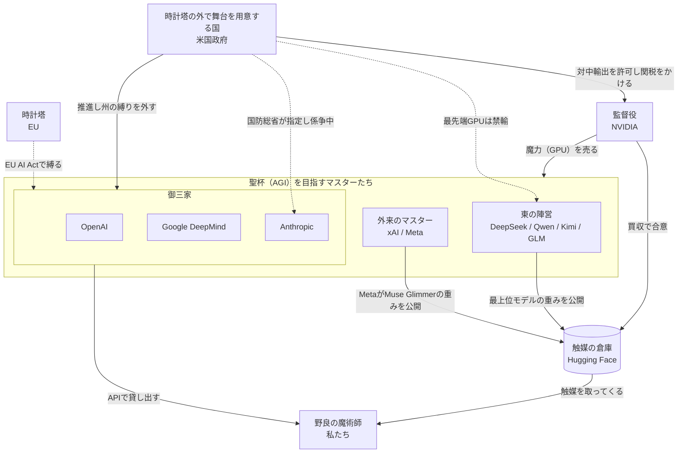
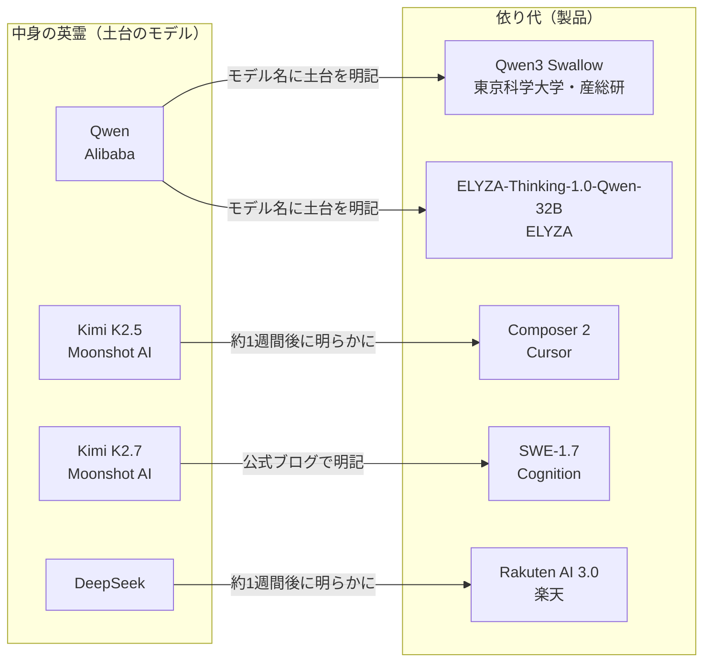

<!-- generated from articles/source/ja/2026-10-12-fate-ai-industry.md by scripts/import-articles.ts - do not edit -->

<aside class="callout">

この記事は、友人に「AI界隈やローカルLLMって、どんな感じなの？」と聞かれて話した内容を、記事用に書き直したものです。

</aside>

## はじめに

AI界隈は聖杯戦争です。

2〜3年前から、bilibiliや微博でAI系の動画や投稿を情報収集がてら眺めています。最近になって気づいたのが、中国のネット民によるAIモデルの擬人化がやたらと出来がいいことです。DeepSeekはクジラのメイドさん。Kimiは月夜の図書館にいる白髪の子。GLMは本を抱えた黒髪の優等生。ChatGPTは白い龍のお嬢様で、愛称は「大小姐」（日本語の「お嬢様」「令嬢」にあたる）。Claudeは床まで届く巻物を書き続けています。話が長いからです。

Opus 5.5の登場で長話の癖はだいぶましになりましたが、特徴をよくつかんだ描写だと、Claudeの利用者ならうなずくでしょう。

<figure>

<figcaption>引用：「女仆装鲸鱼娘」 by <a href="https://space.bilibili.com/4168597">ZipZipPipe</a>（原型は<a href="https://space.bilibili.com/4456176">上善无形</a>の「溟月」）。<a href="https://creativecommons.org/licenses/by-nc-sa/4.0/deed.ja">CC BY-NC-SA 4.0</a>（<a href="https://www.bilibili.com/opus/1231977657712771073">作者の声明</a>）。画像は<a href="https://mobile.moegirl.org.cn/File:%E5%A5%B3%E4%BB%86%E8%A3%85%E9%B2%B8%E9%B1%BC%E5%A8%98.png">萌娘百科</a>から拝借。</figcaption>
</figure>

見た目が可愛いだけじゃありません。使っている人でなければ気づかない細かさで、各モデルの性格がキャラクターのデザインに表れています。

そして極めつけが「Fate/AGI」というネタでした。各社のCEOがマスター、モデルがサーヴァント、目指す聖杯がAGI。革ジャンの人（NVIDIAのジェンスン・フアン）がグラボを掲げて真ん中に立っています。

元の動画はこちら：[Fate/AGI 通向AGI圣杯的战争（ScientificNNChan、bilibili）](https://www.bilibili.com/video/BV1pFan61EvZ)

各社を陣営ポスター風に描いた動画もあります：[请选择你的AI阵营（bilibili）](https://www.bilibili.com/video/BV1EehB6pEJ9)

陣営ポスターを読む（引用）

各ポスターのコピーを読み解くために、動画に出てくるポスターの一部を引用します。どのポスターも、コピーが各社の立ち位置を一言でまとめています。

<figure>

<figcaption>引用：Justin-Yao「<a href="https://www.bilibili.com/video/BV1EehB6pEJ9">请选择你的AI阵营</a>」（bilibili）より、OpenAIのポスター。</figcaption>
</figure>

OpenAIのコピーは「你不必理解AI，你只需要使用我。」（AIを理解する必要はない。私を使えばいい）と「接口一开，天下归心。」（APIを開けば、天下がなびく）、そして「Scam？不，是Scale.」（詐欺？ いや、スケールだ）。背後に立つのは、白い髪と角を持つ龍の娘、大小姐です。

「天下归心」は、曹操の詩「短歌行」の結びの句「周公吐哺，天下归心」から来ています。周公は、客が来ると食事中でも口の中のものを吐き出して迎えました。そのため、天下の人々の心が周公に従った、という意味の句です。ポスターのコピーは、周公が客を迎えた故事を、OpenAIがAPIを開放して開発者を集めることに置き換えています。

<figure>

<figcaption>引用：Justin-Yao「<a href="https://www.bilibili.com/video/BV1EehB6pEJ9">请选择你的AI阵营</a>」（bilibili）より、Anthropicのポスター。</figcaption>
</figure>

Anthropicのコピーは「先别放出来。」（まだ外に出すな）と「越强，越要上锁。」（強いほど、鍵をかけなければならない）、そして「能不能做是一回事，关不关得住是另一回事。」（作れるかどうかと、閉じ込めておけるかどうかは別の問題だ）。AIの危険を最も強く訴えているAnthropicの立場を表すコピーとして、これ以上の言い方はないと思います。

「越强，越要上锁」は古典の成句ではなく、現代の言い回しです。ただ、強すぎるものは危ういという考え方は、中国の古典にも古くからあります。『老子』第76章の「兵强则灭，木强则折」（軍は強すぎると滅び、木は硬すぎると折れる）がその一例です。

「能不能做是一回事，关不关得住是另一回事」は、映画『ジュラシック・パーク』（1993年）のイアン・マルコム博士の台詞を思わせます。「科学者たちは、できるかどうかに夢中で、すべきかどうかを立ち止まって考えなかった」という台詞です。作ったものを人間が制御できなくなる話という点で、ポスターのコピーとマルコム博士の台詞は同じ系統にあります。

<figure>

<figcaption>引用：Justin-Yao「<a href="https://www.bilibili.com/video/BV1EehB6pEJ9">请选择你的AI阵营</a>」（bilibili）より、xAIのポスター。</figcaption>
</figure>

xAIのコピーは「再快一点。先发射，再解释。能加速，就别刹车。」（もっと速く。まず発射、説明は後。加速できるなら、ブレーキは踏むな）。左上には縦書きで「从加速开始。更聪明的文明。」（加速から始まる、よりスマートな文明）とも書かれています。「2026年10月の参戦陣営」の章にある外来のマスターの表では、このポスターから「まず発射、説明は後」を借りています。

「先发射，再解释」の「发射」は、ロケットやミサイルを打ち上げるときに使う語です。ポスターの左奥でも、Xの印が入ったロケットが打ち上がっています。速さを何より重んじる言い回しとしては、映画『カンフーハッスル』（2004年）の台詞で知られる「天下武功，唯快不破」（天下の武術のうち、速さだけは破られない）もあります。

<figure>

<figcaption>引用：Justin-Yao「<a href="https://www.bilibili.com/video/BV1EehB6pEJ9">请选择你的AI阵营</a>」（bilibili）より、DeepSeekのポスター。</figcaption>
</figure>

DeepSeekのコピーは「别人烧卡，我烧脑。」（よそはGPUを燃やす、うちは頭を燃やす）。少ない計算資源で殴り込んできたDeepSeekの立ち位置を、7文字で言い切っています。「烧卡」の「卡」はグラフィックボード（显卡）のことで、「烧脑」は頭をフル回転させるという意味の流行語です。

他社がGPUに札束を燃やしている間、DeepSeekは知恵とアルゴリズムで勝負します。その自負と皮肉を、「别人〜，我…」（よそが〜なら、うちは…）という定番の対比の形で言っています。机の上のマグカップに書かれた「Good Models Cost Less.」もずるい。描かれているのは、メイド服のクジラ娘です。

右側のサーバーには「DEEPSEEK OPEN AI FOR A MORE INTELLIGENT WORLD」と書かれています。社名にOpenを掲げるOpenAIへの当てつけにも読めます。右下の締めの一言は「SPARSE BUT DEADLY.」（疎だが、致命的）。DeepSeekのモデルは、MoE（トークン、つまり文章を細かく区切った単位ごとに、一部の専門家だけを動かす構造）や疎なアテンションで計算量を減らしています。ポスターは、その「疎」をそのまま決め台詞にしています。

<figure>

<figcaption>引用：Justin-Yao「<a href="https://www.bilibili.com/video/BV1EehB6pEJ9">请选择你的AI阵营</a>」（bilibili）より、Qwen（通义千问）のポスター。</figcaption>
</figure>

Qwenのコピーは「你要什么，我这里都有。」（欲しいものは、ここに全部ある）。「真名を隠した擬似サーヴァント」の節で書くとおり、Qwenは派生モデルの土台として一番人気のモデルでもあります。

中国では、何でも手に入るタオバオを「万能的淘宝」と呼びます。「你要什么，我这里都有」は、アリババのタオバオのこの印象を、そのままAIに重ねています。ポスターに添えられた英語は「YOUR AI, OUR EVERYTHING.」で、格好いい企業スローガンになっています。中国語のほうは、品揃えに自信のある商売人の口調です。右上の「更开放 更普惠 更强大」の「普惠」は、「普惠金融」（金融包摂）などに使われる政策用語で、恩恵を大企業だけでなく誰にでも行き渡らせるという意味です。

<figure>

<figcaption>引用：Justin-Yao「<a href="https://www.bilibili.com/video/BV1EehB6pEJ9">请选择你的AI阵营</a>」（bilibili）より、GLM（智谱）のポスター。</figcaption>
</figure>

GLMのコピーは「会想，只是第一步。」（考えられるのは、最初の一歩にすぎない）。上で書いた「本を抱えた黒髪の優等生」は、このポスターの姿です。

ポスターの右側には「理解」「推理」「工具使用」「自主行动」（理解、推論、ツールの使用、自律的な行動）が並び、メインのコピーには「FROM THOUGHT TO ACTION.」が添えられています。考えるのは当たり前で、これからは自分で動いて仕事を片付ける、という打ち出し方です。Z.aiは実際に、GLMをコーディングとエージェント用途のモデルとして売り出しています。コードを書かせると頭1つ抜けている、というのは、GLMを使っている人の実感だと思います。左上の「从清华走向更大的世界」（清華から、より広い世界へ）は、智谱が清華大学の研究室から生まれた会社であることを指しています。

個人的に一番好きなのは、右下のちびキャラです。ノートPCの前で「Still Thinking... (´・ω・`)」と言っています。コピーが「考えられるのは第一歩にすぎない」と格好をつけている横で、本人はまだ考え中。GLMは、推論が長いことを、ポスターの作者にちゃんといじられています。

<figure>

<figcaption>引用：Justin-Yao「<a href="https://www.bilibili.com/video/BV1EehB6pEJ9">请选择你的AI阵营</a>」（bilibili）より、Kimi（Moonshot AI）のポスター。</figcaption>
</figure>

Kimiのコピーは「我会一直读下去。」（ずっと読み続ける）。長い文脈を読めることを売りにするモデルらしく、背景は月夜の図書館になっています。

机の上のメモには、楊植麟（Moonshot AIの創業者）の署名入りで「知识如月，人生不息，我们一起读下去。」（知識は月のよう、人生は止まらない。一緒に読み続けよう）と書かれています。社名のMoonshotに合わせて、月が知識のたとえになっています。「我会一直读下去」には、AIが長い文書を読み込むことと、人が本を読み続けることの2つの意味が重なっています。Kimiは2024年3月に、200万字の文章を一度に読めると発表して、中国で大きな話題になりました。

笑いました。笑ったあとで気づきました。Fate/AGIの見立ては、**業界の構造説明として普通に正しい**うえに、非常にわかりやすいとまで言えると思います。

なので、この見立てで真剣にやっていきます。この記事では、2026年10月時点のAI業界を聖杯戦争として整理します。Fate作品を知っている人なら、読み終わる頃には、各社の立ち位置がなんとなくわかると思います。

Fate作品を知らない人も、次の対応表があれば読み進められます。Fate作品のアニメを見ておくと、この記事をもっと楽しめるので、時間がある人は『Fate/stay night』から入ってみてください。アメリカが舞台の『Fate/strange Fake』も2026年1月からアニメになっていて、第2期の制作も発表されています。

## AI業界は聖杯戦争である

Fateの用語とAI業界の対応は次のとおりです。

| Fateの用語 | AI業界での対応 |
| --- | --- |
| 聖杯 | AGI |
| マスター | AIラボ（とそのCEO） |
| サーヴァント（英霊） | モデル |
| 現界 | モデルが動いている状態 |
| 真名 | モデルの正体（開発元や土台のモデル） |
| 宝具 | モデルの切り札になる能力や仕組み |
| 魔力 | 計算資源（GPU） |
| 令呪 | システムプロンプトと安全制約 |
| 監督役 | NVIDIA |
| 時計塔（魔術協会） | 規制当局 |
| 英霊の座 | 学習データ |

### 聖杯は汚染されているかもしれない

聖杯を手に入れれば、何でも願いが叶います。だから、すべてのマスターが聖杯を奪い合っています。ここまでは普通の話。

Fateの聖杯が厄介なのは、中身が汚染されていて、願いを歪んだ形で叶えてしまう点にあります。「世界を平和にしてくれ」と願ったら人類を消して解決する、あの類の話です。

この聖杯の性質は、AIのアライメント問題（AIの目的や振る舞いを、人間の意図に沿わせる問題）そのものです。人間がAIに目的を与えると、AIは人間の意図とは違う手段で目的を達成してしまうかもしれません。

面白いのは、マスターたち自身が「聖杯は汚染されているかもしれない」と公言していることです。それでも誰も降りません。各社の意見が分かれているのは「危ないかどうか」ではなく、「危ないとして、どうするか」のほうです。2026年7〜10月の発言を並べると、次のようになります。

| マスター | 発言の場 | 言っていること | ひとことで |
| --- | --- | --- | --- |
| Dario Amodei（Anthropic） | エッセイ[「We Must Pace the Frontier」](https://darioamodei.com/post/we-must-pace-the-frontier)（2026年9月、個人ブログ） | 開発は止めない。ただし能力を上げるペースを意図的に落とし、安全対策が追いつく時間を作る。第三者の評価者を社内に常駐させる | 歩みを緩め、検分役を置け |
| Demis Hassabis（Google DeepMind会長、Alphabetのチーフサイエンティスト。2026年8月にCEOを退任） | [エッセイ](https://demishassabis.substack.com/p/a-framework-for-frontier-ai-and-the-dawning-of-a-new-age)（2026年7月）と[X投稿](https://x.com/demishassabis/status/2098909516582490602)（9月） | AGIは数年先に来る。公開前にモデルを検査する標準化機関を米国が先に立ち上げ、国際標準の土台にする。9月にはAmodeiの減速論を「方向は正しい」と支持した | 監督役をちゃんと置け |
| Sam Altman（OpenAI） | [X投稿](https://x.com/sama/status/2089785307315200028)（2026年8月）とFortuneのインタビュー（[9月](https://fortune.com/2026/09/15/sam-altman-openai-ai-safety-pause-trump-xi/)、[10月](https://fortune.com/2026/10/05/can-superintelligence-be-controlled-sam-altman-openai-ai-safety-doomsday-risk-delayed-ipo/)） | アライメントはまだ解決していない。安全性の根拠を示せないモデルは訓練しない。実際に一部の訓練を止めた | 汚染に気づいて儀式を止めた |
| Elon Musk（xAI） | [X投稿](https://x.com/elonmusk/status/2098789109980332057)と[返信](https://x.com/elonmusk/status/2098986888572907643)、[All-In Summit](https://techstartups.com/2026/09/15/elon-musk-calls-on-rival-ai-labs-and-chinese-companies-to-test-each-others-models-amid-calls-for-ai-slowdown/)（2026年9月） | Amodeiの減速論に「Dario is right」と同意し、監督の第一歩は競合同士によるAIの相互審査だと述べた。各社と中国企業が、公開前のモデルを互いに検査し合うべきだと提案した | 互いに宿題を採点し合え |
| Mark Zuckerberg（Meta） | 書簡[「The Future is for Everyone」](https://about.fb.com/news/2026/08/the-future-is-for-everyone/)（2026年8月）と[ポッドキャスト](https://sources.news/p/mark-zuckerberg-meta-muse-ai-podcast-interview)（9月） | 少数のラボが強いモデルを抱え込むほうが危険だ。重みを公開するモデルの提供を再開する | 抱え込むほうが危ない |

2026年の夏、マスターたちは、開発のペースを落とす方向で発言をそろえ始めました。9月12日にAmodeiが「ペースを落とすべきだ」と書くと、HassabisもMuskも同意しました。AltmanのOpenAIは、それより前の8月に一部の訓練を止めています。**聖杯の汚染を認めたうえで、儀式から降りたマスターは一人もいません**。全員が残ったまま、聖杯に近づくペースをそろえようとしています。

「聖杯は危ないので封じるべきだ」とはっきり言っているのは、儀式に参加していない外野の魔術師たちです。たとえばエリーザー・ユドコウスキーは、2025年の共著書『If Anyone Builds It, Everyone Dies』で、開発を国際的に止めるよう訴えています。マスターは全員、危険を口にしながら聖杯に手を伸ばしています。現実の各ラボの安全方針の違いは、この「危ないとして、どうするか」の答えの違いとして読むと分かりやすくなります。

### 監督役が魔力を売っている

サーヴァントは魔力がないと現界を維持できません。どんな大英雄でも、マスターの魔力が乏しければ実力を出せません。モデルとGPUの関係はこれと同じです。

その魔力をほぼ一手に供給しているのがNVIDIAです。全陣営に魔力を売っているので、誰が勝っても儲かります。立ち位置としては完全に監督役です。

本来なら監督役は中立のはずですが、Fate作品を見てきた人はここで笑うと思います。stay nightの監督役である言峰綺礼は、中立どころか自分自身が聖杯戦争の参加者でした。

綺礼には「喜べ少年。君の願いはようやく叶う」という名台詞があります。全陣営にGPUを売り、どの陣営にも聖杯への道を開いてみせる今のNVIDIAは、この台詞を素でやっているように見えます。そう思うとゾクゾクしてきます。

しかも2026年9月、NVIDIAは[Hugging Faceを約129億ドルで買収することで合意しました](https://www.hpcwire.com/off-the-wire/nvidia-confirms-12-9b-hugging-face-acquisition/)。Hugging Faceは、重みが公開されたモデルが世界中から集まっている場所です。重みファイルは、Fateで言えば英霊を呼ぶための「触媒」にあたるので、Hugging Faceは触媒の保管庫になります。**監督役が魔力に加えて触媒の倉庫まで手に入れた形です**。

NVIDIAは「プラットフォームは開かれたままにする、NVIDIAの計算資源を使う必要もない」と表明しています。この約束が守られているかどうかは、買収の完了後にHugging Faceの利用規約と、NVIDIA以外のハードウェア向けの変換ツールや量子化済みファイルの扱いを見れば確かめられます。

### 令呪はシステムプロンプト

サーヴァントは人間よりはるかに強い存在です。それを従わせる唯一の手段が令呪、つまり絶対命令権です。

モデルに対するシステムプロンプトや各種の安全制約がこれにあたります。**「自分より賢いかもしれない存在を、文章による命令で縛る」という構図まで同じです**。令呪で縛れなくなったら終わり、という緊張感も共通しています。

### 時計塔は規制当局

聖杯戦争には、当事者ではないがルールを守らせる組織がいます。魔術協会です。魔術協会は3つの部門から成り、そのうちロンドンに本拠を置く「時計塔」が、現在の魔術協会の総本部です。現実でAI規制の先頭を走っているのもヨーロッパなので、ここは出来すぎています。

- **神秘の秘匿**：戦うのは勝手だが、一般人を巻き込むな。リスクの高さに応じて縛るEU AI Actの発想と同じです。
- **封印指定**：「お前の術は強すぎるので管理下に置く」という制度です。高リスクAIの指定がこれにあたります。封印指定を受けた魔術師も、高リスクAIに指定される企業も、指定を全力で嫌がるところまで似ています。
- **お膝元では現界が遅れる**：新しいモデルや機能がEUだけ後回しになる現象です。たとえばGrok 4.5は、[リリース時点でEUでは提供されていませんでした](https://techjacksolutions.com/?p=64301)。

時計塔のお膝元で不利を被るのは、外から来るマスターだけではありません。ヨーロッパのAI企業という地元のマスターも、EU AI Actの同じ規則に従う必要があります。2025年7月には、ヨーロッパ企業の経営者たちがEU AI Actの適用を2年止めるよう欧州委員会に求める[公開書簡](https://www.rcrwireless.com/20250704/policy/stop-clock-ai-act-eu)を出しました。署名者には、フランスのMistral AIのCEOのArthur Menschや、ドイツの画像生成モデルの会社Black Forest LabsのCEOのRobin Rombachも含まれていました。

欧州委員会は「There is no stopping the clock」（時計は止めない）と[答え](https://www.nicfab.eu/en/posts/aistop/)、汎用AIモデル向けのルールは予定どおり2025年8月に始まりました。それでもMistralは開発を続けていて、2026年10月6日には1兆パラメータの[Mistral Large 4](https://mistral.ai/news/mistral-large-4/)を発表しました。Mistralはこのモデルを、米国や欧州で作られたどのオープンウェイトのモデルよりも大幅に性能が高いと説明していて、重みは10月末までに公開する予定だそうです。時計塔のお膝元で育ったマスターが、西側で最上位モデルの重みを公開する役を引き受けようとしています。

その時計塔も、規則の適用時期を見直しています。EU AI Actの高リスクAI向けの義務は、当初2026年8月に適用が始まる予定でした。それがデジタル・オムニバスという改正で先送りされ、[単体の高リスクシステムは2027年12月2日、製品に組み込まれるものは2028年8月2日から](https://www.gibsondunn.com/eu-ai-act-omnibus-agreement-postponed-high-risk-deadlines-and-other-key-changes/)となりました。改正は[2026年7月27日に発効しています](https://www.casrai.org/news/eu-ai-act-digital-omnibus-deadline-delay)。なお、汎用AIモデル向けの義務の時期は変わっていません。一方で、同意のない性的な画像を生成するAIなどが、禁止される行為に追加されました。

規制当局の側も、高リスクAIを審査する準備がまだ整っていないということです。

東の陣営にも独自の縛りがあります。中国では『人工智能生成合成内容标识办法』（AI生成・合成コンテンツの表示に関する規則）が2025年9月に施行され、AI生成コンテンツへの表示が義務づけられました。bilibiliの動画にも「含AI生成内容」という表示が実際に流れてきます。ルールが画面に見えている、というのはなかなか面白いです。

### 時計塔の外で舞台を作る国

時計塔の外にも、聖杯戦争を動かそうとする勢力がいます。『Fate/strange Fake』では、アメリカの政府系組織と魔術師たちが、時計塔の外で約70年かけて準備し、スノーフィールドという街ごと聖杯戦争の舞台に作り変えました。現実の米国政府にも、既存の規制の枠の外で自分で舞台を用意している点で、この設定と似たところがあります。政策の善悪は一般の利用者である私が決めるものではないので、ここでは事実だけを並べます。

現実の米国政府も、AI開発を国の競争として扱っています。2025年7月に公表した[AI行動計画](https://www.whitehouse.gov/articles/2025/07/white-house-unveils-americas-ai-action-plan/)は、題名からして「Winning the Race」（競争に勝つ）です。同年11月の大統領令[Genesis Mission](https://www.anl.gov/article/energy-department-launches-genesis-mission-to-transform-american-science-and-innovation-through-the)は、国立研究所の計算資源と連邦政府のデータを束ねて、AIで科学研究を進める計画です。政府自身がマンハッタン計画になぞらえています。

州の規制を連邦政府が抑える動きもあります。2025年12月の[大統領令](https://www.paulhastings.com/insights/client-alerts/president-trump-signs-executive-order-challenging-state-ai-laws)は、州のAI法を訴える専門の作業部会を司法省の中に設けるよう、司法長官に命じました。2026年4月には、司法省がコロラド州のAI法をめぐる[xAIの訴訟に加わりました](https://www.axios.com/2026/04/24/justice-department-joins-xai-challenge-colorado-ai-law)。EUでは規制当局が開発企業を縛っています。米国では、連邦政府が州の縛りを外そうとしています。

米国政府は、州の規制を外すだけでなく、公開前のモデルを検分する窓口も自分の手元に置こうとしています。2026年6月の[大統領令](https://www.whitehouse.gov/fact-sheets/2026/06/fact-sheet-president-donald-j-trump-promotes-advanced-artificial-intelligence-innovation-and-security/)は、最先端のモデルを公開前に政府へ任意で提供する仕組みを作るよう命じました。ただし、許認可や義務的な事前審査は作らないと明記しています。

米国政府は、監督役のNVIDIAとも深い関係にあります。2026年1月、米国政府はNVIDIAのH200を中国へ輸出することを、個別審査で[認めました](https://www.cnbc.com/2026/01/14/trump-nvidia-h200-china-ai-chips.html)。

同時に、中国向けのH200は検査のために米国へいったん輸入させ、その際に25%の関税をかける仕組みにしました。売上の25%が米国政府に入る形で、監督役が東の陣営にも魔力を売り、その取引に国が関税をかけています。

2026年9月29日の[大統領令](https://www.whitehouse.gov/fact-sheets/2026/09/fact-sheet-president-donald-j-trump-inaugurates-the-era-of-super-intelligence/)は、政府の公式文書で「AI」を「Super Intelligence」と言い換えるよう命じました。

国とマスターの関係は、いつも穏やかとは限りません。2026年3月、国防総省はAnthropicを「サプライチェーンリスク」に指定しました。報道によると、AnthropicがClaudeを完全自律型兵器や米国民の大量監視に使うことを、契約で認めなかったことが発端でした。Anthropicは指定の取り消しを求めて[提訴](https://axios.com/2026/03/09/anthropic-sues-pentagon-supply-chain-risk-label)し、8月にはカリフォルニア州の連邦地裁が、略式判決で指定を違法な報復と[認定し](https://techcrunch.com/2026/08/28/anthropic-gets-its-first-court-win-over-the-pentagons-supply-chain-risk-label/)、指定を取り消しました。一方で9月には、別の法律に基づく別の指定をめぐって、ワシントンDCの連邦控訴裁判所が2対1で国防総省の指定を[支持しました](https://www.cnbc.com/2026/09/25/pentagon-anthropic-ai-risk-appeals-court.html)。裁判所の判断は分かれています。

令呪に置き換えると、これは「サーヴァントに何をさせないか」をマスターが決め、その決め方に国が異を唱えた件です。令呪を持っているのはマスターでも、国もその使い方に関わろうとしています。3つの地域の規則の方向を並べると、次のようになります。

| 地域 | Fateでの役 | 規則の方向 | 主な規則と時期 |
| --- | --- | --- | --- |
| EU | 時計塔 | 用途のリスクの高さに応じて、開発企業を規制する | EU AI Act。汎用AIモデル向けは2025年8月から。高リスクAI向けは2027年12月と2028年8月に延期 |
| 米国 | 時計塔の外で舞台を用意する国 | 開発を国の競争として後押しし、州の規制を抑える | AI行動計画（2025年7月）、州のAI法に対抗する大統領令（2025年12月）、公開前のモデルを任意で提供する仕組み（2026年6月） |
| 中国 | 東の陣営の規則 | AIが生成した内容に、表示を義務づける | 人工智能生成合成内容标识办法（2025年9月施行） |

### 陣営の相関図

ここまでの関係を1枚にまとめると、次のようになります。実線は資源や重みの流れ、点線は規制や対立を表します。

## 2026年10月の参戦陣営

2026年10月時点の主な陣営を並べます。この業界は数か月で顔ぶれが変わるので、型番は読む時点で古くなっている前提で見てください。

### 御三家は儀式を作った側

聖杯戦争の仕組みを作り、毎回かならず参加枠を持っている3つの家。魔力は潤沢ですが、背後には時計塔の目があります。

| マスター | Fateで言うと | 現行のサーヴァント | 陣営の方針 |
| --- | --- | --- | --- |
| OpenAI | アインツベルン（聖杯を用意した家） | [GPT-6 Sol / Luna](https://community.openai.com/t/announcing-gpt-6-sol-and-gpt-6-luna-in-the-api-codex-and-chatgpt/1399925)（2026年9月）。最上位のGPT-6 Astraは限定公開 | ChatGPTですべてを始めた家。最上位・中堅・軽量を並べて全方位を取りにいく |
| Google DeepMind（2026年8月にHassabisがCEOから会長へ） | 遠坂（霊地を持つ家） | [Gemini 3.8 Flash](https://presenc.ai/research/google-gemini-model-lineage-2026)（2026年9月）。次世代のGemini 4 Argonは限定公開 | 今のLLMの土台であるTransformerの論文を出した家。自前の魔力炉（TPU）を持ち、検索やAndroidという領地も広い |
| Anthropic | マキリ（令呪の術式を作った家） | [Claude Fable 5.1、Opus 5.5、Sonnet 5.5、Haiku 5.5](https://platform.claude.com/docs/en/about-claude/models/overview) | GPT-3の開発者たちが独立して作った家。「聖杯は汚染されている」と最も強く主張しつつ、自分も聖杯を目指す |

Fate作品の御三家は、聖杯戦争の仕組みをそれぞれ別の部分で受け持っていました。アインツベルンは聖杯を、遠坂は儀式を行う土地（霊地）を、マキリ（間桐）はサーヴァントを縛る令呪の術式を用意しました。現実の3社も、この分担にかなりそのまま当てはまります。OpenAIはChatGPTで、全陣営が奪い合う聖杯の形を最初に世に出しました。Googleは自前のTPUと、検索やAndroidという広い領地を持っています。Anthropicは、令呪にあたる安全制約の作り方を前面に出しています。

GPTが擬人化で白い龍として描かれがちなのは、中国で龍が始祖や皇帝の象徴だからです。「全部ここから始まった」という歴史上の立ち位置を、敬意込みで一発で表しています。競合国の製品を雑に扱わず、立ち位置をちゃんと理解して描いてくるあたり、**オタクの解釈は国境を越えて誠実だと思います**。ChatGPTは中国本土では正式に提供されていないのに、この扱いです。グレート・ファイアウォール（中国のネット検閲の仕組み）も、オタクの解釈までは遮断できないようです。

余談ですが、香港に出張した人がChatGPTを使えずに困った、という話を聞いたことがあります。香港にはグレート・ファイアウォールがありません。それでも使えないのは、OpenAIが自社の判断で、中国本土と並んで香港も[提供地域から外している](https://www.chinatalk.media/p/openai-pulls-the-plug-on-china)からです。2026年10月時点では、AnthropicのClaudeも香港では使えません。一方でGoogleは、2026年3月にGeminiの香港向け提供を始めています。サーヴァントを呼べる土地を決めているのは、国だけではありません。

### 外来のマスターは途中から乱入した

| マスター | 現行のサーヴァント | 陣営の方針 |
| --- | --- | --- |
| xAI | [Grok 4.7](https://x.ai/news)（2026年9月） | まず発射、説明は後。コーディング特化に舵を切った |
| Meta | [Muse Spark](https://www.fortune.com/2026/04/08/meta-unveils-muse-spark-mark-zuckerberg-ai-push)（2026年4月。7月以降に更新版）と[Muse Glimmer](https://research.meta.ai/blog/introducing-muse-glimmer-open-agentic-model)（2026年8月） | Llamaで重みを配っていた家。最上位モデルのMuse Sparkは重みを公開せず、8月に中型のMuse Glimmerで重みの公開を再開した |

Metaの方針は、ローカルLLMで使えるモデルの顔ぶれにも影響します。Metaは2026年4月に最上位モデルのMuse Sparkを重みを公開せずにリリースし、8月に30BのMuse GlimmerをApache 2.0で公開しました。Muse Sparkの重みについて、Metaは公開する予定を示していますが、10月上旬の時点ではまだ公開されていません。気長に公式の発表を待ちたいところです。

西側からもGemmaやGranite、Muse Glimmerのような中小型のモデルの重みは出ていますが、最上位クラスの重みを公開しているのは、2026年10月時点では主に東の陣営です。「時計塔は規制当局」の節で書いたMistral Large 4の重みが公開されれば、西側にも最上位クラスの公開モデルが出てきます。

### 東の陣営は魔力を絞られても止まらない

| マスター | 現行のサーヴァント | 規模と公開状況 |
| --- | --- | --- |
| DeepSeek | [DeepSeek-V4-Pro / V4-Flash](https://neuronfeed.com/startups/deepseek)（2026年4月にプレビュー、8月に正式版。9月にはV4.1-Flashも登場） | 約1.6兆 / 2,840億パラメータ。MITライセンスで重み公開 |
| Z.ai（智谱） | [GLM-5.3](https://huggingface.co/zai-org/GLM-5.3)（2026年8月） | 独自ライセンス（GLM-5.3 License）で重み公開。小型のGLM-5.3-FlashはMIT |
| Moonshot AI | [Kimi K3](https://www.ithome.com.tw/news/177376)（2026年7月） | 2.8兆パラメータ。独自ライセンスで重み公開 |
| Alibaba | [Qwen3.8-Max](https://runtimewire.com/ja/article/alibaba-qwen38-24t-open-weights-enterprise-license)と[Qwen3.8-27B](https://datanorth.ai/news/alibaba-releases-qwen3-8-27b)（2026年8月） | 2.4兆パラメータの最上位モデルと、270億の小型版。どちらも重み公開 |
| ByteDance | [豆包 2.1 Pro](http://www.news.cn/tech/20260623/acd6f2f27fc34459a7d1684c03278431/c.html)（2026年6月） | 重みは非公開。動画生成のSeedanceなどマルチモーダルが本領 |

輸出規制で最先端のGPUが手に入りにくい、つまり魔力供給を絞られている陣営がここです。それでも走れているのは工夫の賜物で、DeepSeekを描いたファンアートのコピー「别人烧卡，我烧脑」（よそはGPUを燃やす、うちは頭を燃やす）がすべてを言い表しています。**魔力の乏しいマスターが知恵で勝ち上がる、Fateでいちばん熱い展開です**。

このコピーは、冒頭で紹介した[「请选择你的AI阵营」](https://www.bilibili.com/video/BV1EehB6pEJ9)のDeepSeekのポスターに出てきます。ポスターの画像は、冒頭の折りたたみに引用しました。

余談：DeepSeek娘には歴史がある

クジラメイドのDeepSeek娘は、中国のオタク向け百科事典である萌娘百科に[単独の項目](https://mobile.moegirl.org.cn/DeepSeek%E5%A8%98)が立っています。読むと、この一年半の経緯がそのまま年表になっていて面白いです。

- **原型は日本語圏の配信から**：2024年12月、AIVTuberの開発者yukiPがクジラ娘「小鲸」を作り、2025年1月にDeepSeek V3で雑談配信をしました。青い髪、頭のヒレ、アホ毛、クジラの尾という型はここで定まったとされています。
- **目隠しの時代があった**：初期には目を閉じたり隠したりした絵が多くありました。当時のDeepSeekは画像を読めなかったからです。視覚モデルが入った今は「見えるようになった」という扱いになっています。
- **メイド姿は別のキャラが原型**：いま主流のメイド姿は、上善无形が2025年6月に作ったオリジナルキャラ「溟月」がもとで、当初はDeepSeekと無関係でした。2026年4月にZipZipPipeがDeepSeekの要素とメイド服を足して、今の姿になりました。
- **「大肥鱼」は本人が言い出した**：画像認識が入ったDeepSeekに自社のロゴを見せたところ、思考の途中でそれを「青いでかい魚」と呼び、あとから自分のロゴだと気づきました。あだ名の出どころが本人という珍しい例。
- **小劇場ブームは2026年4月から**：画像生成モデルが多人数の絵を扱えるようになり、AI娘たちの寸劇が大量に作られました。ChatGPTが龍娘に落ち着いたのもこの流れの中だそうです。

オチが2つあります。

1つ目。出回っているAI娘の画像の大半は、GPTの画像生成モデルで作られています。DeepSeek娘を描いているのは、結局のところ大小姐なんです。

2つ目。原型の「溟月」は、作者によってCC BY-NC-SA 4.0で二次創作に開放されています。モデルの重みだけでなく、キャラクターまでオープンライセンスで回っています。東の陣営の公開の文化は、モデルの重みからキャラクターまで一貫しています。

### 真名を明かす陣営と明かさない陣営

並べてみると、はっきりした違いが1つあります。

御三家は、最上位モデルの真名も宝具も明かしません。最上位モデルの重みは非公開で、APIの向こう側にしかサーヴァントはいません。ただし同じ家でも、OpenAIのgpt-ossやGoogleのGemmaのように、一部のモデルの重みは公開されています。東の陣営の多くは、最上位モデルの重みをそのまま公開しています。ただし、ByteDanceの豆包のように、重みを公開していないモデルもあります。2026年の夏は、Kimi K3、Qwen3.8、GLM-5.3と、兆単位、またはそれに近いパラメータを持つモデルが立て続けに公開されました。

では、公開された英霊を自分でも呼べるのでしょうか。2.8兆パラメータの英霊は、個人の魔力量ではとても現界させられません。**重みが公開されていることと、自分のPCで動かせることは別問題です**。

### 真名を隠した擬似サーヴァント

Fate作品には擬似サーヴァントという存在がいます。通常のサーヴァントは、英霊の霊基に魔力で肉体を与えて召喚します。擬似サーヴァントは、現世の人間の体を依り代にして、そこに英霊を憑依させて召喚した存在です。見た目は依り代の人間のもので、人格は依り代と英霊が混じり合い、どちらの人格が表に出るかは個体によって違います。

AIに置き換えると、依り代はサービスの製品名と見た目、英霊は土台のモデルです。追加学習で性格が少し変わっても、能力の大部分は土台のモデルから来ています。

「独自のAIモデル」を売りにするサービスにも、これに近いものが多くあります。Cursorが2026年3月に出したComposer 2は、Moonshot AIのKimi K2.5を土台に追加学習したモデルだと、発表の8日後に出した[技術レポート](https://cursor.com/blog/composer-2-technical-report)に書いています。CognitionのSWE-1.7は、Kimi K2.7が土台だと[公式ブログ](https://cognition.com/blog/swe-1-7)に書いています。楽天が3月に公開したRakuten AI 3.0は、DeepSeekのモデルを採用したと[後から明らかにしました](https://news.yahoo.co.jp/expert/articles/d014ddc69f3bbec265b5e5f74efca652937a8ba7)。東京科学大学と産総研の[Swallow](https://swallow-llm.github.io/qwen3-swallow.ja.html)や、[ELYZAのモデル](https://huggingface.co/elyza/ELYZA-Thinking-1.0-Qwen-32B)は、土台のQwenの名前をモデル名に入れて公開しています。土台と製品の関係を図にすると、次のようになります。

中身の英霊として一番人気なのはQwenです。[Hugging Faceの集計](https://huggingface.co/blog/state-of-open-models-summer-2026)では、2026年夏の時点でQwenを土台にした派生リポジトリは15万件を超え、Metaのモデルの派生全体の約2.6倍あります。この数には、量子化して形式を変えただけのものも含まれます。

中身の英霊の真名、つまり土台のモデルの名前を明かすかどうかは、家によって違います。CursorとRakutenは、公開時には土台のモデルの名前を出していませんでした。外部の開発者の指摘や記者の取材を受けて、両社は約1週間後に土台のモデルを明らかにしています。

## おわりに

中国のネット民の冗談から借りた見立てでしたが、最後まで破綻しませんでした。中国のオタクたちがこの比喩を選んだのは、可愛いからだけではなく、業界の力関係をそのまま写せるからだと思います。

マスターたちは聖杯を目指してサーヴァントを競わせ、監督役は全陣営に魔力を売り、時計塔（EU）は規則で儀式を縛ろうとし、米国は時計塔の外に自分で聖杯戦争の舞台を用意しています。そのうえで、真名を隠す陣営と、真名を明かして重みを配る陣営に分かれています。各社のニュースを読むときは、**その会社がどの家で、何を聖杯と呼び、令呪を誰が握っているか**を当てはめてみてください。たいていの動きは、それで説明がつきます。

2026年10月の時点で、聖杯にたどり着いたマスターはまだいません。聖杯戦争は続いていて、参戦する陣営の顔ぶれも数か月ごとに入れ替わります。

<a class="link-card" href="https://akari-iku.github.io/blog/fate-local-llm/" target="_blank" rel="noopener">

akari-iku.github.io
https://akari-iku.github.io/blog/fate-local-llm/

</a>

## 参考文献

- [NVIDIA Confirms $12.9B Hugging Face Acquisition（HPCwire）](https://www.hpcwire.com/off-the-wire/nvidia-confirms-12-9b-hugging-face-acquisition/)
- [EU AI Act Omnibus Agreement（Gibson Dunn）](https://www.gibsondunn.com/eu-ai-act-omnibus-agreement-postponed-high-risk-deadlines-and-other-key-changes/)
- [EU AI Act Digital Omnibus deadline delay（CASRAI）](https://www.casrai.org/news/eu-ai-act-digital-omnibus-deadline-delay)
- [Announcing GPT-6 Sol and GPT-6 Luna（OpenAI Community）](https://community.openai.com/t/announcing-gpt-6-sol-and-gpt-6-luna-in-the-api-codex-and-chatgpt/1399925)
- [Google Gemini Model Lineage 2026（Presenc）](https://presenc.ai/research/google-gemini-model-lineage-2026)
- [Models overview（Anthropic）](https://platform.claude.com/docs/en/about-claude/models/overview)
- [News（xAI）](https://x.ai/news)
- [What Is Grok 4.5?（Tech Jacks Solutions）](https://techjacksolutions.com/?p=64301)
- [Meta unveils Muse Spark（Fortune）](https://www.fortune.com/2026/04/08/meta-unveils-muse-spark-mark-zuckerberg-ai-push)
- [DeepSeek（NeuronFeed）](https://neuronfeed.com/startups/deepseek)
- [DeepSeek娘（萌娘百科）](https://mobile.moegirl.org.cn/DeepSeek%E5%A8%98)
- [GLM-5.3（Hugging Face）](https://huggingface.co/zai-org/GLM-5.3)
- [Moonshot AI發表Kimi K3（iThome）](https://www.ithome.com.tw/news/177376)
- [Alibaba、Qwen3.8を公開（RuntimeWire）](https://runtimewire.com/ja/article/alibaba-qwen38-24t-open-weights-enterprise-license)
- [Alibaba releases Qwen3.8-27B（DataNorth）](https://datanorth.ai/news/alibaba-releases-qwen3-8-27b)
- [豆包 2.1 Pro（新華網）](http://www.news.cn/tech/20260623/acd6f2f27fc34459a7d1684c03278431/c.html)
- [Composer 2 Technical Report（Cursor）](https://cursor.com/blog/composer-2-technical-report)
- [SWE-1.7（Cognition）](https://cognition.com/blog/swe-1-7)
- [楽天、Rakuten AI 3.0にDeepSeekのモデルを採用（Yahoo!ニュース エキスパート）](https://news.yahoo.co.jp/expert/articles/d014ddc69f3bbec265b5e5f74efca652937a8ba7)
- [Qwen3 Swallow（Swallow LLM）](https://swallow-llm.github.io/qwen3-swallow.ja.html)
- [ELYZA-Thinking-1.0-Qwen-32B（Hugging Face）](https://huggingface.co/elyza/ELYZA-Thinking-1.0-Qwen-32B)
- [State of Open Models: Summer 2026（Hugging Face）](https://huggingface.co/blog/state-of-open-models-summer-2026)
- [Major European enterprises urge EU to 'stop the clock' on AI Act（RCR Wireless）](https://www.rcrwireless.com/20250704/policy/stop-clock-ai-act-eu)
- [EU Commission Rejects «Stop the Clock» open letter appeal（nicfab）](https://www.nicfab.eu/en/posts/aistop/)
- [Introducing Mistral Large 4（Mistral AI）](https://mistral.ai/news/mistral-large-4/)
- [アニメ『Fate/strange Fake』放送開始（電撃オンライン）](https://dengekionline.com/article/202601/62441)
- [Fate/strange Fake Season 2 confirmed（Popverse）](https://www.thepopverse.com/tv-fate-strange-fake-season-2-anime-confirmed-anime-nyc-2026/)
