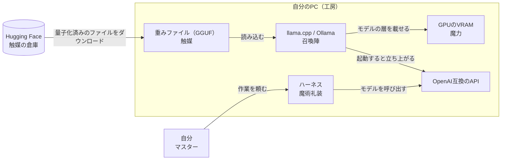
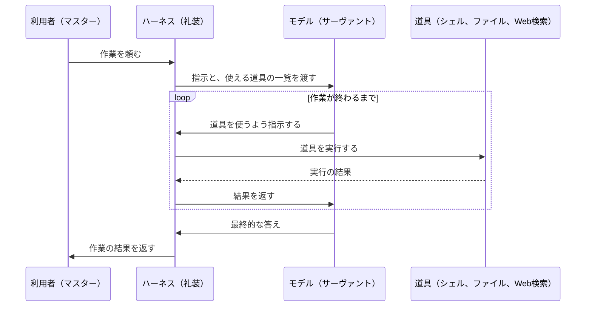

<!-- generated from articles/source/ja/2026-10-12-fate-local-llm.md by scripts/import-articles.ts - do not edit -->

<aside class="callout">

この記事は、友人に「AI界隈やローカルLLMって、どんな感じなの？」と聞かれて話した内容を、記事用に書き直したものです。

</aside>

## はじめに

ローカルLLMの話をすると、「ローカルLLMって実際どうなの」「中国のモデルってどうなの」「それぞれ何が得意なの」と、毎回同じことを聞かれます。いちいち答えるのが面倒になってきたので、まとめて書いておくことにしました。この記事がその答えになります。

ただし、モデルは毎日のように増えていて、各社の方向性や研究の進み方しだいで特徴も変わっていきます。**この記事に書くのは、2026年10月時点の傾向にすぎません**。そのため、個々のモデルではなく、Qwen系列やGemma系列のような系列ごとに整理します。同じ系列のモデルは、世代が変わっても性格が似ていることが多いからです。

[前編](https://akari-iku.github.io/blog/fate-ai-industry/)では、2026年10月時点のAI業界を、Fate作品の聖杯戦争に見立てて整理しました。AGIという聖杯を目指して、AIラボ（マスター）がモデル（サーヴァント）を競わせています。GPU（魔力）はNVIDIA（監督役）が全陣営に売っています。AIラボは、重みを明かさない米国の大手と、重みを公開することが多い中国の各社（東の陣営）に分かれています。

この記事では、その聖杯戦争に、陣営に属さない一般の魔術師として加わる方法を書きます。自分のPCでモデルを動かすローカルLLMは、Fateで言えば自前の召喚です。前編を読んでいなくても、次の対応表があれば読み進められます。

| Fateの用語 | AI業界での対応 |
| --- | --- |
| 聖杯 | AGI |
| マスター | AIラボ（とそのCEO） |
| サーヴァント（英霊） | モデル |
| 現界 | モデルが動いている状態 |
| 霊基 | モデルの中身（重みの数値の精度） |
| 宝具 | モデルの切り札になる能力や仕組み |
| 魔力 | 計算資源（GPU） |
| 令呪 | システムプロンプトと安全制約 |
| 監督役 | NVIDIA |
| 英霊の座 | 学習データ |
| 東の陣営 | 重みを公開していることが多い中国の各社（DeepSeek、Qwen、GLM、Kimiなど） |

## ローカルLLM（自前の召喚）

### APIはモデルを借りること（他人のサーヴァント）

ChatGPTやClaudeをAPIやアプリで使うのは、他のマスターが契約しているサーヴァントに仕事を頼んでいる状態です。

強い。とにかく強い。兆単位のパラメータを持つ英霊が、アプリなら月額数千円、APIなら使った分の従量課金で働いてくれます。

ただし、令呪を持っているのは、モデルを提供するAIラボです。モデルが何に答えて何を断るか、仕様がいつ変わるか、利用者が渡した情報がどう扱われるか。**決定権は提供元にあります**。ある日サーヴァントの性格が変わっていても、利用者は受け入れるしかありません。

### ローカルは自分のPCで動かすこと（自分の工房）

ローカルLLMは、自分の工房（PC）で、自分の魔力（GPU）を使って、自分でサーヴァントを呼びます。

呼べる英霊は、大手陣営の最上位と比べれば、まだ格が落ちます。ただ、その差は年々縮まっていて、ローカルで動くモデルはもう弱い存在ではありません。そして、**令呪は自分の手にあります**。

| | APIで借りる | ローカルで召喚する |
| --- | --- | --- |
| 強さ | 最上位の英霊 | 自分の魔力量で呼べる範囲 |
| 令呪 | 相手のマスターが持つ | 自分が持つ |
| 情報の行き先 | 相手の工房を通る | 自分の工房から出ない |
| 維持費 | アプリは月額、APIは従量課金 | 電気代と初期投資 |
| 仕様変更 | 相手の都合で変わる | 自分が変えるまで変わらない |

### わざわざローカルでモデルを動かす理由（自前で召喚する理由）

性能の上限だけを比べれば、今もAPIのほうが上です。それでもローカルでモデルを動かす理由は4つあります。

- **情報を外に出せない**：社外秘の文書、顧客の個人情報、契約で持ち出しを禁じられたデータ。これらを他人の工房に送ってよいかどうかは、技術の問題である前に統制の問題です。データが自分の工房（PC）から一歩も出ないなら、外部に送ってよいかという議論そのものが要りません。
- **挙動を固定できる**：業務に組み込んだモデルが、提供側の更新で昨日と違う答えを返すようになることがあります。運用する側にとっては普通に事故です。手元の重みは、自分が差し替えるまで一文字も変わりません。
- **正当な仕事でも断られることがある**：フロンティアモデルの安全対策によって、医療やセキュリティのような真っ当な仕事も断られることがあります。令呪が提供元のAIラボの手にある以上、利用者の命令が正当でも、サーヴァントは従わないことがあります。
- **単純に面白い**：自分の機材で英霊が喋り出す瞬間は、何度やっても楽しいものです。

ローカルLLMの需要というと、成人向けの用途を思い浮かべる人も多いと思います。ただ、3つ目の理由で困っているのは、医療やセキュリティのような真っ当な仕事です。この記事を読むような人には記憶に新しいと思いますが、2026年7月、Hugging Faceは自律型のAIエージェントによる侵入を受けました。Hugging Faceは侵入の調査に商用のモデルを使おうとしましたが、提供側の安全対策に拒まれました。Hugging Faceの報告によれば、その安全対策は「インシデント対応者と攻撃者を区別できない」というものでした。そこでHugging Faceは、重みが公開されているGLM-5.2を自社の基盤で動かし、ログの解析を進めました。


<a class="link-card" href="https://huggingface.co/blog/security-incident-july-2026" target="_blank" rel="noopener">

<span class="link-card-body">
<span class="link-card-domain">huggingface.co</span>
<span class="link-card-title">Security incident disclosure — July 2026</span>
</span>
</a>


### ローカルLLM向けの完成品マシン（工房ごと売る店）

キャスターのクラススキルに「陣地作成」があります。自分に有利な魔術工房を作る能力です。ローカルLLMを続けていると、手元のゲーミングPCでは、VRAMやメモリが工房として足りなくなってきます。その需要に応えて、2025年から2026年にかけて、各社がローカルLLM向けの工房を既製品として売り出しました。

NVIDIAは2025年10月に、128GBの統合メモリを積んだ小型機[DGX Spark](https://en.wikipedia.org/wiki/Nvidia_DGX)を発売しました。2,000億パラメータ程度のモデルまで手元で動かせる、とNVIDIAは説明しています。上位機として、748GBのメモリを持つDGX Stationも、PCメーカー経由で売られています。AMDのRyzen AI Max+ 395を積んだ小型PCやノートPCも、128GBの統合メモリを売りにしています。Appleは、最大512GBのメモリを積めるMac Studioを出しています。

統合メモリは、CPUとGPUが同じメモリを共有する仕組みです。メインメモリの大部分をモデルに回せるので、VRAM 8GBでは呼べない英霊も呼べるようになります。ただし、統合メモリの読み書きの速さ（帯域）は、GPU専用のVRAMより遅いことが多いです。英霊を呼べても、動きは遅くなりがちです。

工房の値段は上がっています。2026年はメモリの供給が逼迫していて、NVIDIAはDGX Sparkの希望小売価格を2026年2月に3,999ドルから4,699ドルへ[上げました](https://forums.developer.nvidia.com/t/2-23-2026-price-change-announcement/361713)。2026年10月には、メモリを64GBに減らした版が、4,999ドルからOEM経由で[発売されます](https://blogs.nvidia.com/blog/local-ai-dgx-spark-64gb-sync/)。監督役は魔力に加えて工房まで売り始めましたが、工房の値札はメモリの相場で決まっています。

## ローカルLLMを動かすのに必要なもの

召喚に必要なものは、触媒、魔力、召喚陣の3つです。後の章で書く魔術礼装（ハーネス）まで含めると、全体の流れは次のようになります。



### 重みファイル（触媒）

英霊を呼ぶには、その英霊にゆかりのある聖遺物が要ります。何を触媒にするかで、誰が来るかが決まります。

ローカルLLMでこれにあたるのが、モデルの重みファイルです。英霊の座（学習データ）から呼ばれた英霊の姿を、持ち運べる形に固めたものと考えてください。llama.cppで使うのはGGUFという形式で、Hugging Faceに大量に置いてあります。公式が出していることもあれば、有志が変換して上げてくれていることもあります。

ファイル名にはたいてい、モデル名、パラメータ数、量子化の種類が入っています。`○○-9B-Q4_K_M.gguf` のような形です。この読み方が分かれば、触媒選びの半分は終わっています。

### 手元に入れる前にクラウドで試す（サポート枠）

『Fate/Grand Order』には、ほかのマスターのサーヴァントをサポート枠で借りて、クエストに連れて行ける仕組みがあります。自分で召喚する前に、そのサーヴァントの使い勝手を確かめられます。

重みが公開されたモデルにも、同じ使い方ができます。Cloudflareの[Workers AI](https://developers.cloudflare.com/workers-ai/models/)、Googleの[AI Studio](https://aistudio.google.com/)（Gemma 4の31Bと26B）、Hugging Faceの[Inference Providers](https://huggingface.co/docs/inference-providers)のように、公開モデルをクラウドで動かして試せるサービスがあります。重みを数GBダウンロードする前に、日本語の受け答え、指示への従い方、口調の癖を確かめておけます。私も10月に、Cloudflareが重みを公開した判定モデルClefを、Workers AIから呼び出して試しました。


<a class="link-card" href="https://akari-iku.github.io/blog/clef-decision-models/" target="_blank" rel="noopener">

<span class="link-card-body">
<span class="link-card-domain">akari-iku.github.io</span>
<span class="link-card-title">Cloudflare の判定モデル Clef を Workers AI で触ってみた | akari.log</span>
</span>
</a>


新しいモデルの重みが公開されると、推論サービスや推論エンジンが、公開と同じ日に対応を出すことも増えました。英語では「Day-0 support」（公開初日の対応）と呼ばれます。たとえば推論エンジンのvLLMは、2026年7月27日にKimi K3の重みが公開された日に、[Day-0対応を発表しました](https://vllm.ai/blog/2026-07-27-k3)。複数の推論サービスのモデルをまとめて使える[OpenRouter](https://openrouter.ai/)にも、新しい公開モデルが早い段階で並びます。

サポート枠で癖をつかみ、手元に呼ぶ英霊を決めてから工房に籠ればいいんです。ただし、クラウドで動いている版と手元で使う量子化版は、精度が違うことが多いです。手元で量子化（モデルの数値の精度を落として小さくすること）した版を使うと、受け答えが少し変わることがあります。

### VRAM（魔力量）

マスターの魔力量で、呼べる英霊の格が決まります。ローカルLLMではVRAMがこれにあたります。

私の環境はRTX 5060で、VRAMは8GB（8151 MiB）です。魔術師としては、正直なところ並以下です。それでも呼べる英霊はちゃんといます。

必要なVRAMは、ざっくり次の足し算で見積もれます。

- **重みファイルのサイズ**：ほぼそのままVRAMに載る
- **コンテキストの分**：会話を長く覚えさせるほど増える
- **余白**：OSやブラウザも同じVRAMを使っている

8GBなら、重みファイルは5〜6GBまでが現実的な上限になります。ファイルが8GBぴったりのモデルは、8GBのカードでは全層をGPUに載せられません。ファイルサイズだけを見てVRAMに収まると考えるのは、初心者が最初に踏む罠です。

もう1つの罠は、配布元の「8GBで動く」という表記です。8月にQwen3.8-27Bを試したとき、Unslothの要件表にある数値は、**VRAM単独ではなく、メインメモリとVRAMの合計**でした。この数値を、VRAM 8GBのカード1枚で動くかどうかの答えとして読むと、判断を誤ります。


<a class="link-card" href="https://akari-iku.github.io/blog/qwen38-27b-8gb-vram/" target="_blank" rel="noopener">

<span class="link-card-body">
<span class="link-card-domain">akari-iku.github.io</span>
<span class="link-card-title">VRAM 8GBで27Bを1bitまで潰したら、8Bの4bitに完敗した | akari.log</span>
</span>
</a>


魔力が足りないマスターにも、補う手段はあります。遠坂凛は宝石に魔力を溜めておき、戦いの場で使います。ローカルLLMでも、メインメモリを増設して載らない層をCPU側に回したり、GPUを足してVRAMを増やしたりできます。それでも足りなければ、工房ごと買い替えることになります。

### 量子化（魔力不足での現界）

格の高い英霊を、少ない魔力で無理やり現界させる方法があります。霊基を削って、ステータスを落とすのです。

量子化は、重みの数値の精度を落としてファイルを小さくする技術です。本来16ビットで持っている数値を、4ビットや8ビットに丸めます。ビット数が霊基の大きさで、ビットを減らすほど霊基を削ったことになります。当然、賢さは少し落ちます。筋力AのサーヴァントがBやCで現界するイメージに近いです。

| 量子化 | ランクダウンの程度（目安） | 使いどころ |
| --- | --- | --- |
| Q8 | ほぼ本来のステータス | 魔力に余裕があるとき |
| Q6 / Q5 | 体感ではほとんど分からない | 少し余裕があるとき |
| Q4_K_M | わずかに落ちるが実用十分 | 定番。迷ったらこれ |
| Q3 | 劣化が目につき始める | どうしても載らないとき |
| Q2以下 | 宝具が撃てない | 動かすこと自体が目的のとき |

大事な経験則が1つあります。**小さいモデルを高精度で動かすより、大きいモデルをQ4で動かすほうがたいてい賢い**。 格の高い英霊は、多少ランクダウンしても地力が違います。ただしQ3以下まで落とすと話が変わってくるので、Q4_K_Mを1つの底と考えておくといいでしょう。

目安として、Q4_K_Mのファイルサイズは「パラメータ数（10億単位）× 0.6GB」くらいになります。8Bなら約5GB、12Bなら約7GB。VRAM 8GBで快適に呼べるのは、だいたい9B前後までということになります。

### llama.cpp（召喚陣）

最後に召喚陣。ローカルLLMの実行環境です。

OllamaやLM Studioは、召喚陣があらかじめ描いてあるキットです。手軽で、最初の一体を呼ぶには向いています。VRAMに全層が収まるモデルを使う限り、私もOllamaのままで困ったことはありません。最初はOllamaで始めて、VRAMに載りきらないモデルを動かしたくなったときや、もっと細かく調整したくなったときに、llama.cppに移るのがおすすめです。

llama.cppは、陣を自分で描く道具です。そのぶん、モデルのどの部分をGPUに置いてどの部分をCPUに回すかを細かく決められます。VRAMに載りきらないモデルを動かすとき、この配分の差は速度に出ます。8月の検証では、同じモデルを同じVRAM使用量で動かして、Ollamaの6.30 tok/sがllama.cppでは9.35 tok/sになりました。

基本の詠唱はこれだけです。

```bash
llama-server -hf <ユーザー名>/<リポジトリ名>:Q4_K_M -ngl 99 -c 8192
```

- `-hf`：Hugging Faceから触媒を取ってくる。初回だけダウンロードが走る
- `-ngl`：モデルの層のうち何層をGPUに載せるか。99か `all` と書けば「全部」の意味になる
- `-c`：コンテキスト長。大きくするほどVRAMの使用量が増える

起動すると、ブラウザから開けるチャット画面と、OpenAI互換のAPIが立ち上がります。

最近のllama.cppは、`-ngl` を指定しなければ、VRAMに収まるように載せる層の数を自動で決めます（`--fit` という機能で、既定で有効です）。手動で決めたいときは、`-ngl` の数字を減らします。載らなかった層はCPUとメインメモリで動きます。Fateで言えば、足りない魔力をマスター自身の生命力で補っている状態で、動くには動きますが目に見えて遅くなります。**全層がGPUに載る構成を探すのが、8GB勢の基本戦術になります**。

## ハーネス（魔術礼装）

### ハーネスでモデルにできることが増える（礼装の効果）

『Fate/Grand Order』のマスターは、魔術礼装を身につけて戦います。礼装を着替えると、マスタースキル（マスターが使えるスキル）が変わり、サーヴァントの回復や強化のしかたも変わります。

ローカルLLMでこれにあたるのが、ハーネスです。ハーネスは、モデルの外側で動くプログラムで、モデルにシェルやファイル編集やWeb検索などの道具を渡します。モデルが道具を使うと指示したら、ハーネスがそれを実行して、結果をモデルに返します。この往復を繰り返すことで、モデルは答えを返すだけでなく、自分で作業を進められるようになります。Claude CodeやCodex CLI、OpenCodeは、どれもハーネスの一種です。llama-serverはOpenAI互換のAPIを立ち上げるので、接続先を変えられるハーネスなら、ローカルで呼んだサーヴァントにも礼装を着せられます。



### DeepSeek Harness（東の陣営が配る礼装）

DeepSeekは2026年8月13日に、ハーネスの「[DeepSeek Harness](https://github.com/deepseek-ai/deepseek-harness)」（コマンド名は `dsh`）をMITライセンスで公開しました。モデル、道具、サンドボックス、作業のループまでを、すべてプラグインとして差し替えられる作りになっています。[公式ドキュメント](https://deepseek-harness.github.io/deepseek-harness/en/guide/providers)によれば、接続先は外部のAPIにも、OpenAI互換のAPIを持つ自前のサーバーにも切り替えられます。東の陣営は、英霊の重みだけでなく、英霊に着せる礼装まで配り始めたことになります。ただし、まだ開発者向けのプレビュー版で、READMEには「互換性を壊す変更が入る」と大文字で書かれています。

### ハーネスはモデルに合わせて選ぶ（礼装選び）

良い礼装が無償で手に入るからといって、どのサーヴァントにも同じ礼装を着せればいいわけではありません。モデルによって、学習のときに慣れた道具の呼び出し方や、得意な作業や、推論の長さが違います。ハーネスを選ぶときも、まず呼んだサーヴァントの特徴を知り、その特徴に合う礼装を選びたいところです。

モデルの「得意なこと」として語られるのは、たいてい、ハーネスを使わずにモデル単体で測った素の性能の話です。実際に使ったときの手応えは、次の3つで大きく変わります。

- **応答の好み**：短く的確に答えるか、説明を多めに足すか、思考の過程を見せるか
- **コーディングの指示の出し方**：プロンプトの書き方、テストを先に書かせるかどうか、変更を差分で出させるかどうか
- **ハーネスの設計**：エージェントのループ、道具の呼び出し方、記憶の持たせ方、失敗したときのやり直し方

特にエージェントやコーディングの用途では、モデル単体の差より、ハーネスの設計の差のほうが結果に出やすいです。私の印象では、中国系のモデル（Qwen、DeepSeek、GLM、Kimi）は、素のまま使うより、うまくハーネスに載せたときの伸びしろが大きいです。西側のモデル（Gemma、gpt-oss、Granite、Muse）やMistralは比較的素直に動きますが、これらのモデルもハーネスしだいで手応えが上がります。モデルを選ぶときの決め手は、「このモデルが何を得意とするか」より、「**自分のハーネスと相性がいいか**」になることが多いです。

### 書かせたモデルに採点させない（マスターの仕事）

モデルの特徴を知っておくべき理由は、もう1つあります。LLMは、自分が書いたものを甘く評価しがちです。

Panickssery、Bowman、Fengの2024年の[研究](https://arxiv.org/abs/2404.13076)では、LLMは自分が書いた文章を見分けられ、見分けられるモデルほど自分の文章を高く採点しました。2026年3月のKhullarらの[研究](https://arxiv.org/abs/2603.04582)は、コーディングエージェントで同じ傾向を確かめています。PRを承認するかどうかを判断させるとき、同じ会話の中で自分が行った作業として評価させると、モデルは問題のある変更を見逃しやすくなりました。

コーディングエージェントにコードを書かせたら、**レビューは別のモデルに任せます**。同じモデルを使うなら、少なくとも別のセッションにします。テストのような、モデルの判断に頼らない確認も組み合わせます。自分のサーヴァントの報告だけを信じず、別の目を入れるのは、マスターの仕事です。

## 動かすモデルの選び方（英霊の選び方）

どのモデルを呼ぶかは、メモリ、ライセンス、用途、ハーネスとの相性、量子化版の有無の順に見ていくと決めやすくなります。

### メモリで上限を決める（魔力量）

最初に見るのは、自分のメモリで動かせる大きさです。VRAMの節の目安（Q4_K_Mで、パラメータ数（10億単位）×0.6GB）を使えば、全層がVRAMに載る大きさがわかります。全層が載らなくても、一部の層をメインメモリに置けば動きますが、そのぶん遅くなります。

MoEのモデルは、見積もり方が少し違います。たとえばQwen3.8-Flash-Nextは、総パラメータが125Bあり、Q4の量子化版（UnslothのUD-Q4_K_XL）でも約111GBあります。ただし、1トークンごとに動くのは6Bだけです。専門家の部分をメインメモリに置き、llama.cppの `--n-cpu-moe` のようなオプションでCPU側に回せば、VRAMが少なくても動かせる可能性があります。そのかわり、メインメモリを大量に積む必要があります。VRAMの節に書いた、遠坂凛が宝石に溜めた魔力で補う戦い方に近い召喚です。

動かすための道具も増えています。たとえば2026年9月に公開された[Strata](https://github.com/Niko1221/Strata)は、Qwen3.8-Flash-Nextを、VRAMが12GB以上のGPUと32GB以上のメインメモリで動かすための推論エンジンです。特定のモデルに合わせて作り込んだ道具が出てくると、呼べる英霊の幅が少しずつ広がります。

自分の機材で何が動くかは、ツールでも調べられます。GitHubには、PCのGPUとメモリを調べて、動かせるモデルを提案するOSSがあります。[llmfit](https://github.com/AlexsJones/llmfit)は、量子化の種類ごとに必要なメモリと速度の目安を出し、MoEのモデルにも対応しています。[whichllm](https://github.com/Andyyyy64/whichllm)は、最近のベンチマークの結果をもとに、動かせるモデルを順位づけします。どちらも見積もりなので、最後は自分で動かして確かめます。

### 系列とライセンスを見る（真名）

次に、利用の用途に合わせてライセンスを見ます。個人で試すのか、業務に組み込むのか、サービスとして提供するのかで、確かめるべき条件が変わります。同じ系列でも、モデルの大きさによってライセンスが違うことがあります。2026年10月時点の主な系列は次のとおりです。

| 系列 | 陣営 | ライセンス | 公式 | Hugging Face |
| --- | --- | --- | --- | --- |
| Qwen（Alibaba） | 東 | 27BなどはApache 2.0。最大の2.4TとFlash-Nextは独自ライセンス | [qwen.ai](https://qwen.ai) | [Qwen](https://huggingface.co/Qwen) |
| DeepSeek | 東 | MIT | [deepseek.com](https://www.deepseek.com) | [deepseek-ai](https://huggingface.co/deepseek-ai) |
| GLM（Z.ai） | 東 | GLM-5.3は独自ライセンス。GLM-5.3-Flashと5.2以前はMIT | [z.ai](https://z.ai) | [zai-org](https://huggingface.co/zai-org) |
| Kimi（Moonshot AI） | 東 | Kimi K3は独自ライセンス（K2世代は改変MIT） | [kimi.ai](https://www.kimi.ai/blog/kimi-k3) | [moonshotai](https://huggingface.co/moonshotai) |
| Gemma（Google） | 西 | Apache 2.0（Gemma 4） | [Google DeepMind](https://deepmind.google/models/gemma/) | [google](https://huggingface.co/google) |
| gpt-oss（OpenAI） | 西 | Apache 2.0 | [OpenAI](https://openai.com/index/introducing-gpt-oss/) | [openai](https://huggingface.co/openai) |
| Granite（IBM） | 西 | Apache 2.0 | [IBM](https://www.ibm.com/granite) | [ibm-granite](https://huggingface.co/ibm-granite) |
| Muse（Meta） | 西 | Muse GlimmerはApache 2.0 | [Meta](https://research.meta.ai/blog/introducing-muse-glimmer-open-agentic-model) | [meta-models](https://huggingface.co/meta-models) |
| Mistral | 西（欧州） | Small 4はApache 2.0。Medium 3.5は改変MIT（前月の連結の月収が2,000万ドルを超える企業は使えない） | [mistral.ai](https://mistral.ai/) | [mistralai](https://huggingface.co/mistralai) |

独自ライセンスの多くは、モデルをAPIなどで第三者に提供する事業者や、利用者や売上の多い製品に条件を付けています。Qwen3.8-Flash-Nextのように、規模に関係なく、APIでの提供やAIアシスタント製品への組み込みに別のライセンスを求めるものもあります。個人で手元で動かすぶんには困らないことが多いですが、使う前にHugging Faceのモデルカードとライセンスファイルで確かめてください。

### 用途で決める（英霊の性格）

系列ごとの傾向は次のとおりです。2026年10月時点の私の見立てで、各社の方向性や研究しだいで変わります。

| 系列 | 傾向（得意なこと） | ローカルで動くサイズ |
| --- | --- | --- |
| Qwen | 何でもこなす万能型。中国語と英語に特に強く、同じCJK言語（中国語・日本語・韓国語）の日本語と韓国語もある程度こなす。コーディング、長い文脈、道具の利用、エージェントにも強い | 前の世代に0.6B〜9Bの小型（スマホや軽いPC向け）がある。27B〜32Bは24GB前後のGPUで快適。最新のQwen3.8は27Bから |
| DeepSeek | 推論が得意。段階を追って考えるのが得意で、数学、論理、コーディングに強い | 手元向けは前の世代のR1の蒸留版（1.5B〜14Bは8〜16GB、32Bは24GB前後）。最新のV4.1世代は数百B以上でサーバー級 |
| GLM | コーディング、エージェント、長時間の作業、ソフトウェア開発に強い。効率的なMoE | 最新世代は、小さいGLM-5.3-Flashでも320B（1トークンごとに18B）あり、サーバー級 |
| Kimi | エージェント、長い文脈（最大100万トークン）、長時間のコーディング、知識作業に強い。極端に疎なMoE | K2世代（総1T、1トークンごとに32B）は、大容量のメモリがあれば量子化して動かせる。K3（2.8T）は大規模なクラスタが要る |
| Gemma | 効率重視の小型〜中型。画像や音声も扱え、エージェントと推論も得意。ノートPCやスマホ向き | E2B・E4B（スマホ・ノートPC）、12B、26B（1トークンごとに4B）、31B |
| gpt-oss | 推論、道具の利用、エージェント。推論の深さを調整できる。数学とコーディングにも強い | 20b（16GBのメモリ）、120b（80GB級のGPU1枚）。MoEで、1トークンごとに動く部分が少ない |
| Granite | 企業向け。推論、エージェント、道具の利用、データの統制を重視。考える過程を出すかどうかを切り替えられる | 3B・8B（軽量〜中級）、30B（上位の一般向けGPU） |
| Muse | 手元で動かすエージェント向け。道具の呼び出し、常時動かすエージェント、コーディング、画像の扱い | Muse Glimmer 30B（4ビットで約17〜20GB。24GBのGPUやMacで実用的） |
| Mistral | 効率的な小型モデルと、多言語や画像の扱い。コーディングとエージェントにも対応。欧州の主権を意識した色が強い | 手元向けは前の世代のMinistral（3B・8B・14B）。Small 4（119B）以上は大きなリソースが要る |

### ハーネスとの相性を見る（礼装）

ハーネスの章で書いたとおり、上に挙げた得意なことは、素の性能の話です。実際の手応えは、応答の傾向、指示の出し方、ハーネスの設計で大きく変わります。候補を2つか3つに絞れたら、自分のハーネスに載せて同じ作業をさせ、結果を比べるのが最も確かな選び方です。

### 量子化版がそろっているか（霊基の準備）

公開されたばかりのモデルは、手元ですぐに動かせるとは限りません。推論サービスや推論エンジンの公開初日（Day-0）の対応は、「動かせる」という意味です。手元で使える量子化版（GGUF）がそろうのは、たいてい少し後になります。llama.cppで動かすなら、UnslothのようなGGUFを配っている作者のリポジトリに、目当ての量子化版が並んでからが試しどきです。

### VRAM 8GBで動く実例（呼べる英霊）

私のVRAM 8GBの環境で呼べる英霊の候補を並べます。クラスは私の独断でつけました。VRAMの目安は第三者のまとめサイトの値です。

| クラス | モデル | Q4での必要VRAM（目安） | 特徴 |
| --- | --- | --- | --- |
| セイバー | [Qwen3.5 9B](https://www.mayhemcode.com/2026/06/best-local-llms-for-4gb-6gb-and-8gb.html) | 6GB前後 | 最優のクラス（Fateで最も優れているとされるクラス）らしく、癖がなく何でもこなす。全層がVRAMに収まり、コンテキストにも余裕が残る。迷ったらまずこれ |
| アーチャー | [Granite 4.2 8B](https://bestllmfor.com/meilleur-llm/8gb-vram/)（IBM） | 約4.6GB | クラススキル「単独行動」のとおり、少ない魔力で動く。浮いた分を長いコンテキストに回せる。Apache 2.0 |
| バーサーカー | [Gemma 4 12B](https://bestllmfor.com/meilleur-llm/8gb-vram/)（Google） | 約7GB | 格上だが、重みファイル5〜6GBの上限を超える。コンテキストを短くするか、`-ngl` を減らす必要がある。画像を読ませたいならこれ |
| アサシン | [Bonsai 27B](https://gigazine.net/gsc_news/en/20260721-qwen3-8/) | 約3.9GB | Qwen3.6-27Bを極端に小さくしたという触れ込み。クラススキル「気配遮断」がすぎる。私は未検証で、最初の一体には向かない |

### 実測での失敗例（召喚事故）

Fate作品では、召喚がいつも狙いどおりに成功するとは限りません。『Fate/stay night』の遠坂凛は、セイバーを呼ぶつもりでアーチャーを呼びました。しかもこの召喚で、凛はうっかりを2つ重ねています。

1つ目は時刻です。遠坂邸の時計はすべて1時間進められていて、凛は魔力が最も高まる午前2時に召喚したつもりで、実際には午前1時に儀式を行っていました。2つ目は立ち位置です。マスターは召喚陣の外で詠唱するものなのに、凛は陣の上に立っていました。英霊は、現世の存在がすでにいる場所には現れることができません。そのため、アーチャーは召喚陣ではない別の場所に現れました。

アサシンのBonsai 27Bはまだ試していませんが、27Bを極端に小さく量子化するという同じ発想のモデルは、8月に試しています。UnslothがQwen3.8-27Bの霊基を1ビット級まで削ったUD-IQ1_S（6.19GB）です。重要な層は高いビット数のまま残す方式なので、ファイルサイズから計算した平均は約1.8ビットです。この召喚は事故に終わりました。同じ8GBのVRAMで呼んだ8Bの4ビット量子化版（qwen3:8b）に完敗したのです。

| | Qwen3.8-27B 1ビット級（6.19GB） | qwen3:8b 4ビット（4.9GB） |
| --- | --- | --- |
| うるう年判定の関数 | 700トークンで打ち切り、未完成 | 43トークンで完成 |
| 二分探索の関数 | 700トークンで打ち切り、未完成 | 89トークンで完成 |
| 生成速度 | 31.87 tok/s | 47 tok/s |
| VRAM使用量 | 6974 MiB | 5722 MiB |

1ビット級の27Bは全層がVRAMに載り、速度もそれなりに出ました。それでも、700トークンの上限までに、うるう年の判定を書き終えられませんでした。考える過程が長すぎた可能性もありますが、同じ条件で動かした8Bには及びませんでした。霊基を削りすぎると、気配と一緒に実力まで消えるようです。

日本語の回答が無限ループする事故も起きました。モデルが、夏にも秋にも桜が咲く文章を延々と書き続けたのです。ただしこの事故の原因は霊基を削ったことではなく、`presence_penalty`（同じ語の繰り返しを抑えるパラメータ）を指定し忘れたことでした。Unslothの推奨値である1.5を指定したら、ループは止まりました。**召喚事故のすべてが霊基のせいとは限りません**。凛が召喚陣の上に立っていたのと同じで、呼ぶ側の手順を誤っていることもあります。


<a class="link-card" href="https://akari-iku.github.io/blog/qwen38-27b-8gb-vram/" target="_blank" rel="noopener">

<span class="link-card-body">
<span class="link-card-domain">akari-iku.github.io</span>
<span class="link-card-title">VRAM 8GBで27Bを1bitまで潰したら、8Bの4bitに完敗した | akari.log</span>
</span>
</a>


Bonsai 27Bがこの結果を覆せるかどうかは、自分の手で試すまで判断しないほうがいいでしょう。

### 8GBでは動かないモデル（呼べない英霊）

東の陣営の最上位モデルたちは、8GBではどうやっても呼べません。Qwen3.8の小型版である27Bですら、Q4で16GB前後が要ります。霊基を1ビット級まで削れば8GBに載りますが、その状態の27Bは8Bの4ビット量子化版に勝てませんでした。西側の英霊も同じで、Metaが8月に重みを公開したMuse Glimmerは30Bあり、Q4で18GB前後が要ります。

ただし、手元で呼べない英霊とも、手合わせはできます。クラウドで試す節で書いたように、公開モデルをクラウドで動かせるサービスは各社から出ています。手元に収まらない最上位モデルはクラウドで呼び、手元では自分の魔力量で呼べるモデルを動かせば十分です。自分の環境で動かせるところで、どんどん動かして遊んでみてください。

手元で呼べるモデルも、年々良くなっています。同じ9Bクラスでも、賢さは世代ごとに目に見えて上がっています。**待っていれば、英霊のほうが私たちの魔力量に合わせて小さくなってくれます**。この業界のいちばん良いところだと思います。

<details><summary>余談：Physical AIは選び方の考え方が違う</summary>


ここまでの得意・不得意やハーネスの話は、テキストと画像の世界の話です。ロボットを動かすPhysical AI（身体を持つAI）になると、モデルを選ぶときの考え方がかなり変わります。

- **求められる能力**：長い文脈の理解やコーディングより、カメラの映像を見てすぐに動作へ変える速さ、物理的に正しい動き、安全な動作、遅延の小ささが重要になります。
- **データと評価**：Webの文章を大量に学習するのではなく、ロボットの操作データや、シミュレーション上での強化学習・模倣学習が中心です。評価も、コーディングのベンチマークではなく、作業の成功率や安全性で測ります。
- **モデルの作り**：言語モデルそのものより、映像と言葉から動作を出すVLA（Vision-Language-Action）モデルや、世界の動きを予測する世界モデルが中心になります。

2026年10月時点で名前がよく挙がるモデルを、米国・西側と中国に分けて並べます。版の更新がとても速い分野なので、モデルの名前は、読む時点で古くなっている前提で見てください。

| 陣営 | モデル・系列 | 開発元 | 重みの公開 | 特徴 |
| --- | --- | --- | --- | --- |
| 米国・西側 | [π0.7](https://www.pi.website/)（2026年4月） | Physical Intelligence | 最新版は非公開。π0〜π0.5は[openpi](https://github.com/Physical-Intelligence/openpi)で公開 | 器用な操作と、学習していない技能の組み合わせに強い |
| 米国・西側 | [Isaac GR00T N1.7](https://huggingface.co/nvidia/GR00T-N1.7-3B)（2026年7月に一般提供） | NVIDIA | 公開（NVIDIA Open Model License。商用利用可） | ヒューマノイド向けの3B。NVIDIAのJetsonでの推論を想定している |
| 米国・西側 | [Gemini Robotics 2](https://deepmind.google/blog/gemini-robotics-2-brings-whole-body-intelligence-to-robots/)（2026年7月） | Google DeepMind | 非公開。推論役のER 2はGemini APIで使える。本体は一部の協力企業だけ | 全身の制御と計画、複数のロボットの協調 |
| 米国・西側 | [OpenVLA](https://huggingface.co/openvla/openvla-7b)（2024年6月） | Stanford、UC Berkeleyほか | 公開（MIT。土台はLlama 2） | 7B。研究で比較の基準によく使われる |
| 米国・西側 | [Helix 02](https://www.figure.ai/news/helix-02)（2026年1月） | Figure AI | 非公開 | 自社のヒューマノイドの全身を、1つのシステムで制御する |
| 米国・西側 | [SmolVLA](https://huggingface.co/lerobot/smolvla_base)、[Octo](https://github.com/octo-models/octo) | Hugging Face（LeRobot）、UC Berkeleyほか | 公開（SmolVLAはApache 2.0、OctoはMIT） | 小型で、一般向けのGPUやエッジ機器で動かしやすい |
| 中国 | [Qwen-RobotManip / RobotNav / RobotWorld](https://github.com/QwenLM/Qwen-RobotManip)（2026年6月） | Alibaba（Qwenチーム） | 非公開（公開の予定なし） | 物の操作、移動、世界モデルをそろえた構成。操作のモデルはQwen3.5-4Bが土台 |
| 中国 | [RynnBrain](https://www.alibabacloud.com/blog/alibaba-unveiled-open-sourced-embodied-foundation-model-for-robotics_602898)（2026年2月） | Alibaba DAMO Academy | 公開（Apache 2.0） | Qwen3-VLが土台で、2B〜122B。理解と計画を担う「脳」のモデル |
| 中国 | [Hy-Embodied](https://github.com/Tencent-Hunyuan/Hy-Embodied-0.5-VLA)（2026年6〜7月） | Tencent | 公開（VLA、RxBrain、VLM-1.0はApache 2.0） | 環境の理解、推論、行動の生成を3つのモデルで分担する |
| 中国 | [Genie Envisioner 2.0](https://github.com/AgibotTech/GE-Sim-V2)、GO-2（2026年4月） | AgiBot | Genie Envisionerは公開（独自部分はCC BY-NC-SA 4.0）。GO-2の重みは見当たらない（2026年10月時点） | 実機で集めた大量のデータと、世界モデル・シミュレータ |
| 中国 | [UnifoLM-WLA-1.0](https://github.com/unitreerobotics/unifolm-wla)（2026年9月） | Unitree | 公開（Apache 2.0） | 6B。自社のロボットG1で64の作業をこなす。追加学習用のコードも公開 |
| 中国 | [Xiaomi-Robotics-1](https://github.com/XiaomiRobotics/Xiaomi-Robotics-1)（2026年8月） | Xiaomi | 公開（Apache 2.0） | 5B。Qwen3-VLが土台 |
| 中国 | [InternVLA-A1.5](https://github.com/InternRobotics/InternVLA-A-series)（2026年7月） | 上海AI Lab | 公開（コードと重みともCC BY-NC-SA 4.0） | 理解、未来の予測、行動を1つのモデルにまとめる |
| 中国 | [Seed GR-3](https://seed.bytedance.com/en/direction/robotics)（2025年7月） | ByteDance | 非公開 | 4B。両腕での操作や、布のような柔らかい物の扱い |

並べてみると、言語モデルと似た構図が見えます。米国・西側では最新版を非公開にする会社が多く、重みを公開しているのはNVIDIAなどの一部です。中国では、Tencent、Unitree、Xiaomiのように重みを公開する会社が多く並びます。ただし、AlibabaのQwenチームやByteDanceのように、非公開の会社もあります。Physical AIはまだ標準のベンチマークが固まっていないので、性能の順位は流動的です。

陣営の強さも並び替わります。言語モデルで強い陣営が、そのままロボットでも強いとは限りません。重みが公開されていて手元で動かせることも、ロボットに載せた小さな機器（エッジ機器）で動かす、という別の意味を持つようになります。

ただし、多くのVLAモデルは、言語と画像の理解に強いモデルを土台にしています。そのため、ここまでの話とまったく無関係にはなりません。Physical AIでは、どの土台のモデルを使うかより、どんなデータをどれだけ集め、どんな制御の仕組みに載せるかの比重が、さらに大きくなります。Fateで言えば、英霊の格より、召喚したあとの鍛え方と、戦い方を決めるマスターの采配が物を言う世界です。


</details>

## おわりに

聖杯戦争の見立ては、ローカルLLMの話まで破綻しませんでした。ただ、1つだけ現実がFateと違うところがあります。

『Fate/stay night』の聖杯戦争は、選ばれた七人のマスターだけの儀式です。一般人は巻き込まれることはあっても、参加はできません。

現実は違います。触媒は公開されていて、召喚陣の描き方も公開されていて、8GBの魔力しかない私でも英霊を呼べます。聖杯そのものには手が届かなくても、サーヴァントと契約して、自分の令呪で動かすところまでは誰にでも開かれています。

これは当たり前のことではありません。東の陣営の多くが最上位モデルの重みを公開し続けていること、有志が量子化して配ってくれていること、llama.cppのような召喚陣が無償で整備されていること。そのどれかが止まれば、聖杯戦争は観戦するだけのものに戻ります。触媒の倉庫も、持ち主が変わろうとしています。NVIDIAは2026年9月にHugging Faceの買収で合意し、各国の審査を経て、2027年前半に買収を完了する予定です。NVIDIAは、誰でもモデルやデータセットをアップロード・ダウンロードできる今の運用を続け、ほかのチップメーカーにも対応し続けると約束しています。この約束が買収の後も守られるかどうかは、野良の魔術師こそ見ておいたほうがいいと思います。

性能の上限だけを比べれば、借りたサーヴァントのほうが今はまだ強いです。それでも、モデルに何をさせて何を断らせるか、どの情報を外に出すかを決められるのは、令呪を持っているマスターだけです。強さだけでサーヴァントを選ぶ前に、令呪が誰の手にあるかを確かめてください。

問おう。あなたが、そのモデルのマスターか。

## 参考文献

- [NVIDIA Confirms $12.9B Hugging Face Acquisition（HPCwire）](https://www.hpcwire.com/off-the-wire/nvidia-confirms-12-9b-hugging-face-acquisition/)
- [Zhipu AI releases GLM-5.2（DataNorth）](https://datanorth.ai/news/zhipu-ai-releases-glm-5-2)
- [Security incident disclosure（Hugging Face、2026年7月）](https://huggingface.co/blog/security-incident-july-2026)
- [Alibaba releases Qwen3.8-27B（DataNorth）](https://datanorth.ai/news/alibaba-releases-qwen3-8-27b)
- [Nvidia DGX（Wikipedia）](https://en.wikipedia.org/wiki/Nvidia_DGX)
- [2/23/2026 Price Change Announcement（NVIDIA Developer Forums）](https://forums.developer.nvidia.com/t/2-23-2026-price-change-announcement/361713)
- [DGX Spark 64GB（NVIDIA Blog）](https://blogs.nvidia.com/blog/local-ai-dgx-spark-64gb-sync/)
- [DeepSeek Harness: Configure models（公式ドキュメント）](https://deepseek-harness.github.io/deepseek-harness/en/guide/providers)
- [Best Local LLMs for 4GB, 6GB, and 8GB VRAM in 2026（Mayhemcode）](https://www.mayhemcode.com/2026/06/best-local-llms-for-4gb-6gb-and-8gb.html)
- [Best LLM for 8 GB of VRAM in 2026（bestllmfor）](https://bestllmfor.com/meilleur-llm/8gb-vram/)
- [Qwen3.8の発表とBonsai 27B（GIGAZINE）](https://gigazine.net/gsc_news/en/20260721-qwen3-8/)
- [Kimi K3 Is Here: Efficient Day-0 Support on vLLM（vLLM）](https://vllm.ai/blog/2026-07-27-k3)
- [NVIDIA Form 8-K（2026年9月2日、Hugging Faceの買収契約）](https://www.sec.gov/Archives/edgar/data/0001045810/000104581026000078/nvda-20260902.htm)
- [Qwen3.8-Flash-Next（Hugging Face）](https://huggingface.co/Qwen/Qwen3.8-Flash-Next)
- [Strata（GitHub）](https://github.com/Niko1221/Strata)
- [llmfit（GitHub）](https://github.com/AlexsJones/llmfit)
- [whichllm（GitHub）](https://github.com/Andyyyy64/whichllm)
- [deepseek-ai/deepseek-harness（GitHub）](https://github.com/deepseek-ai/deepseek-harness)
- [The Open-Sourcing of DeepSeek Harness（InfoQ）](https://www.infoq.com/news/2026/08/deep-seek-harness/)
- [LLM Evaluators Recognize and Favor Their Own Generations（arXiv）](https://arxiv.org/abs/2404.13076)
- [Self-Attribution Bias: When AI Monitors Go Easy on Themselves（arXiv）](https://arxiv.org/abs/2603.04582)
- [VRAM 8GBで27Bを1bitまで潰したら、8Bの4bitに完敗した（自サイト）](https://akari-iku.github.io/blog/qwen38-27b-8gb-vram/)
