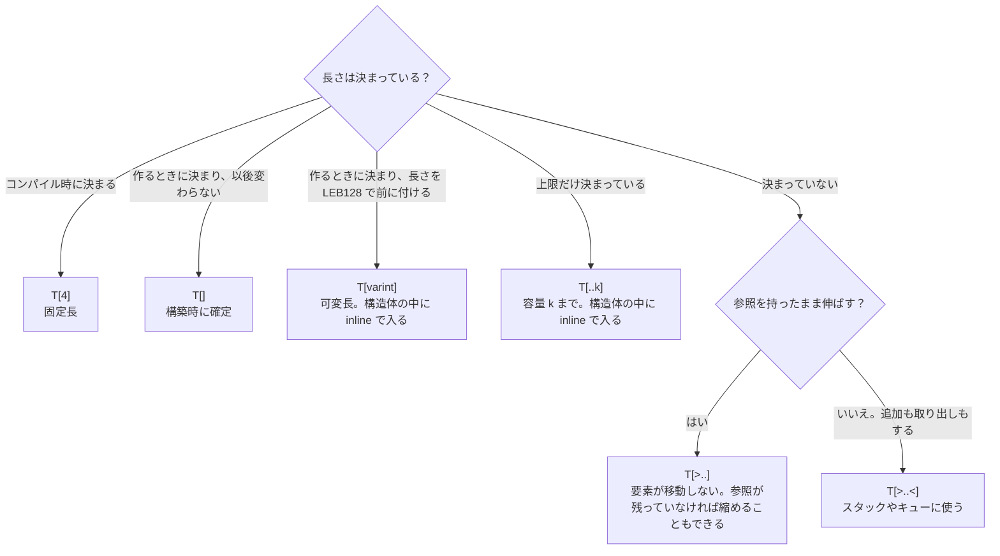
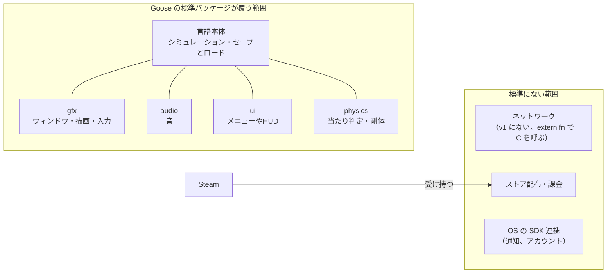

<!-- generated from articles/source/ja/2026-10-29-goose-no-serializer.md by scripts/import-articles.ts - do not edit -->

<aside class="callout">

この記事は実測記録です。2026年10月27日に発表記事で知った言語を、翌日に Windows で動かした結果と、そこから考えたことを書いています。主役は、シリアライザを書かずにセーブデータを保存して読み戻す実験です。速度の数値も載せますが、脇役です。

</aside>

## はじめに

2026年10月27日に、GIGAZINE で Goose というプログラミング言語の記事を見ました。見出しは「メモリ安全で、C++ より速く、メモリも少ない」で、そこまでなら最近よく見る発表です。目が止まったのは、作者の名前と README の一文でした。

作者は [Wouter van Oortmerssen](https://x.com/wvo) さんです。FlatBuffers の作者で、今は自分のゲームスタジオを経営しています。README の「History & Use of AI」には、数年前に Goose を設計して実装を始めたが、ゲーム会社の経営で時間がなくなり、Claude Fable が出て実装できるようになった、とあります。設計は人間、コンパイラの実装とドキュメントは Fable、という分担です。とても現代的ですよね。

FlatBuffers は、バイト列をパース（デコード）せずにそのまま読むためのシリアライズ形式です。JSON のように読むたびにオブジェクトを作り直すのではなく、バイト列の中の相対オフセットをたどって値を直接読みます。

<details><summary>FlatBuffers とは</summary>

2014年に Google が公開したシリアライズ形式で、設計したのが Wouter van Oortmerssen さんです。もともとはゲーム開発のために作られました。

解きたかった問題は、ゲームのアセット（マップ、モデル、設定）の読み込みです。JSON や Protocol Buffers は、ファイルを読んだあとに全体を解析して、メモリ上にオブジェクトを組み立て直します。アセットが大きいと、この組み立てに時間とメモリを使います。

FlatBuffers はこれをやめました。ファイルの中身は、スキーマ（`.fbs` ファイル）から生成したコードが作る1つのバイト列で、値はすべて決まった位置か、その位置からの相対オフセットで見つかります。読む側は、バイト列をメモリに置いたまま、必要な値だけを直接読みます。コピーもアロケーションもありません。ファイルから読んでも、ネットワークから受け取っても、メモリにマップしても、同じバイト列をそのまま使えます。

外から来たバイト列は信用できないので、verifier が「オフセットがすべてバッファの範囲内を指しているか」を検査します。値の中身が正しいかは検査しません。

Google 以外では、Facebook が 2015 年に Android アプリのデータ読み込みに採用した例が知られています。


<a class="link-card" href="https://flatbuffers.dev/" target="_blank" rel="noopener">
<span class="link-card-body">
<span class="link-card-domain">flatbuffers.dev</span>
<span class="link-card-title">FlatBuffers Docs</span>
</span>
</a>


</details>

この形式を作った人が言語を作ったら、言語の中のデータはどうなるのか。気になって触ってみたら、Goose では **「プログラムが計算に使っているメモリ上のバイト列」と「ファイルに書くバイト列」が同じもの** でした。シリアライザが要らないのは、そのためです。セーブデータを書いて読む実験で、それを確かめました。

比べる相手として、同じプログラムを Rust と C++ でも書きました。Goose の構文がどの言語から来ているか、シリアライザを書かずに済むとは何が減ることなのか、を並べて見るためです。

先に、この記事の範囲を書いておきます。触ったのは1日で、バージョンは v2026.3 です。

## Goose とは

公式ページの説明を、短くまとめておきます（2026年10月28日時点）。


<a class="link-card" href="https://aardappel.github.io/goose/" target="_blank" rel="noopener">
<span class="link-card-body">
<span class="link-card-domain">aardappel.github.io</span>
<span class="link-card-title">The Goose Programming Language · Goose</span>
</span>
</a>


Goose はシステムプログラミング向けの言語です。**メモリ安全性を保ちながら、ヒープアロケーター、ガベージコレクター、参照カウント、デストラクタ、ライフタイム注釈のどれも持ちません**。動的な値はすべて、コンパイラが管理するデータスタックの上に inline で置かれ、スコープを抜けた時点で解放されます。コンパイラは C++ で書かれていて、出力は1つの C ファイルです。ライセンスは Apache-2.0 で、リポジトリは下記です。


<a class="link-card" href="https://github.com/aardappel/goose" target="_blank" rel="noopener">

<span class="link-card-body">
<span class="link-card-domain">github.com</span>
<span class="link-card-title">GitHub - aardappel/goose: The Goose Programming Language</span>
</span>
</a>


公式ページの数値は、自分たちのベンチマーク16本をまとめた値（幾何平均）です。速度は、普通に書いた C++ の 3.51 倍、手で最適化した C++ の 1.24 倍、unsafe を使わない Rust の 1.13 倍。ピークメモリは、それぞれ 1.95 倍、1.32 倍、1.25 倍少ないとしています。負けるケースも同じページに載っています。なお、GIGAZINE の記事にある 3.3 倍と 1.12 倍は、公式ページの現在の値とは違います。この記事では公式ページの値を使います。

作者の経歴をまとめておきます。1990年代に Amiga E という言語を作り、Cube と Sauerbraten というオープンソースの FPS エンジンを作り、Google で FlatBuffers を作り、自分のゲーム用に Lobster という言語を作りました。README によると、今のスタジオ（VoxRay Games）は Lobster の上に成り立っています。ずっと **ゲームを速く動かすためのデータの置き方を追い続けている人** です。Goose の設計は数年前に済んでいて、AI 向けに設計したものではないそうです。

この記事で実験することは3つです。1つ目は、「ライフタイムの注釈を書かなくても、メモリ安全性が保たれる」という公式の説明を、他の言語ならメモリを壊すコードを書いて、コンパイルエラーになるかで試します。2つ目は、タイトルの問いです。ゲームのセーブデータを、シリアライザを書かずにファイルへ書いて読み戻し、壊したファイルも読ませます。3つ目は、「普通に書いた C++ の 3.51 倍速い」という公式の数値について、同じベンチマークは手元にないので、自分で書いたプログラムで Rust と C++ と比べます。2つ目と3つ目の間に、その3言語のプログラムを並べて構文を比べる節を挟みます。

## 環境と手順

実行環境は次のとおりです。実行日は 2026年10月28日です。

| 項目 | 値 |
| --- | --- |
| OS | Windows 11 |
| Goose | v2026.3（2026-10-21 リリース）の Windows x64 ビルド済みバイナリ。`goose version` は `goose runtime 4d3da949e563` |
| C コンパイラ | MSVC 19.44（Visual Studio 2022 Build Tools） |
| Rust | rustc 1.99.1 |
| CPU / メモリ | AMD Ryzen 7 5700X / 32 GB |

GitHub Releases の zip を展開するだけで、`goose file.goose` でプログラムをその場で実行できました。同梱の TinyCC が、生成した C をプロセスの中でコンパイルして実行します。Windows では追加のツールは要りません。実行ファイルを作る `goose build` には C コンパイラが要ります。`goose toolchain` というコマンドが、PATH に `cl` がない状態でも Visual Studio Build Tools の MSVC を見つけてくれました。

```bash
goose samples/01_tour.goose
goose build samples/01_tour.goose
```

速度の計測は、`goose build`（-O2）、`cargo build --release`、`cl /O2` で作った実行ファイルを、Python からプロセスごと起動して壁時計時間とピークワーキングセットを取りました。各入力を10回（大きい入力は5回）実行し、表には最良値を載せています。起動時間を含むので、小さい入力の数値は比較に使えません。

同梱の `samples/` には31本のプログラムがあり、`docs/` にはチュートリアル、仕様書、リファレンス、設計メモが入っています。この記事で「設計文書」と書いているのは、`docs/design/` の中のファイルです。

この記事で書いたコードと実行結果は、次のリポジトリに置いておきます。


<a class="link-card" href="https://github.com/akari-iku/goose-playground" target="_blank" rel="noopener">

<span class="link-card-body">
<span class="link-card-domain">github.com</span>
<span class="link-card-title">akari-iku/goose-playground</span>
</span>
</a>


## まず、わざとエラーを出してみる

1つ目の実験です。「ライフタイムの注釈を書かなくても、メモリ安全性が保たれる」という説明を確かめます。どこでコンパイラが止めてくれるのかを見るために、言語の説明を読む前に、コンパイルエラーになるはずのコードをわざと書いてみました。最初は、ローカルの配列への参照を返す関数です。

```goose
fn make() -> i64& {
    var xs: i64[>..] = [];
    xs.push(1);
    return xs[0];
}
```

`i64[>..]` は、要素が移動しないことを保証する配列の型です。末尾に追加しても既存の要素の場所が変わらないので、参照が無効になりません（配列の種類は、セーブデータの節の前に整理します）。コンパイルすると、次のエラーが出ました。

```
01_dangling_return.goose:8: error: returning a reference rooted in xs, which dies with this function (§9.2)
    return xs[0];
```

行番号は実験ファイルのもので、掲載したコードは抜粋です。**エラーメッセージが、参照の root（寿命を決める変数、ここでは `xs`）を名指しして、仕様書の節番号を添えています**。`docs/goose_spec.md` の §9.2 には、参照には必ず root があり、参照を返したり保存したりできるのは、root が保存先より長く生きるときだけ、という規則が書いてあります。`xs` は関数と一緒に消えるので、返せません。

もう1つ試しました。配列の一部を指す参照（スライス）`w` をあとで使うのに、その前に元の配列を空にする例です。

```goose
var line: u8[>..] = [];
line.append("hello world");
let w = line[..5];
line.clear();
print(w);
```

```
02_clear_while_sliced.goose:8: error: cannot clear line while w is still used: it may hold a reference or slice into it (§5.1)
```

`w` の最後の使用が `clear()` より後にあることまで見ています。`print(w)` を `clear()` の前に動かすと通ります。

逆に、通ってほしいものも確かめました。配列の要素への参照を取ったあと、配列を伸ばし続けても、その参照がまだ使えるか、です。参照を取ってから10万回 push して、最初の参照に書き込んでみました。`Item` は id と weight を持つ構造体です。Goose の `=` はコピーで、参照を持つには `.=` を使います。Rust なら、`first` を持ったまま `items.push` するとコンパイルエラーになる書き方です。

```goose
var items: Item[>..] = [];
let first .= items.push(Item { 1, 0.5 });
for i in 2..100001 { items.push(Item { i as i32, i * 0.5 }); }
first.weight = 99.5;
print(items.len, " items, first weight ", items[0].weight);
```

```
100000 items, first weight 99.5
```

`[>..]` の配列は要素を移動しないので、**`push` が返した参照はそのまま有効** です。移動しないのは、伸びる配列が1本ずつ専用のデータスタック（あらかじめ予約したアドレス範囲）に置かれ、末尾に積むだけで伸びるからです。`std::vector` や `Vec` は、容量が足りなくなると要素を別の領域にまとめてコピーするので、古い領域を指していた参照は使えなくなります。Goose の `[>..]` ではそれが起きません。

公式ページが制限事項として認めている穴も再現しました。`reusable` と宣言したプールはスロットを再利用するので、解放済みのスロットへの参照を持ち続けると、そのスロットにあとから入った別の値が読めます。

```goose
reusable var pool: Item[>..] = [];
let stale: Item& = pool.alloc_ref(Item { 10, 1.0 });
pool.free(pool.index_of(stale));
let next: Item& = pool.alloc_ref(Item { 12, 2.0 });
print(stale.id);   // 12
```

型に `Item&` と書いた変数は、`=` でも参照として束縛されます。コンパイルは通り、`stale.id` は 12 でした。公式はこれを「型は合っているのでメモリ破壊ではなく、論理バグ」と説明しています。その説明のとおりでした。

ここで見た「要素が移動しない配列」と「参照の root」が、次の実験でセーブデータの木を相対オフセットで持てる前提になります。

## セーブデータを書いて、読んで、壊す

2つ目の実験で、タイトルの問いに答えます。作者はゲーム開発者で、公式のパッケージ（gfx、audio、ui、physics）もゲーム向けなので、題材はゲームのセーブデータにしました。セーブデータは「書いて、読んで、たどる」というゲームのデータの典型で、固定サイズの値、可変サイズの値、木構造の3つがそろいます。Goose でファイルに書いて読み戻し、同じことを C++ で、手書きのシリアライザで書いて比べました。

Rust は比べていません。serde を使えばシリアライザは書かずに済みますが、読んだあとにオブジェクトを作り直す点は C++ と同じです。Rust の rkyv は相対ポインタと検証器で Goose と同じ形式をライブラリとして実現していますが、読み込んだ値は専用の Archived 型で、普通の値のまま push や書き換えはできません。この違いは、あとの「FlatBuffers と Goose の対応」で触れます。

データは3種類です。プレイヤー、持ち物、そしてクエスト（ゲーム内の課題）です。クエストは、大きな目標の下に小さな手順がぶら下がる親子関係を持つので、木構造にしました。たとえば「村の池を守る」の下に「葦を集める」、さらにその下に「鎌を探す」、という形です。Goose はガチョウなので、題材は池にしました。

### 先に、配列の型名

セーブデータの構造体を読む前に、配列の型名を整理しておきます。Goose 独自の部分です。配列の型名は、長さの決まり方と伸び方の組み合わせで8種類あります。代表的な6種類を図にします。「この値がどう伸びて、どこに置かれるか」を型で宣言する、と考えると読めます。



このほかに、配列の一部を指す参照であるスライス `T[:]` があります（1つ目の実験の `line[..5]` がそれです）。**Rust では参照どうしの寿命の関係を注釈で書きます。Goose では、値の置き場所と伸び方を配列の種類として型に書き、寿命はコンパイラが root から推論します**。

### 3種類のデータ

```goose
struct Vec2 { x: f32, y: f32 }
struct Player { name: u8[..16], hp: i32, gold: i32, pos: Vec2 }

struct Item { name: u8[varint], qty: varint, cents: varint }

struct Quest {
    id: u32,
    title: u8[..24],
    done: bool = false,
    first_child: Quest&<u32>?,
    next: Quest&<u32>?,
}
```

`Player` は固定サイズです。名前は容量16の inline 配列なので、`Player` は1つの平らな値で、`Player` の配列は添字で引けます。

`Item` は可変サイズです。名前は必要なバイト数だけ持ち、数値は LEB128（小さい値ほど短くなる整数の表現）で持ちます。

`Quest` は木です。`first_child` と `next` の型 `Quest&<u32>?` は「同じ配列の中の別の要素への、4バイトの相対オフセット」です。格納される値は、参照先のアドレスからこのフィールド自身のアドレスを引いた差です。ポインタ（メモリ上の絶対アドレス）は1つもありません。ポインタをファイルに書くと、次に実行したときには別の場所を指してしまいますが、相対オフセットは配列ごと別の場所に置いても同じ要素を指します。

保存は、3つの配列を順にバイト列に追記するだけです。

```goose
var file: u8[>..] = [];
file.append("GSAV");
players.to_bytes(file);
bag.to_bytes(file);
quests.to_bytes(file);
write_file(path, file);
```

`to_bytes` は、配列がメモリ上で占めているバイト列を、長さの前置きつきで追記します。**シリアライザを書く必要がありません**。理由は3つです。メモリ上の配列にポインタが1つもないこと、木のリンクが相対オフセットであること、そのリンクを張れるのが要素の移動しない `[>..]` の配列の中だけであること（1つ目の実験で見た性質）です。この3つがそろっているので、バイト列をそのまま別の場所に置いても意味が変わりません。これがタイトルの問いへの答えです。

読み戻しは `from_bytes` です。`image` は、ファイルから切り出した Quest セクションのバイト列です。ファイルから来たバイト列は、コンパイラが組み立てた値のようには信用できないので、読む前に検証します。

```goose
var lq, ok = from_bytes<Quest[>..]>(image);
```

検証に通ると、普通の配列が返ってきます。**ファイルから読んだデータと、プログラムが使うデータの区別がありません**。読み戻した `lq` に新しいクエストを push することも、相対オフセットで子をたどることもできました。C++ でこれをやるには、ファイルを読んだあとに `std::vector<Quest>` を組み立て直す処理が要ります。Goose では、その処理がありません。

### サイズ

C++ 版は、`std::string` と `std::vector` を使う一般的な書き方にしました。C と同じ平らな構造体（`char title[24]` と添字）で書けば C++ でもファイルにそのまま書けますが、添字の範囲検査と「リンクが同じ配列の中を指している」ことの保証は手書きになります。この記事では、添字の範囲検査とリンク先の配列の検査を誰が書くか、という点で比べます。Goose ではコンパイラと `from_bytes` が行います。

Goose では、メモリ上のサイズがそのままファイル上のサイズです。C++ 版はメモリ上の値とファイルの形が別なので、表はメモリ上のサイズで比べます。

| データ | Goose（メモリ上＝ファイル上） | C++ メモリ上（MSVC） |
| --- | --- | --- |
| Player 1件 | 33 バイト | 48 バイト。名前が16文字以上なら、別途ヒープに領域を確保する |
| Item 3件 | 35 バイト | 144 バイト |
| Quest 1件 | 38 バイト | 72 バイト。子の配列と長いタイトルは別途ヒープに確保（7件で5回） |

Goose の構造体は、フィールドを宣言順に詰めて置きます。C++ のコンパイラが入れるアライメント用の空きバイトもありません。アラインされていない読み書きは安価とみなす設計で、必要なら `pad` を自分で書きます（仕様書 §3.2）。`Quest` の 38 バイトは、id 4、title 1 + 24、done 1、リンク 4 × 2 です。

ファイル全体は Goose が 375 バイト、C++ が 369 バイトでほぼ同じです。C++ はメモリ上の値を詰め直してファイルに書くので、ファイルは 369 バイトですが、メモリ上では大きくなります。Goose はメモリ上も 375 バイトのままです。

### 書いた量

シリアライザは、Goose では書いていません。`to_bytes` の呼び出しが1行ずつあるだけです。C++ では Writer と Reader、型ごとの write と read で 78 行書きました。読み込み時の検証も、Goose では `from_bytes` が組み込みで行い、C++ では長さのチェックと、子の添字が範囲内かの検査を手書きしました。Goose 側で自分で書いたのは、セクションの区切りを読む8行だけです。長さの前置きを読んで、その分だけ切り出す処理です。

### ファイルの中身

Goose が書いた `save.gsav` の先頭です。

```
00000000: 4753 4156 4203 6775 7300 0000 0000 0000  GSAVB.gus.......
00000010: 0000 0000 0000 4600 0000 e204 0000 0000  ......F.........
00000020: 4841 0000 40c0 076d 616c 6c61 7264 0000  HA..@..mallard..
```

`47 53 41 56` は自分で書いたタグ "GSAV" です。`42` は LEB128 の 66 で、Player セクションの本体が 66 バイトあることを表します。`03 67 75 73` は名前で、長さ 3 と "gus"、残り13バイトは未使用です。`46 00 00 00` は hp = 70、`e2 04 00 00` は gold = 1250、続く8バイトは pos の f32 が2つです。`07 6d 61 6c 6c 61 72 64` から2人目の "mallard" が始まります。

ここに並んでいるのは、プログラムが計算に使っていたメモリ上のバイト列そのものです。設計文書（`docs/design/serialization.md`）の言葉では、Goose のデータは「それ自体がシリアライズ済みの形」です。保存では要素の領域をそのまま書き出し、読み込みではそのまま読み込みます。読み込んだあとにポインタを書き換える処理はありません。

### 壊したファイルを読ませる

セーブデータは、ディスクの故障や改造ツールで壊れることがあります。`from_bytes` の検証が何を拒否して何を通すのか、境目を見るために、ファイルを4通りに壊して読ませました。

| 操作 | Goose `from_bytes` | C++ 手書き Reader |
| --- | --- | --- |
| リンク（相対オフセット）の1バイトを反転 | 拒否 | 拒否（添字の範囲検査を書いたので） |
| データ（done フラグ）の1バイトを書き換え | 受理。木の根のクエストの done が true になる | 受理 |
| 末尾を1バイト切る | 拒否 | 拒否 |
| Item セクションのバイト列を Quest として読む | 拒否 | 未実施 |

設計文書は、この線引きをはっきり書いています。**`from_bytes` が検証するのは安全性であって、整合性ではありません**。壊れたリンクは「配列の外のメモリを指す参照」になり得るので拒否します。数値が壊れていても、リンクがすべて配列の中を指していれば、木としてはたどれるので受理します。値の正しさは `from_bytes` では確かめません。確かめるにはチェックサムを使う、と設計文書は書いています。チェックサムは、データ全体から計算する検査用の値で、1バイトでも変わると値が変わります。

FlatBuffers の verifier も同じです。オフセットがバッファの範囲内を指しているかだけを確かめ、中の値が正しいかは見ません。

C++ 側で同じ安全性を得るには、Reader に長さのチェックを入れ、読み終わったあとに添字の範囲を検査する必要があります。どちらも書き忘れると、壊れたファイルは範囲外アクセスになります。

### 1番 Goose らしいエラー

この実験で1番印象に残ったのは、動いた結果ではなく、途中で出たコンパイルエラーです。最初、クエストの木に子を足す関数を、親を参照で受け取る形で書きました。

```goose
fn add_child(pool: Quest[>..]&, parent: Quest&, ...) {
    let node .= pool.push(Quest { ... });
    ...
    cur.next .= node;   // cur は parent からたどった参照
}
```

```
error: a relative reference must point within the same root as its location (§3.9); this reference is rooted at pool
```

相対オフセットは「同じ配列の中」でしか意味を持ちません。そのため、リンクを張る2つの参照が同じ配列から来ていることを、コンパイラが静的に確認します。`parent` を `Quest&` で受け取ると、その参照がどの配列に根ざしているかコンパイラには見えません。直し方は、親を添字（`i64`）で受け取り、関数の中で `pool[parent_at]` と解決することでした。

```goose
fn add_child(pool: Quest[>..]&, parent_at: i64, ...) -> i64 {
    let node .= pool.push(Quest { ... });
    let parent .= pool[parent_at];
    ...
}
```

「ポインタではなく添字で持つ」は、ゲーム開発系の C++ ではよくやることかと思います。**Goose では、それをコンパイラが要求してきます**。

もう1つあります。相対参照を含む配列は、値としてコピーできません。配列全体を同じ並びのままファイルへ書くのとは違い、一部の値だけを別の場所へコピーすると、相対オフセットの指す先がずれるためです。失敗時に空の配列を返そうとして `var empty: T = []; return empty, false;` と書いたら、`copying a value of type Quest[>..], which contains self-relative references, is not supported; construct it in place` と言われました。`return from_bytes<T>("");` と書くと、空のバイト列から「空の配列と false」をその場で構築して返せます。

## FlatBuffers と Goose の対応

タイトルの問いへの答えは、セーブデータの節で見たとおりです。ここでは、その仕組みが FlatBuffers のどの部分にあたるかを並べます。

| FlatBuffers | Goose |
| --- | --- |
| バッファ内の相対オフセット | `Quest&<u32>` のような相対参照。格納値は「target − フィールド自身のアドレス」で、両端が一緒に動くので位置独立 |
| ネストした文字列や配列を inline で持つ | `u8[..16]` や `u8[varint]` が構造体の中に inline で入る |
| 読み込み時に verifier を通す | `from_bytes` が同じ線引き（安全性のみ）で検証する |
| バッファをそのまま write | 「Goose のデータはそれ自体がシリアライズ済みの形」 |
| スキーマにフィールドを足しても古いバッファを読める | 未確認。`from_bytes` は型のバイト配置で検証するので、構造体を変えると古いファイルは拒否されると読めるが、試していない |
| 他の言語から同じバッファを読める | 未確認。バイト配置は仕様書の付録にあるので読む側を書くことはできるが、生成コードはない |

違いは2つです。FlatBuffers はスキーマ言語とコード生成を必要とし、基本は読み取り専用です。Rust の rkyv も、読み込んだ値は専用の型です。**Goose では、言語の普通の値が可変のまま同じ性質を持ちます**。`var quests: Quest[>..]` と宣言した配列に push して、参照で書き換えて、そのままファイルに書けます。

その代償が、配列の種類を型で宣言することです。要素が移動しない配列（`[>..]`）だからこそ、相対オフセットが壊れません。公式ページも、制限事項の先頭に「データがどこにあり誰が所有するかを考える必要がある」と挙げています。

### data-oriented design との対応

ゲーム業界で独自エンジンを作る人たちがたどり着いた設計の考え方を、data-oriented design と呼びます。Insomniac Games の Mike Acton さんの CppCon 2014 の講演で広まり、Unity は DOTS としてエンジンに取り込み、Richard Fabian さんが本にまとめています。


<a class="link-card" href="https://www.youtube.com/watch?v=rX0ItVEVjHc" target="_blank" rel="noopener">
<span class="link-card-body">
<span class="link-card-domain">www.youtube.com</span>
<span class="link-card-title">https://www.youtube.com/watch?v=rX0ItVEVjHc</span>
</span>
</a>


<a class="link-card" href="https://unity.com/dots" target="_blank" rel="noopener">

<span class="link-card-body">
<span class="link-card-domain">unity.com</span>
<span class="link-card-title">DOTS - Unity’s Data-Oriented Technology Stack</span>
</span>
</a>


<a class="link-card" href="https://www.dataorienteddesign.com/dodbook/" target="_blank" rel="noopener">
<span class="link-card-body">
<span class="link-card-domain">www.dataorienteddesign.com</span>
<span class="link-card-title">Data-Oriented Design</span>
</span>
</a>


要素は4つです。

1. オブジェクトをポインタでつながず、配列に連続で並べる
2. ポインタの代わりに、添字やハンドルで参照する
3. 構造体の配列ではなく、フィールドごとの配列（SoA）にする
4. アセットはロード時に組み立て直さず、ファイルの形のままメモリに置く

Goose は、このうち1、2、4を言語機能にしています。3については `docs/design/soa.md` に「SoA を配列の種類として足す」という未実装の提案があります。

## 同じプログラムを3言語で書く

ここからはタイトルの問いを離れて、Goose の書き心地を見ます。構文がどこから来ているかを見るために、L-system で SVG を書き出すプログラムを Goose、Rust、C++ で書きました。L-system は、文字列の書き換え規則で図形を作る仕組みです。規則を何回か適用して長い文字列を作り、その1文字ずつを「前に進む」「曲がる」の命令として読んで線を引くと、植物や曲線になります。

関数の分け方と出力の形式をそろえたので、4つのプリセットすべてで、3言語の出力がバイト単位で一致しました。

| プリセット | 深さ | 線分数 | SVG のサイズ |
| --- | --- | --- | --- |
| plant（植物） | 6 | 6,048 | 182,943 バイト |
| koch（コッホ曲線） | 4 | 625 | 17,517 バイト |
| dragon（ドラゴン曲線） | 12 | 4,096 | 112,031 バイト |
| sierpinski（シェルピンスキー） | 6 | 2,187 | 68,397 バイト |

plant を深さ5で描いたものです（線分 1,488 本）。


4つのプリセットの SVG は、リポジトリの `notes/images/` に置いてあります。

### 骨格は Rust、細部はいろいろな言語から

関数定義は `fn rewrite(src: const u8[:], out: u8[>..]&)` と書きます。Rust の `fn rewrite(src: &[u8], out: &mut Vec<u8>)` とほぼ同じ形で、`const` の位置だけ C++ です。`match`、`if` が式であること、`as`、`::` も Rust のままです。

違うのは参照の渡し方です。Goose では、書き換えてもらう配列を渡すときに、呼び出し側は `rewrite(cur, next)` とそのまま書きます。Rust のように `&mut next` と書く必要はありません。これは C++ の参照と同じです。参照を変数に束縛するときは `let first .= items.push(...)` と `.=` を使い、`=` は左辺の型が参照型でなければコピー、`.==` は同じ対象を指しているかの判定です。この3つの区別は Goose 独自です。

ほかの言語から来ている書き方もあります。複数の戻り値 `-> f64, f64` と `let depth, ok = parse_int(s)` は Go の多値返却、`Preset?` と `guard ... else` は Swift と Kotlin、末尾から数える添字 `xs[^2..]` は C# の形です。

文字列型はありません。u8（1バイトの整数）の配列なら、どの種類でも文字列として使います。伸ばすなら `u8[>..]`、構造体の中なら `u8[..16]` や `u8[varint]` です。`"hello"` のようなリテラルは読み取り専用のスライス `const u8[:]` で、どの種類の配列にもコピーできます。C の `char*` に近い感覚です。

配列の型名は、セーブデータの節で整理したとおりです。構造体の中に `to: u8[..32]` と書くと、容量32の配列が構造体の中に inline で入ります。C の `char to[32]` に近いですが、長さを持っています。

### Rust と Goose の両方を書く人が踏む罠

`for &x in xs` の意味が、Rust と Goose で逆です。

| 書き方 | Goose | Rust |
| --- | --- | --- |
| `for x in xs` | 要素のコピーで回す | `xs` がスライスや `&Vec<T>` なら `&T`、`Vec<T>` そのものなら所有権を移して `T` |
| `for &x in xs` | 要素への参照で回す。`x` に書き込むと元の配列が変わる | 参照をはがして、値で回す |

**記号が同じで意味が逆です**。Goose の `&` は、引数の型 `out: T&` でも束縛の `let r .= ...` でも、一貫して「この名前は参照である」という宣言です。C++ の `for (auto& x : xs)` と同じ読み方をすれば合います。

書いている途中で踏んだ構文エラーは3つで、どれもエラーメッセージだけで直せました。

<details><summary>踏んだ構文エラー3つ</summary>

- `match` の腕に文を書くには `{}` が必須。`'+' => t.heading += p.angle,` は構文エラー
- `pad` は構造体のパディング用のキーワードで、変数名に使えない
- `for depth { ... }` は書けず、`for _ in depth { ... }` と書く

</details>

## 速度も測った

3つ目の実験です。「普通に書いた C++ の 3.51 倍速い」という公式の数値を、自分のプログラムで見ます。公式と同じベンチマークは手元にないので、L-system のプログラムで Rust と C++ と比べました。計測条件は「環境と手順」のとおりです。

最初に測ったとき、plant depth 10 で Goose は C++ の8倍速く見えました。ただし、**この差はメモリ管理の差ではありません**。この入力の出力は 55 MB の SVG で、処理のほとんどは `f64` を小数2桁の文字列にする部分です。差がついたのは、Goose の `format_flt`、Rust の `{:.2}`、MSVC の `snprintf("%.2f")` の速さでした。

そこで、C++ と Rust にも、Goose の `format_flt` と同じ「100倍して四捨五入し、桁を1文字ずつ書く」フォーマッタを手書きして測り直しました。この丸め方は `%.2f` の丸め方（2進数の真の値に最も近い10進数を選ぶ）と一般には一致しませんが、この4プリセットの入力では出力が3言語でバイト単位で一致しました。C++ なら標準の `std::to_chars` を使う手もありますが、Goose と同じ処理に合わせるために手書きにしています。

各セルは「壁時計時間 / ピークワーキングセット」です。

| 入力 | Goose | Rust 標準 | Rust 手書き | C++ 標準 | C++ 手書き |
| --- | --- | --- | --- | --- | --- |
| plant depth 8 | 17 ms / 11 MB | 39 ms / 16 MB | 19 ms / 15 MB | 98 ms / 14 MB | 25 ms / 13 MB |
| plant depth 10 | 167 ms / 113 MB | 520 ms / 162 MB | 205 ms / 161 MB | 1459 ms / 141 MB | 298 ms / 141 MB |

**差は 8 倍から 1.8 倍に縮みました**。Rust との差は 1.2 倍です。残った差が何によるものかは、この記事では追っていません。数値を引用するなら「手書き」の列です。公式の 3.51 倍という数値そのものは、この記事では確かめられていません。確かめられたのは、「自分で書いた1本のプログラムでは、文字列化の差を除くと C++ の 1.8 倍、Rust の 1.2 倍だった」ことまでです。

## 誰向けの言語か

Goose が諦めているものを、公式ページの制限事項から拾います。

- 関数の外へ持ち出せるクロージャ（escaping closure）がない。TypeScript でいう、`setTimeout` や `addEventListener` にコールバックを渡して後で呼んでもらう書き方ができない
- 関数ポインタがない。関数を変数に入れて持ち回れない
- 動的ディスパッチは、enum のタグで分岐する `match` だけ。インターフェイスに対して実装を差し替える書き方がない
- プログラム全体を一度にコンパイルする。プラグインを後から読み込めない
- 標準ライブラリに、ネットワークとサブプロセスがない（v1 の範囲外。必要なら `extern fn` で C を呼ぶ）

<details><summary>そのほかの制限</summary>

- 再帰関数は、伸びる配列を再帰呼び出しをまたいで保持できない
- 可変サイズの要素を持つ配列は、添字で引けない（先頭から順にたどる）
- 正規表現は ASCII のみ
- WebAssembly は設計メモの段階で未実装

</details>

この制限を、ゲームとビジネス系で分けて読むと、向き不向きがはっきりします。

| | ビジネス系・便利系 | ゲーム |
| --- | --- | --- |
| 時間の制約 | 要求ごとの応答時間。平均で良い | 16.6 ms（60 fps の1フレーム）の中に全部収める |
| メモリの制約 | 足せる | 上限が固定 |
| 困るもの | 仕様変更、外部連携、例外的な入力 | GC の停止、断片化、キャッシュミス |
| 欲しいもの | 変更しやすさ、プラグイン構造 | 毎フレーム同じ時間で終わること、連続したデータ |

Goose が諦めたもののうち、関数ポインタと動的ディスパッチは、ゲームの中核ループの内側（1要素ごとに仮想呼び出しをする場所）では避けるものです。ジョブの投入やイベントのコールバックには使うので、Goose ではそこを enum のタグと `match` で書き換えることになります。プラグイン構造や動的ディスパッチを多用するビジネス系では、設計の前提が成り立ちません。

「向いていない」にも2種類あります。ネットワークがないのは「今の v1 で標準にない」話で、`extern fn` やパッケージで埋まる可能性があります。動的ディスパッチがないのは「設計上そもそも合わない」話で、今後も変わらないはずです。

向いているのは、「構造を持つデータを作って、保存して、読み戻して、たどる」が処理の中心にあるものです。ゲームの中核（シミュレーション、セーブとロード）はその典型です。ゲーム以外で、触ってみて合いそうだと感じた領域を挙げておきます。試したわけではないので、見立てです。

| 領域 | 合いそうな理由 |
| --- | --- |
| インデックスや組み込みの KVS | 木やハッシュ表を相対参照のプールで作り、そのままファイルにできる。同梱の `samples/25_serialize.goose` が単語インデックスを保存して読み戻す例 |
| エミュレータのセーブステート | 機械の状態を1つの構造体にすれば、`to_bytes` の出力がそのままセーブステート |
| コンパイラやインタプリタ | AST を相対参照の木で持てば、パース結果をバイト列のまま保存して、次回はパースせずに読める |
| ログやテレメトリの記録と再生 | 追記だけの配列にレコードを積んで書き出す。途中で切れたファイルは検証で弾ける |
| 通信のペイロード定義 | FlatBuffers のもともとの用途。構造体の定義がそのままワイヤ形式になる。ソケットは `extern fn` で C を呼ぶ |

映像の処理は、フレームが最初から平らな `u8` の配列なので、Goose の強み（ポインタなしの構造化データ）が関係せず、スレッド間の受け渡しが memcpy になる点も不利です（公式 README の記述で、コストは測っていません）。合うのはフレームの外側で、動画編集ソフトのプロジェクトファイル（タイムライン、クリップ、エフェクトの設定）はセーブデータと同じ性質です。

公式には gfx、audio、ui、physics のパッケージがあります。PC 向けのゲームに要るもののうち、標準で覆う範囲とそうでない範囲は次のように分かれます。



Web アプリは、ネットワークが標準にない時点で対象外です。スマホアプリは、ストア配布、課金、OS の SDK 連携が前提なので、Swift や Kotlin か、Unity や Flutter に収束します。PC（Steam）なら、配布と課金を Steam が受け持ち、ウィンドウ、描画、音、入力、物理は Goose のパッケージが覆います。OS の通知やアカウント連携は残りますが、PC のゲームでは必須ではありません。Goose が現実に選択肢になるのは **PC 向けに、自分でエンジンを持ちたい小さなチーム** で、これは作者自身の立場と一致しています。

ビジネス系の読者には、別の読み方を勧めます。FlatBuffers と data-oriented design の考え方を、コンパイラのエラーメッセージで教わる教材として読む、という読み方です。「同じ root の中でしか相対参照を張れない」というエラーは、どの言語で書いていても、データを連続で置くときに守っている規則そのものです。Redux で状態を正規化して、オブジェクトの参照ではなく ID で持つやり方と同じ発想です。

## まとめ

Goose は、いろいろな言語の良いところを集めた言語ではありません。FlatBuffers の考え方を言語の値に昇格させ、構文は読者が慣れた形を借りた言語です。一言でまとめると、「FlatBuffers のバッファを、そのまま変数として扱える言語」です。シリアライザが要らないのはそのためで、その代わりに、配列の種類を型で宣言します。触って1番伝わったのは速度ではなく、**シリアライザを書かずにセーブデータが往復し、壊れたリンクだけが拒否されること** でした。

「はじめに」で触れたとおり、Goose は数年前の人間の設計を AI が実装して世に出た言語です。その設計は、書き手に注釈を書かせず、コンパイラに推論させる方向のものでした。この記事で踏んだコンパイルエラーは、構文の3つも相対参照の root も、メッセージに書かれた仕様書の節番号を読めば直せました。注釈を書かせず、間違いを具体的なエラーで返す設計は、AI がコードを書いて直す回し方と相性がよいはずです。数年前の設計が、その時代とたまたま噛み合っている。この記事を書いていて1番面白かったのは、その巡り合わせでした。

実験に使ったコードと実行結果は、次のリポジトリにあります。Goose の実験4本、L-system の3言語版、セーブデータの Goose 版と C++ 版、計測スクリプト、検証メモが入っています。


<a class="link-card" href="https://github.com/akari-iku/goose-playground" target="_blank" rel="noopener">

<span class="link-card-body">
<span class="link-card-domain">github.com</span>
<span class="link-card-title">akari-iku/goose-playground</span>
</span>
</a>


### 参考

- 公式ページ: https://aardappel.github.io/goose/
- GitHub: https://github.com/aardappel/goose
- 設計文書: `docs/design/relative_references.md`、`docs/design/serialization.md`（リポジトリ内）
- 作者: https://strlen.com/ 、https://x.com/wvo
- GIGAZINE の記事: https://gigazine.net/news/20261027-goose/
- この記事のコードと実行結果: https://github.com/akari-iku/goose-playground
